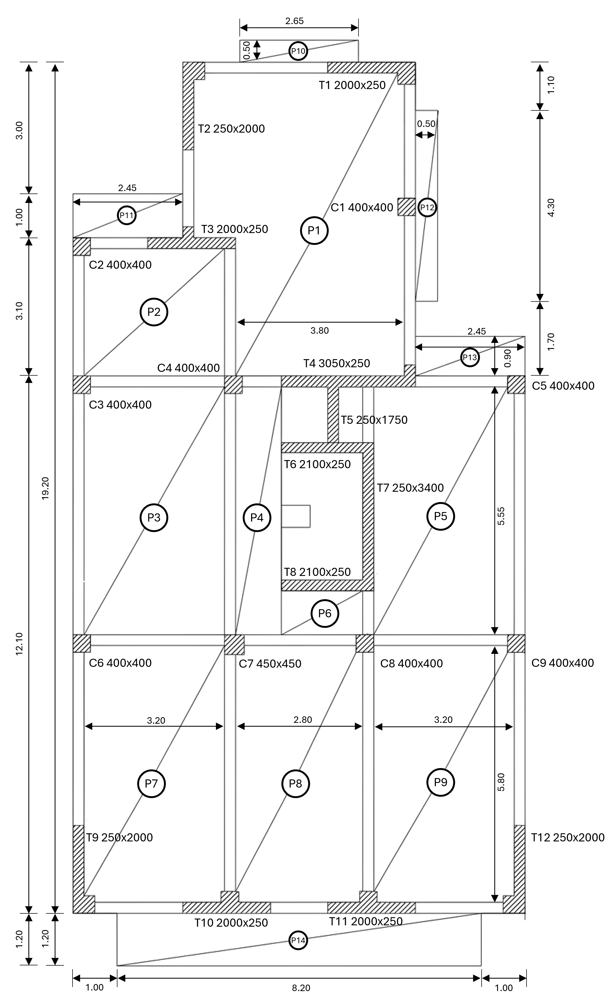
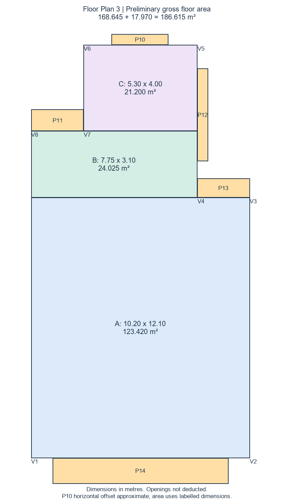

# Homework 1 - AI-Assisted Structural Analysis of Floor Plan 3

**Course:** DISC 5203 - Computer (& AI) Methods for Structural Engineering  
**Student:** Fangyutong  
**Student ID:** 21353319  
**Email:** yfangbu@connect.ust.hk  
**Submission date:** 29 September 2026

## 1. Objective and scope

This report presents an AI-assisted gravity-load analysis of the assigned Floor Plan 3. The work reconstructs the floor outline from raster drawings, identifies the vertical structural elements, establishes a coordinate system, generates closed tributary areas, calculates dead and live loads, and accumulates axial loads through five identical storeys.

The analysis contains nine columns (C1-C9) and twelve reinforced-concrete wall elements (T1-T12). It also records the AI-agent workflow, human review, Git history, deterministic checks, assumptions, and limitations needed to reproduce and defend the result.

The supplied structural drawing is shown below.



## 2. Given information and adopted inputs

The assignment defines the plan as a typical floor of a five-storey building with a 3 m storey height, a 150 mm slab where no other thickness is shown, and a live area load of 5 kN/m2.

| Parameter | Adopted value |
|---|---:|
| Number of storeys | 5 |
| Storey height | 3.00 m |
| Slab thickness | 0.150 m |
| Concrete unit weight | 25.00 kN/m3 |
| Slab self-weight | 3.750 kN/m2 |
| Live area load | 5.000 kN/m2 |

The plan does not state its dimensional units explicitly. Dimensions such as 3.20, 5.80, and 19.20 are interpreted in metres because they are consistent with building-scale dimensions. Section labels such as 400x400 and 2000x250 are interpreted in millimetres. All calculation geometry is converted to metres.

No values are provided for finishes, beams, masonry partitions, facade loads, or live-load reduction. These components are therefore excluded rather than assigned invented values.

## 3. AI-agent and Git workflow

Codex was used as an AI agent within the project repository. Unlike a standalone conversational response, the agent was used to read the source files, write and revise scripts, execute calculations, generate diagrams, inspect results, run deterministic checks, and maintain Git records.

The workflow was:

1. Read the assignment and inspect the assigned floor-plan image.
2. Reconstruct the external floor outline and calculate the gross area.
3. Identify columns, walls, openings, projections, and the stair/core zone.
4. Plot image-derived coordinates for visual review.
5. Generate an initial support-axis and tributary-boundary diagram.
6. Review the initial result manually and identify missing wall-corner and boundary intersections.
7. Reconstruct closed tributary regions computationally.
8. Calculate element loads and five-storey axial-force accumulation.
9. Recalculate the main outputs independently and record PASS/FAIL checks.
10. Commit each meaningful stage to Git without deleting the earlier audit trail.

The repository includes `AGENTS.md` as the agent guidance file, `skills.md` as the reusable procedure record, all calculation scripts, intermediate outputs, detailed step reports, and the complete Git history.

## 4. Floor geometry

### 4.1 Coordinate system

The origin is placed at the lower-left corner of the main building footprint, excluding projection P14. The x-axis points to the right and the y-axis points upward.

The main outline vertices are:

| Vertex | x (m) | y (m) |
|---|---:|---:|
| V1 | 0.00 | 0.00 |
| V2 | 10.20 | 0.00 |
| V3 | 10.20 | 12.10 |
| V4 | 7.75 | 12.10 |
| V5 | 7.75 | 19.20 |
| V6 | 2.45 | 19.20 |
| V7 | 2.45 | 15.20 |
| V8 | 0.00 | 15.20 |

The reconstruction and the main interpreted coordinates are shown below.


### 4.2 Gross floor area

The main footprint is decomposed into three rectangles:

\[
A_\mathrm{body}=10.20(12.10)+7.75(3.10)+5.30(4.00)=168.645\ \mathrm{m^2}
\]

The external projections are:

| Projection | Dimensions (m) | Area (m2) |
|---|---:|---:|
| P10 | 2.65 x 0.50 | 1.325 |
| P11 | 2.45 x 1.00 | 2.450 |
| P12 | 0.50 x 4.30 | 2.150 |
| P13 | 2.45 x 0.90 | 2.205 |
| P14 | 8.20 x 1.20 | 9.840 |
| **Total** | | **17.970** |

Therefore:

\[
A_\mathrm{gross}=168.645+17.970=186.615\ \mathrm{m^2}
\]



### 4.3 Openings and stair/core zone

The detailed structural drawing was used to review the central area rather than relying only on the simplified plan image.


O1 and O2 are treated as openings because the detailed drawing does not show ordinary slab panels in these rectangles. The enclosure bounded by T6, T7, and T8 is treated as a separate stair/core zone S1.

| Zone | Dimensions (m) | Area (m2) | Treatment |
|---|---:|---:|---|
| O1 | 1.05 x 1.25 | 1.3125 | Void |
| O2 | 0.55 x 1.25 | 0.6875 | Void |
| S1 | 1.85 x 2.90 | 5.3650 | Separate load model |
| **Total excluded from ordinary flat slab** | | **7.3650** | |

The ordinary flat-slab area is:

\[
A_\mathrm{flat\ slab}=186.615-7.365=179.250\ \mathrm{m^2}
\]

Excluding S1 from the ordinary flat-slab allocation does not mean that S1 carries no load. Its load is added separately in Section 7.

## 5. Vertical structural elements

Columns are represented by their section centres. Walls are represented by finite geometric centreline segments. Short returns associated with several walls are retained in the machine-readable coordinate file and grouped under the corresponding wall ID when the tributary regions are generated.

| Element | Type | Centre or main axis start (m) | Main axis end (m) | Section (mm) |
|---|---|---|---|---:|
| C1 | Column | (7.550, 15.900) | Same point | 400x400 |
| C2 | Column | (0.200, 15.000) | Same point | 400x400 |
| C3 | Column | (0.200, 11.900) | Same point | 400x400 |
| C4 | Column | (3.600, 11.900) | Same point | 400x400 |
| C5 | Column | (10.000, 11.900) | Same point | 400x400 |
| C6 | Column | (0.200, 6.050) | Same point | 400x400 |
| C7 | Column | (3.600, 6.050) | Same point | 450x450 |
| C8 | Column | (6.600, 6.050) | Same point | 400x400 |
| C9 | Column | (10.000, 6.050) | Same point | 400x400 |
| T1 | Wall | (5.750, 19.075) | (7.750, 19.075) | 2000x250 |
| T2 | Wall | (2.575, 17.200) | (2.575, 19.200) | 250x2000 |
| T3 | Wall | (1.700, 15.075) | (3.700, 15.075) | 2000x250 |
| T4 | Wall | (4.700, 11.975) | (7.750, 11.975) | 3050x250 |
| T5 | Wall | (5.875, 10.350) | (5.875, 12.100) | 250x1750 |
| T6 | Wall | (4.700, 10.475) | (6.800, 10.475) | 2100x250 |
| T7 | Wall | (6.675, 7.200) | (6.675, 10.600) | 250x3400 |
| T8 | Wall | (4.700, 7.325) | (6.800, 7.325) | 2100x250 |
| T9 | Wall | (0.125, 0.000) | (0.125, 2.000) | 250x2000 |
| T10 | Wall | (2.450, 0.125) | (4.450, 0.125) | 2000x250 |
| T11 | Wall | (5.750, 0.125) | (7.750, 0.125) | 2000x250 |
| T12 | Wall | (10.075, 0.000) | (10.075, 2.000) | 250x2000 |

The complete machine-readable schedule, including short wall returns, is provided in `Step_01B_Vertical_Element_Coordinates.csv`.

## 6. Tributary-area method

### 6.1 Support axes and boundaries

Each column is treated as a point support at its centre. Each wall is treated as a finite support-axis segment rather than an infinite line. Main wall segments and short returns carrying the same ID are grouped as one support.

The first generated diagram contained several directionally reasonable lines but did not form complete closed regions. I manually marked the expected axes, midpoint boundaries, and 45-degree divisions at orthogonal wall corners. This review identified where the generated boundaries needed to continue and intersect.


The final calculation uses rectilinear distance. For a slab point \((x,y)\) and a finite horizontal or vertical support segment, the distance is the shortest L1 distance to that segment. Each slab cell is assigned to the nearest support ID. In this orthogonal layout, the equal-distance boundaries produce:

- midpoint boundaries between adjacent support axes;
- horizontal or vertical boundary segments;
- 45-degree divisions near the ends and corners of perpendicular walls; and
- actual intersections that close each tributary region.

The partition is clipped by the external floor outline, O1, O2, and S1.


### 6.2 Numerical implementation

The slab domain is sampled with a 0.01 m calculation grid. Every valid slab cell is assigned to one and only one support. Areas are obtained from the assigned cell count multiplied by the cell area.

The calculation was repeated with a 0.02 m grid. The area of any individual element changed by no more than approximately 0.073 m2, which is about 0.041% of the 179.250 m2 ordinary flat-slab area. This checks numerical discretisation but does not remove uncertainty in the image-derived support locations.

### 6.3 Tributary areas


| Element | Tributary area (m2) | Element | Tributary area (m2) |
|---|---:|---|---:|
| C1 | 7.2973 | T1 | 8.3630 |
| C2 | 2.6293 | T2 | 6.3181 |
| C3 | 7.8498 | T3 | 14.1177 |
| C4 | 5.4765 | T4 | 12.1027 |
| C5 | 4.3862 | T5 | 1.0133 |
| C6 | 9.2966 | T6 | 7.1752 |
| C7 | 10.4308 | T7 | 8.7395 |
| C8 | 9.0280 | T8 | 10.4369 |
| C9 | 7.3866 | T9 | 8.4668 |
| | | T10 | 15.1329 |
| | | T11 | 15.1360 |
| | | T12 | 8.4668 |

The area-conservation check is:

\[
\sum_i A_i=179.250\ \mathrm{m^2}=A_\mathrm{flat\ slab}
\]

The generated regions do not overlap and collectively cover the adopted ordinary flat-slab area.

## 7. Vertical-load calculation

### 7.1 Ordinary slab loads

For element \(i\) with tributary area \(A_i\), the assigned ordinary slab dead and live loads per floor are:

\[
G_{s,i}=A_i(0.150)(25)=3.75A_i
\]

\[
Q_{s,i}=5.00A_i
\]

### 7.2 Vertical-element self-weight

The self-weight of a column or wall segment for one storey is:

\[
G_{e,i}=b_i l_i h_s\gamma_c
\]

where \(b_i l_i\) is the labelled column or main wall plan area, \(h_s=3.00\ \mathrm{m}\), and \(\gamma_c=25.00\ \mathrm{kN/m^3}\).

Nominal labelled main wall dimensions are used for self-weight. Approximate short returns are excluded to avoid uncertain overlap and double-counting.

### 7.3 Separate S1 model

Detailed stair-flight slope and thickness information is unavailable. S1 is therefore represented provisionally by its 5.365 m2 horizontal plan area using the same 150 mm concrete thickness and 5 kN/m2 live load:

\[
G_{S1}=5.365(3.75)=20.11875\ \mathrm{kN/floor}
\]

\[
Q_{S1}=5.365(5.00)=26.82500\ \mathrm{kN/floor}
\]

These loads are distributed to T6, T7, and T8 in proportion to their bordering lengths:

\[
T6:T7:T8=2.10:3.40:2.10
\]

This is an explicit approximation, not a stiffness-based stair analysis.

### 7.4 Storey accumulation and combinations

The characteristic per-floor loads for element \(i\) are:

\[
G_i=G_{s,i}+G_{e,i}+G_{S1,i}
\]

\[
Q_i=Q_{s,i}+Q_{S1,i}
\]

At the bottom of a storey segment supporting \(n\) identical floors:

\[
N_G=nG_i,\qquad N_Q=nQ_i
\]

The reported combinations are:

\[
N_\mathrm{service}=N_G+N_Q
\]

\[
N_\mathrm{ULS}=1.35N_G+1.50N_Q
\]

\[
N_\mathrm{mass}=N_G+0.30N_Q
\]

The bottom segments support five floors, while the upper segments support four, three, two, and one floor respectively. The complete 105-row schedule is provided in `Step_02_Axial_Loads_by_Level.csv`.

## 8. Results

The combined coordinate, tributary-area, and load summary is shown below. Base values correspond to the bottom of the five-storey element stack.

| Element | Type | Location / main axis (m) | Section (mm) | Area (m2) | G/floor (kN) | Q/floor (kN) | Base G (kN) | Base Q (kN) | Base G+Q (kN) | Base ULS (kN) |
|---|---|---|---:|---:|---:|---:|---:|---:|---:|---:|
| C1 | Column | (7.550, 15.900) | 400x400 | 7.2973 | 39.36 | 36.49 | 196.82 | 182.43 | 379.26 | 539.36 |
| C2 | Column | (0.200, 15.000) | 400x400 | 2.6293 | 21.86 | 13.15 | 109.30 | 65.73 | 175.03 | 246.15 |
| C3 | Column | (0.200, 11.900) | 400x400 | 7.8498 | 41.44 | 39.25 | 207.18 | 196.25 | 403.43 | 574.07 |
| C4 | Column | (3.600, 11.900) | 400x400 | 5.4765 | 32.54 | 27.38 | 162.68 | 136.91 | 299.60 | 424.99 |
| C5 | Column | (10.000, 11.900) | 400x400 | 4.3862 | 28.45 | 21.93 | 142.24 | 109.66 | 251.90 | 356.51 |
| C6 | Column | (0.200, 6.050) | 400x400 | 9.2966 | 46.86 | 46.48 | 234.31 | 232.41 | 466.73 | 664.94 |
| C7 | Column | (3.600, 6.050) | 450x450 | 10.4308 | 54.30 | 52.15 | 271.51 | 260.77 | 532.28 | 757.70 |
| C8 | Column | (6.600, 6.050) | 400x400 | 9.0280 | 45.85 | 45.14 | 229.28 | 225.70 | 454.98 | 648.07 |
| C9 | Column | (10.000, 6.050) | 400x400 | 7.3866 | 39.70 | 36.93 | 198.50 | 184.66 | 383.16 | 544.97 |
| T1 | Wall | (5.750, 19.075) to (7.750, 19.075) | 2000x250 | 8.3630 | 68.86 | 41.81 | 344.31 | 209.07 | 553.38 | 778.43 |
| T2 | Wall | (2.575, 17.200) to (2.575, 19.200) | 250x2000 | 6.3181 | 61.19 | 31.59 | 305.96 | 157.95 | 463.92 | 649.98 |
| T3 | Wall | (1.700, 15.075) to (3.700, 15.075) | 2000x250 | 14.1177 | 90.44 | 70.59 | 452.21 | 352.94 | 805.15 | 1139.89 |
| T4 | Wall | (4.700, 11.975) to (7.750, 11.975) | 3050x250 | 12.1027 | 102.57 | 60.51 | 512.86 | 302.57 | 815.43 | 1146.22 |
| T5 | Wall | (5.875, 10.350) to (5.875, 12.100) | 250x1750 | 1.0133 | 36.61 | 5.07 | 183.06 | 25.33 | 208.39 | 285.13 |
| T6 | Wall | (4.700, 10.475) to (6.800, 10.475) | 2100x250 | 7.1752 | 71.84 | 43.29 | 359.21 | 216.44 | 575.65 | 809.59 |
| T7 | Wall | (6.675, 7.200) to (6.675, 10.600) | 250x3400 | 8.7395 | 105.52 | 55.70 | 527.62 | 278.49 | 806.11 | 1130.02 |
| T8 | Wall | (4.700, 7.325) to (6.800, 7.325) | 2100x250 | 10.4369 | 84.07 | 59.60 | 420.36 | 297.98 | 718.35 | 1014.46 |
| T9 | Wall | (0.125, 0.000) to (0.125, 2.000) | 250x2000 | 8.4668 | 69.25 | 42.33 | 346.25 | 211.67 | 557.92 | 784.95 |
| T10 | Wall | (2.450, 0.125) to (4.450, 0.125) | 2000x250 | 15.1329 | 94.25 | 75.66 | 471.24 | 378.32 | 849.56 | 1203.66 |
| T11 | Wall | (5.750, 0.125) to (7.750, 0.125) | 2000x250 | 15.1360 | 94.26 | 75.68 | 471.30 | 378.40 | 849.70 | 1203.86 |
| T12 | Wall | (10.075, 0.000) to (10.075, 2.000) | 250x2000 | 8.4668 | 69.25 | 42.33 | 346.25 | 211.67 | 557.92 | 784.95 |
| **Total** | | | | **179.2500** | **1298.49** | **923.07** | **6492.47** | **4615.38** | **11107.84** | **15687.90** |

The total permanent load per floor includes ordinary slab dead load, the equivalent S1 dead load, and vertical-element self-weight:

\[
G_\mathrm{floor}=672.1875+20.11875+606.1875=1298.49375\ \mathrm{kN}
\]

The total variable load per floor is:

\[
Q_\mathrm{floor}=896.2500+26.8250=923.0750\ \mathrm{kN}
\]

The five-storey totals are:

| Quantity | Total (kN) |
|---|---:|
| Base G | 6492.469 |
| Base Q | 4615.375 |
| Base G+Q | 11107.844 |
| Base 1.35G+1.50Q | 15687.895 |
| Base G+0.30Q | 7877.081 |


T11 and T10 have the largest calculated base ULS axial loads, approximately 1203.86 kN and 1203.66 kN respectively. This follows from their relatively large tributary areas and their own wall self-weight. The result is a gravity-load allocation based on the stated tributary assumptions; it is not a stiffness-based redistribution analysis.

## 9. Independent verification

`verify_results.py` reads the delivered CSV files and recomputes the expected values without using the Step 02 reported totals as its expected results. It writes `Step_03_Verification_Results.csv` and exits with an error if any required check fails.

All 23 checks pass. They cover:

- 21 vertical elements and 105 by-level result rows;
- matching IDs in the coordinate, area, summary, and by-level files;
- tributary-area closure to 179.250 m2;
- gross-area closure to 186.615 m2 after adding O1/O2 and S1;
- ordinary slab, S1, and vertical-element load components;
- whole-floor and five-storey G and Q totals;
- service, ULS, and quasi-permanent combinations;
- the 1:2:3:4:5 floor-accumulation sequence for every element;
- nonnegative areas and loads; and
- representative hand checks for C1 and T7.

The maximum difference between the independently recomputed values and the four-decimal CSV outputs is 0.00005 kN or m2, which is caused by output rounding.

### 9.1 Representative C1 check

\[
G_{s,C1}=7.2973(3.75)=27.3649\ \mathrm{kN/floor}
\]

\[
G_{e,C1}=0.400(0.400)(3.0)(25)=12.0000\ \mathrm{kN/floor}
\]

Therefore \(G_{C1}=39.3649\ \mathrm{kN/floor}\) and \(Q_{C1}=36.4865\ \mathrm{kN/floor}\). The five-storey base ULS value is:

\[
N_{ULS,C1}=1.35(5)(39.3649)+1.50(5)(36.4865)=539.3617\ \mathrm{kN}
\]

### 9.2 Representative T7 check

The S1 allocation ratio for T7 is:

\[
r_{T7}=\frac{3.40}{2.10+3.40+2.10}=0.447368
\]

The T7 main-wall self-weight is:

\[
G_{e,T7}=0.250(3.400)(3.0)(25)=63.7500\ \mathrm{kN/floor}
\]

After adding the tributary slab and allocated S1 loads, \(G_{T7}=105.5236\ \mathrm{kN/floor}\) and \(Q_{T7}=55.6982\ \mathrm{kN/floor}\). The five-storey base ULS value is 1130.0206 kN, matching the result schedule.

## 10. Generalisation to an unknown floor plan

The method separates the problem into input geometry, support representation, spatial allocation, load calculation, and independent verification. This sequence can be applied to another orthogonal floor plan as follows:

1. Define the external polygon and projections in a common coordinate system.
2. Define every opening or separately modelled zone as an exclusion polygon.
3. Enter columns as centre points and walls as finite centreline or fixation-line segments.
4. Assign each valid slab cell to the nearest support using the selected distance rule.
5. Extract closed support regions and verify that their sum equals the adopted slab area.
6. Read element sections and tributary areas into the load-calculation stage.
7. Apply the new number of storeys, heights, material densities, area loads, and combinations.
8. Run ID, area, load, and accumulation checks before accepting the output.

The nearest-support allocation, area-conservation test, load equations, storey accumulation, and verification structure are reusable. The current drawing-extraction and geometry declarations remain specific to Plan 3 and require new coordinates for an unknown image. Image interpretation is therefore treated as a reviewed input stage rather than claimed as a fully automatic computer-vision solution.

For a future implementation, the outline, openings, supports, and load assumptions can be moved from the script input blocks into a common JSON or CSV schema. The same partition and load engine can then run without editing the algorithm code.

## 11. Assumptions and limitations

1. Coordinates, openings, and short wall returns are reconstructed from raster images and are not original CAD data.
2. Geometric wall centrelines are used as support axes. If the intended major-direction fixation lines differ, the relevant axes and tributary regions must be regenerated.
3. The horizontal location of P10 is not fully dimensioned. This affects its local partition but not its stated area.
4. O1 and O2 are treated as voids based on the detailed drawing interpretation.
5. S1 is modelled using equivalent horizontal plan area. An inclined stair slab could have greater self-weight.
6. S1 load is distributed by bordering length, not stiffness or a detailed stair load path.
7. Approximate short wall returns are excluded from self-weight to avoid uncertain overlap and double-counting.
8. Column and wall footprints remain within the gross slab allocation, while member self-weight is added separately. This follows the adopted tributary-load model but does not explicitly remove small material-overlap volumes.
9. Finishes, beams, partitions, facade, and live-load reduction are excluded because values were not supplied.
10. The analysis addresses gravity-load allocation only. It is not a lateral-load, stiffness, foundation, or member-capacity analysis.

## 12. Conclusion

The reconstructed gross floor area is 186.615 m2. After deducting O1/O2 and separating S1, the ordinary flat-slab area is 179.250 m2. This area is divided among 21 vertical elements using closed support regions derived from finite wall axes and column centres.

The calculated permanent and variable loads per typical floor are 1298.494 kN and 923.075 kN respectively. At the base of five identical storeys, the total characteristic load is 11107.844 kN and the total 1.35G+1.50Q load is 15687.895 kN. The element schedules, floor-by-floor accumulation, plots, source geometry, and verification results are retained in machine-readable files.

All 23 independent checks pass. The numerical outputs are reproducible under the stated assumptions, while the report clearly identifies the remaining uncertainty associated with image-derived geometry, wall fixation lines, and the provisional stair/core model.

## Appendix A - Repository records

| File | Purpose |
|---|---|
| `HW1_Final_Report.md` | Complete continuous final report |
| `Step_01_Geometry_and_Tributary_Areas.md` | Detailed geometry and tributary-area record |
| `Step_01B_Vertical_Element_Coordinates.csv` | Machine-readable support geometry |
| `Step_01C_Tributary_Areas.csv` | Tributary-area schedule |
| `Step_02_Vertical_Load_and_Axial_Force_Calculation.md` | Detailed load-calculation record |
| `Step_02_Element_Load_Summary.csv` | Element load summary |
| `Step_02_Axial_Loads_by_Level.csv` | Complete five-storey level schedule |
| `Step_03_Verification_and_Checkpoint.md` | Detailed independent-check record |
| `Step_03_Verification_Results.csv` | PASS/FAIL verification table |
| `area_check.py` | Gross-area reconstruction |
| `geometry_review.py` | Coordinate and opening review |
| `support_axes.py` | Support-axis review diagram |
| `tributary_regions.py` | Tributary-region construction |
| `step02_loads.py` | Load schedules and chart |
| `verify_results.py` | Independent deterministic verification |
| `AGENTS.md` | AI-agent project guidance |
| `skills.md` | Reusable procedures |

## Appendix B - Reproduction

Run the main calculation stages from the repository root:

```powershell
python tributary_regions.py
python step02_loads.py
python verify_results.py
```

`verify_results.py` regenerates the Step 03 files and returns a nonzero exit status if a required check fails.
