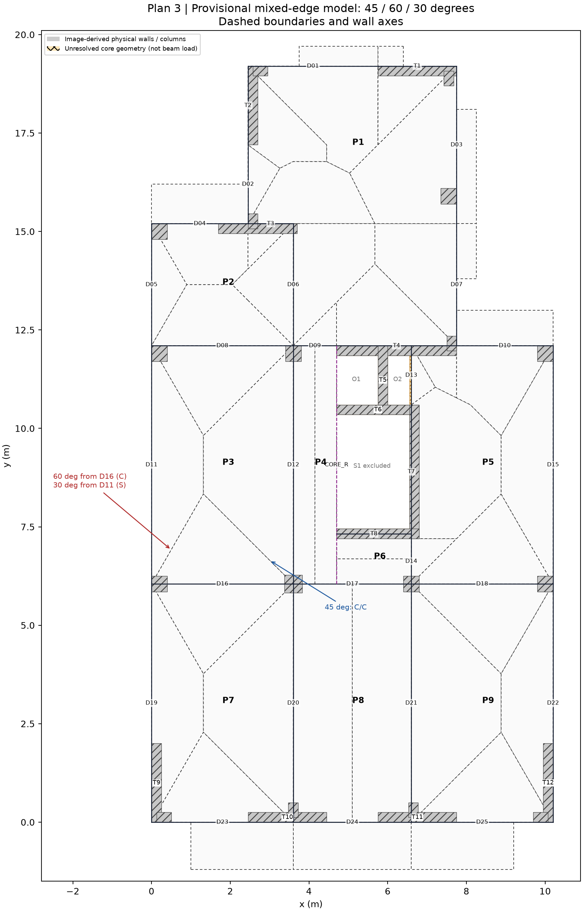
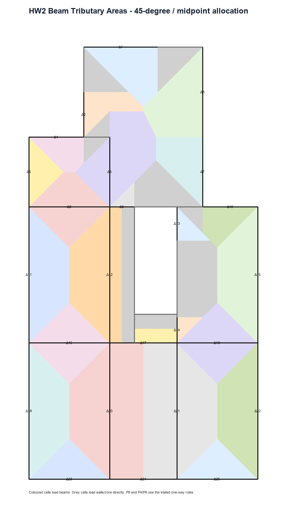
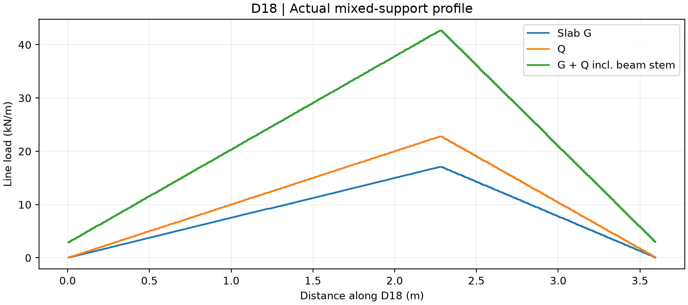
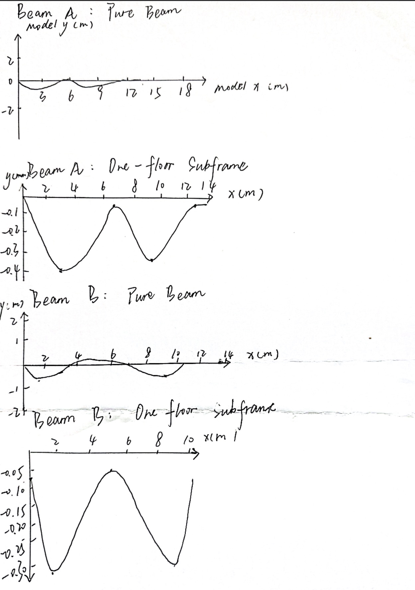

# DISC 5203 Homework 2 - Beam Load Transfer and OpenSees Modelling

**Student:** Fangyutong<br>
**Student ID:** 21353319<br>
**Email:** yfangbu@connect.ust.hk<br>
**Plan:** Floor Plan 3<br>
**Status:** Submission draft with the pre-analysis moment estimates and student-supplied hand-drawn deformation sketches included; final support-condition sign-off remains pending.

## 1. Methodology and retained HW1 basis

HW2 extends the verified HW1 repository rather than reconstructing the floor outline or column/wall coordinates. All dimensions are in metres unless noted otherwise. The slab service load used for beam transfer is:

\[
G_k = 0.150(25)=3.75\;\text{kN/m}^2,\qquad
Q_k=5.00\;\text{kN/m}^2,
\]

so the slab service intensity is \(n=G_k+Q_k=8.75\;\text{kN/m}^2\). Beam-stem self-weight is added separately as

\[
g_{beam}=0.25(d-0.15)(25)\;\text{kN/m}.
\]

The beam axes and support mappings are image-derived. Original CAD coordinates and reinforcement/connection details were not supplied. The complete beam census is in [Step 04 beam census](Step_04_Beam_Census.csv).

## 2. Task 1 - Beam tributary areas

Each slab panel was classified before allocation. Matched edge conditions (continuous/continuous or simple/simple) use 45-degree divisions. At an assumed continuous/simple corner, the division is 60 degrees from the continuous edge and 30 degrees from the simple edge. One-way panels transfer to the two supporting edges perpendicular to their span; cantilevers transfer to their root.





The ordinary HW1 slab area is 179.250000 m2. The revised model allocates 151.771260 m2 to beams and 25.771240 m2 to direct wall/support paths; 1.707500 m2 at the core remains explicitly unresolved. It is not hidden in a residual reaction. A further 2.584167 m2 in P1 has equal finite-edge scores for W_T3 and D06 and is provisionally assigned by support-list order. These are modelling uncertainties, not failed numerical closure.

The full assumptions, edge schedule, exact polygons, before/after comparison and independent checks are recorded in:

- [Step 04 revision report](Step_04_Beam_Census_and_Tributary_Areas.md)
- [Slab-edge condition schedule](Step_04_Slab_Edge_Conditions.csv)
- [Closed polygon geometry](Step_04_Closed_Regions.geojson)
- [Finite-edge tie audit](Step_04_Finite_Edge_Ties.csv)
- [Revision and verification log](Step_04_Mixed_Support_Revision_Log.md)

## 3. Task 2 - Line loads on every beam

For each beam and each 0.01 m strip, the tributary polygon intersection gives tributary width \(b(s)\). The actual service line load is

\[
q(s)=8.75b(s)+g_{beam}.
\]

The force-equivalent uniform load is \(\int q(s)ds/L\). A separate midspan-moment-equivalent value is obtained by integrating the simply supported midspan influence function; it is not used to reconstruct a symmetric load shape. OpenSees reads the actual profile directly.

The complete table and worked D18 example are in [Step 05 beam loads](Step_05_Beam_Line_Loads_and_Worked_Example.md). Machine-readable values are in [line-load summary](Step_05_Beam_Line_Loads.csv) and [load profiles](Step_05_Beam_Load_Profiles.csv).



### Independent coefficient-route reconciliation

HKConcrete 2013 Table 6.7 was applied only to clean rectangular four-edge panels P2, P3, P7 and P9 using \(q=0.75\beta_vnl_x\). The coefficient route closes the panel loads to 99.13%–100.01%; the polygon area route closes to 100%. The difference is consistent with interpolation and rounded tabulated coefficients. Irregular/core/one-way/cantilever panels were not forced into a table outside its scope.

See [coefficient-versus-area check](Step_05_Coefficient_Area_Reconciliation.md).

## 4. Task 3 - Two beams and two model types

Beam A is the peripheral vertical line D19-D11-D05. Beam B is the interior horizontal line D16-D17-D18. Two model types are retained for each:

1. A standalone continuous beam, used as a transparent limiting model.
2. A one-floor 3D plan-grid subframe with perpendicular floor members and fixed-base vertical supports.

The material model is linear elastic concrete with \(E=30\) GPa and \(\nu=0.20\). Gross sections are used. Service G+Q loads and vertical-member self-weight are included. Cracking, slab/diaphragm stiffness, upper storeys and direct wall slab loads are excluded.

### Task 6 - Pre-analysis moment estimate

The adopted transparent screening calculation uses the Step 05 moment-equivalent service line load with the simply supported reference expression \(M_{ss}=qL^2/8\). For Beam A, \(q_{M,eq}=12.7795\) kN/m and \(L=6.05\) m give:

\[
M_{ss,A}=\frac{12.7795(6.05)^2}{8}=58.47\ \mathrm{kN\,m}.
\]

For Beam B, \(q_{M,eq}=28.6854\) kN/m and \(L=3.60\) m give:

\[
M_{ss,B}=\frac{28.6854(3.60)^2}{8}=46.47\ \mathrm{kN\,m}.
\]

These are order-of-magnitude simply supported scales, not exact continuous-beam moments. Positive sagging is expected within spans and negative hogging over internal supports. The full calculation and comparison are retained in [Step 06 pre-analysis moment estimates](Step_06_PreAnalysis_Moment_Estimates.md).

### Task 7 - Standalone beam results

The standalone models preserve the actual Step 05 asymmetric profiles. Their input files, result JSON files, N/V/M diagrams and checks are indexed in [the process-file manifest](HW2_Process_File_Manifest.md).

### Task 8 - One-floor plan-grid subframes

The earlier single-line subframes are preserved as iteration evidence but are superseded for Tasks 8, 10 and 12. The revised grid models add perpendicular floor members and actual vertical support locations.

#### Beam A grid


#### Beam B grid


## 5. Task 9 - Hand-drawn deformation checks

The student-supplied sheet below contains four sketches: Beam A standalone, Beam A grid subframe, Beam B standalone and Beam B grid subframe.



The qualitative curvature agrees with the corresponding solver plots: Beam A shows two dominant downward lobes and a much smaller final-span response, while Beam B shows two dominant exterior-span lobes. The grid sketches also reproduce the unequal downward displacement peaks caused by support stiffness and load redistribution. The hand sketches are qualitative and their axes are not used as numerical solver data. The computer-generated schematic retained in the process log remains illustrative only.

## 6. Task 10 - Standalone beam versus grid subframe

| Beam | Model | Peak sagging (kN m) | Peak hogging (kN m) | Max abs shear (kN) | Max abs axial (kN) | Max vertical displacement (mm) |
|---|---|---:|---:|---:|---:|---:|
| A | Standalone | 35.629 | -50.301 | 40.433 | 0.000 | 0.491 |
| A | Plan-grid subframe | 29.407 | -46.932 | 37.595 | 8.016 | 0.427 |
| B | Standalone | 37.046 | -22.291 | 43.990 | 0.000 | 0.323 |
| B | Plan-grid subframe | 27.314 | -24.907 | 41.862 | 7.236 | 0.319 |

The standalone beam can transmit load only along the marked line. The plan-grid subframe adds column/wall rotational stiffness and alternate paths through perpendicular members. It therefore changes support moments, span moments, axial action and reactions. The grid subframe is the more defensible of the two for load distribution, while the standalone model remains a useful transparent limit and debugging check.

Detailed assumptions and response ordinates are in [Tasks 8, 10 and 12 report](Step_08_Grid_Subframes_and_Task12.md).

## 7. Task 11 - Speech-to-model and iteration evidence

The English structural briefing, model assumptions, rejected simplifications, revision notices and student sign-off points are retained in [the briefing and iteration log](Step_06_OpenSees_Briefing_and_Iteration_Log.md). The scripts, configuration, source profiles and all generated results are retained in Git. The mixed-edge revision and the replacement of symmetric fitted loads by direct profiles are documented separately so the model evolution remains auditable.

## 8. Task 12 - HW1 axial-force consistency check


The local-grid reactions have the same sign and order of magnitude as the HW1 one-floor G+Q values, but several differences are large (up to approximately 124%). This is not presented as a successful equality check. HW1 assigns the complete floor directly to vertical elements; the local grids include only their listed beam branches and omit direct wall slab loads, the unresolved core area, slab stiffness and upper-storey participation. The gap therefore identifies remaining scope differences. The detailed per-grid-point table is [Step 12 cross-check CSV](Step_12_HW1_Grid_Subframe_Cross_Check.csv).

For total one-floor column axial magnitude, HW1 is currently the safer estimate because it contains the complete adopted floor area. For local frame redistribution, the plan-grid subframe is more physically informative. Neither is a final full-building result until the unresolved core path and omitted slab/wall actions are included consistently.

## 9. Verification summary

- HW1 regression: 23/23 checks passed.
- Mixed-support generation: 52/52 checks passed.
- Independent mixed-support checks: 147/147 passed.
- Standalone/single-line OpenSees checks: 33/33 passed.
- Plan-grid subframe checks: 42/42 passed.
- Maximum plan-grid vertical equilibrium error: \(9.85\times10^{-8}\) kN.
- Coefficient-route panel closure: 99.13%–100.01%; polygon area route: 100%.

Passing these checks establishes reproducibility and numerical consistency of the stated model. It does not prove unverified image-derived support conditions.

## 10. Remaining student sign-off before submission

1. Confirm the C/S edge-condition schedule and the Beam A/Beam B mapping against the course drawing.
2. Confirm the T3, T4 and T7 discrete wall-end idealisations.
3. Resolve or explicitly accept the 1.707500 m2 unallocated core area and P1 finite-edge tie convention.
4. Add two handwritten moment-bound calculations and four hand-drawn deformation sketches.
5. Add a short personal comment beside each sketch comparing it with the solver output.
6. Remove the word “Draft” from the report title/status only after these items are complete.

## 11. Reproduction

```powershell
python -m pip install -r requirements.txt
python tributary_regions.py
python step02_loads.py
python verify_results.py
python hw2_beam_loads.py
python verify_hw2_mixed_supports.py
python step05_coefficient_check.py
python step06_run_all.py
python verify_step06_opensees.py
python step08_grid_subframes.py
python verify_step08_grid_subframes.py
```

All report text, source code, comments, filenames, tables and Git commit messages are maintained in English. The complete process-file inventory is in [HW2 process-file manifest](HW2_Process_File_Manifest.md).
