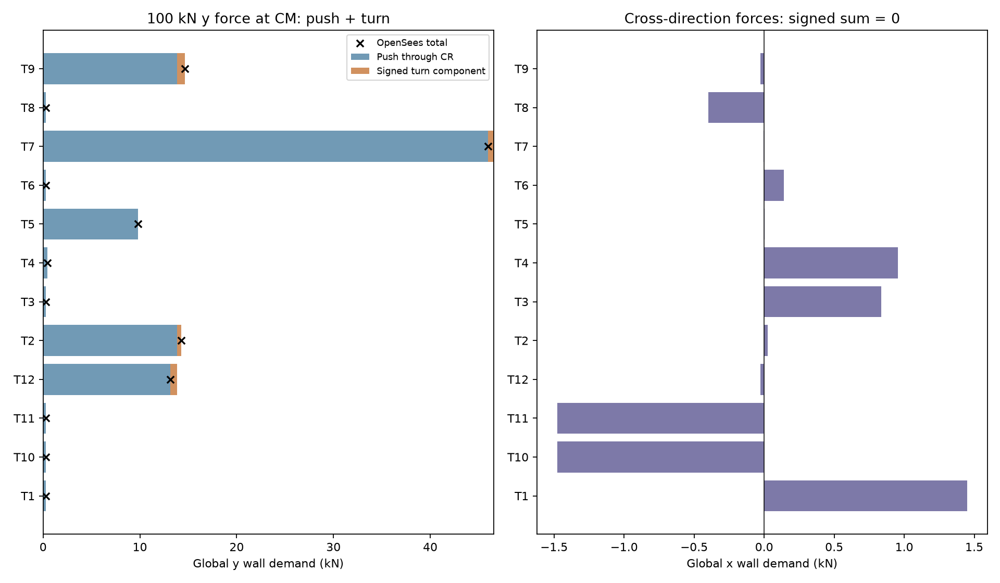

# HW3 Tasks 4 and 5 - Rigid diaphragm and no-rotation check

Status: verified numerical model of the provisional common-geometry baseline. Task 2 experiment-control and identity limits remain documented.

## Model and conventions

OpenSeesPy engine 3.8.0; 3D, six DOF per node, one 3 m vertical ElasticTimoshenkoBeam per wall, 12 main-wall rectangles, fixed bases. E=30e6 kN/m2, nu=0.2, G=12.5e6 kN/m2, shear area=(5/6)Lt in each principal direction. Local y follows the wall length; Iz=tL^3/12 is strong and Iy=Lt^3/12 weak. Both are retained. Intrinsic vertical wall torsion J=0 is excluded consistently with the analytical model. Short returns, columns, cracking and slab flexibility are excluded.

The CM master has fixity (0,0,1,1,1,0). Wall-top z is fixed, bending rotations remain free. ops.rigidDiaphragm(3, master, *tops) and Transformation constraints explicitly enforce the floor plane. This is not a very-stiff-slab substitute or fixed-fixed wall model.

The command usage follows the official [ElasticTimoshenkoBeam documentation](https://openseespydoc.readthedocs.io/en/latest/src/ElasticTimoshenkoBeam.html) and [rigidDiaphragm documentation](https://openseespydoc.readthedocs.io/en/latest/src/rigidDiaphragm.html). The [model briefing](records/Task_04_Model_Briefing.md) and analytical result were committed before executing OpenSees.

## Three independent unit loads

Three rebuilt models apply Px=1 kN, Py=1 kN and Mz=1 kN m at CM. Master u, v and phi are the columns of F. K=inv(F). Units are kN, m and radians; mixed matrix entries carry their corresponding translational/rotational units.

```text
F about CM:
[[ 2.737900100832e-07 -5.025404745675e-09  8.382531457602e-09]
 [-5.025404745675e-09  3.305592905931e-07 -3.673452953916e-09]
 [ 8.382531457602e-09 -3.673452953916e-09  6.127433809332e-09]]

K about CM:
[[ 3.812103e+06  3.801578e-11 -5.215082e+06]
 [ 5.354295e-10  3.045466e+06  1.825785e+06]
 [-5.215082e+06  1.825785e+06  1.714294e+08]]
```

CM=(4.963771, 8.326083) m. Flexibility-derived CR=(5.563280, 9.694116) m; e=1.493628 m. Maximum analytical/OpenSees CR difference is 0.000e+00 m; relative flexibility error is 1.602e-16.

[Raw solver responses](outputs/Plan3/task4/OpenSees_Result.json) retain unit loads, master and wall-top displacements, base reactions and element end forces. The no-shear sensitivity is an actual rebuilt elasticBeamColumn model; isolated strong/weak cantilever tests also check local-axis orientation and shear compliance.

## Assumed 100 kN y demonstration

The test force is explicitly assumed for linear verification; it is not a specified code design earthquake load. The same wall geometry and shear assumptions apply to every CR reported above.

Master response: u=-0.000503 mm, v=0.033056 mm, phi=-3.67345295e-07 rad. Positive demand values below are minus the corresponding base reaction. The raw six-component base reactions are retained in [the reaction table](outputs/Plan3/task4/Demonstration_Wall_Reactions.csv).

| Wall | Push y (kN) | Turn y (kN) | Total y (kN) | Total x (kN) |
|---|---:|---:|---:|---:|
| T1 | 0.283614 | -0.003702 | 0.279912 | 1.448476 |
| T10 | 0.283614 | 0.006632 | 0.290246 | -1.476636 |
| T11 | 0.283614 | -0.003712 | 0.279902 | -1.476636 |
| T12 | 13.819740 | -0.695239 | 13.124501 | -0.027568 |
| T2 | 13.819740 | 0.456704 | 14.276444 | 0.026971 |
| T3 | 0.283614 | 0.009131 | 0.292746 | 0.837076 |
| T4 | 0.432511 | -0.003129 | 0.429382 | 0.954657 |
| T5 | 9.815866 | -0.033283 | 9.782582 | 0.004332 |
| T6 | 0.297795 | -0.000594 | 0.297200 | 0.141053 |
| T7 | 46.562357 | -0.569765 | 45.992592 | -0.004107 |
| T8 | 0.297795 | -0.000594 | 0.297200 | -0.400050 |
| T9 | 13.819740 | 0.837551 | 14.657291 | -0.027568 |

Total y resistance equals 100 kN. Total x resistance is zero, with positive and negative cross-direction forces balancing. In an asymmetric layout individual walls need not form equal pairs; the full signed group must balance. Base force/moment sums and each top node's rigid-plane displacement relation are independently checked.



## Task 5 - push through CR, and push plus turn

A force at a plan offset is applied at the CM master with its equivalent signed moment. Unit Px through CR has moment -(yr-ym); unit Py through CR has moment +(xr-xm). Their rotations are:

| Case | Rotation (rad) |
|---|---:|
| unit_x_through_CR | 1.801349e-24 |
| unit_y_through_CR | 7.192448e-25 |

The direct 100 kN force at CM decomposes into a push through CR plus signed torque T=(xm-xr)*Fy=-59.950920 kN m. Rebuilt push and torque runs superpose to the direct run in all master responses and all wall forces. General torque is ex*Fy-ey*Fx; total eccentricity times force applies only for a perpendicular force direction.

## Verification and reproduction

75/75 checks passed. See [verification record](records/Task4_5_Verification.json) for flexibility symmetry, positive stiffness, hand/model agreement, single-wall limits, actual bending-only limit, reaction closure, rigid-plane kinematics, zero rotation through CR and load decomposition.

```text
python HW3/scripts/task04_opensees.py
python HW3/scripts/verify_task04.py
python HW3/scripts/write_task04_report.py
```

This validates the declared numerical idealisation; it does not certify the image-derived source geometry or complete the remaining HW3 tasks.
