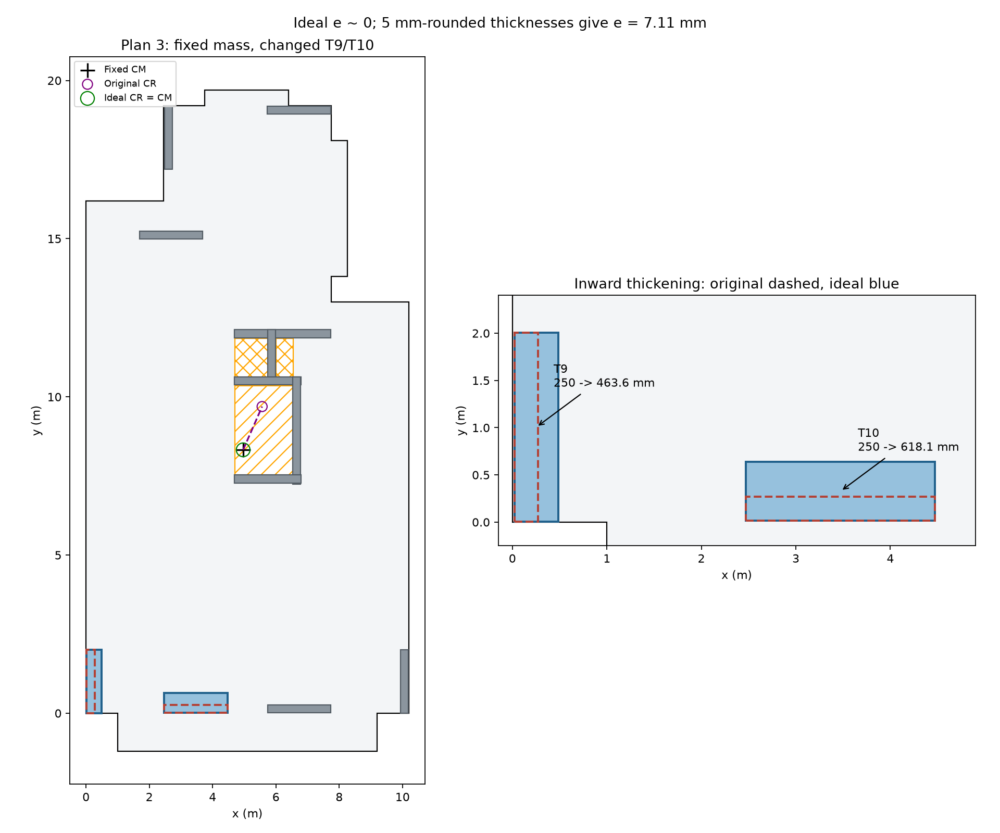
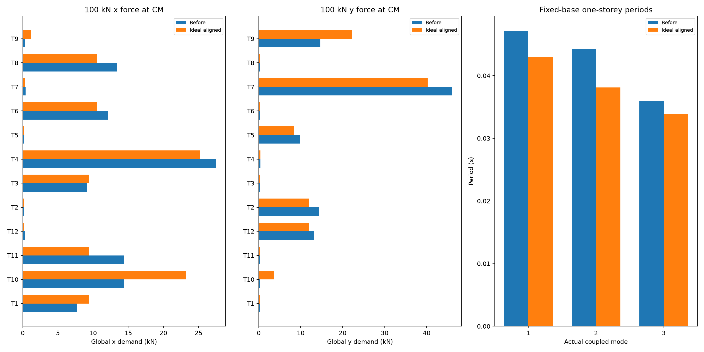

# HW3 Tasks 6 and 7 - Aligning CM and CR by wall modification

Student: Fangyutong | ID: 21353319 | Floor Plan 3

Status: verified modification of the declared provisional common-geometry model. Task 2's formal experiment-control limitations and Task 8 remain open. This is a mathematical design proposal, not a construction design or student-signed hand prediction.

## 1. Frozen design intent and constraints

The [pre-solve design briefing](records/Task_06_PreSolve_Design_Briefing.md) and [modification parameters](params_modification.json) were committed before optimisation. Only T9 and T10 thicknesses may increase (0.25 to 1.00 m). Main lengths, directions, columns, voids, S1 and the mass layout remain fixed. T9 grows inward from its exterior left face; T10 grows upward from its exterior bottom face. Their axes therefore move by half the thickness increase, a declared geometric rule rather than a reader edit.

These locations were chosen because CR initially lies right and above CM. Increasing y stiffness at the left-side T9 and x stiffness at the bottom-side T10 should pull CR left/down. Both strong and weak rectangular-wall stiffnesses and shear flexibility are recalculated at every step. No columns or architectural grid lines are relocated, and no new wall is inserted through the core openings.

## 2. Modification and cost

| Wall | Original thickness (mm) | Ideal thickness (mm) | 5 mm rounded (mm) | Centre shift dx,dy (m) | Added concrete per storey (m3) |
|---|---:|---:|---:|---|---:|
| T9 | 250.0 | 463.564916 | 465.0 | (0.106782, 0.000000) | 1.281389 |
| T10 | 250.0 | 618.147922 | 620.0 | (0.000000, 0.184074) | 2.208888 |

The ideal proposal adds 3.490277 m3 concrete and 87.256926 kN dead weight per storey (25 kN/m3). That is approximately 8.894692 t, or 5.40% of the prescribed equivalent floor mass. This increase is quantified separately and is **not** added to the fixed mass in the exercise. A real design must revisit the additional mass, gravity/foundation loads, connections, reinforcement and architectural clearances.

All proposed main rectangles remain inside the retained floor and avoid O1/O2, S1 and existing columns; no new main-wall overlap is introduced. See the saved geometry audits in [Modification_Result.json](outputs/Plan3/task6/Modification_Result.json). These checks address the available image-derived geometry, not unprovided architectural/reinforcement details.



## 3. CM/CR before and after

The unchanged CM is (4.963771, 8.326083) m; one-storey mass is 164.666794 t. All models use E=30e6 kN/m2, nu=0.2, H=3 m, both principal bending axes and shear, 12 main-wall Timoshenko cantilevers, zero intrinsic vertical wall torsion, fixed bases and an explicit Transformation rigid diaphragm. No lateral columns or cracking are introduced.

| Layout | Hand CR x,y (m) | OpenSees CR x,y (m) | Eccentricity (m) | Rotation under 100 kN x (rad) | Rotation under 100 kN y (rad) |
|---|---|---|---:|---:|---:|
| before | (5.563280, 9.694116) | (5.563280, 9.694116) | 1.4936283 | 8.382531e-07 | -3.673453e-07 |
| ideal_aligned | (4.963771, 8.326083) | (4.963771, 8.326083) | 3.55271368e-15 | 1.275919e-21 | 8.060658e-24 |
| rounded_5mm | (4.960227, 8.319914) | (4.960227, 8.319914) | 0.00711348134 | -2.799220e-09 | 1.607852e-09 |

The ideal target e<=1e-6 m is met. The 5 mm-rounded proposal leaves e=7.113 mm rather than claiming exact coincidence after rounding. Numerical alignment does not imply millimetre accuracy of the source image. [Optimisation_Trajectory.json](outputs/Plan3/task6/Optimisation_Trajectory.json) preserves all actual residual evaluations and termination status.

## 4. Why the forces change

The load tests are separately assumed 100 kN forces in x and y at CM, not code earthquake design demands. The signed torque about CR is T=(xm-xr)Fy-(ym-yr)Fx. The maximum magnitude envelope is e*F only when the force is perpendicular to the eccentricity vector.

For a y force: f_i,dir=(ky_i/Kyy)F, f_i,turn=ky_i*(x_i-xr)*T/J, and factor=1+(xm-xr)*(x_i-xr)/r_ty^2 with r_ty^2=J/Kyy. For an x force the factor is 1+(ym-yr)*(y_i-yr)/r_tx^2 with r_tx^2=J/Kxx. Here J is floor torsional stiffness about CR, not an individual wall's section torsion constant. The brief's radius-only denominator is dimensionally inconsistent; a squared radius is required. The wall stiffness factor cannot be omitted from the force term.

| Force | Most amplified original wall(s) | Original factor | Increase over direct share |
|---|---|---:|---:|
| x | T10, T11 | 1.305200 | 30.520% |
| y | T9 | 1.060605 | 6.061% |

This identifies the plan-specific penalty: the low-y walls T10/T11 are amplified for the x push; low-x T9 is amplified for the y push. A negative torsional increment can instead relieve another wall. After ideal alignment all aligned-force factors equal 1 and the cross-direction turn vanishes.

### Peak aligned wall force

| Assumed force | Peak before (wall, kN) | Peak ideal after (wall, kN) | Change |
|---|---|---|---:|
| x, 100 kN | T4, 27.454585 | T4, 25.228452 | -8.108% |
| y, 100 kN | T7, 45.992592 | T7, 40.243008 | -12.501% |

The reduction in the peaks combines torsion removal **and** stiffness redistribution. It must not all be attributed to removing e. The thickened walls attract more direct load; not every wall demand decreases. [Force_Amplification_Comparison.csv](outputs/Plan3/task6/Force_Amplification_Comparison.csv) reports each wall's direct share, torsional increment, final force, squared torsional radius and analytical/observed factors for both directions and all three layouts.



## 5. Modes and period ratios

The mass matrix is diag(M,M,I_CM), identical in all layouts. The analytical generalized eigenproblem and actual OpenSees eigenanalysis with mass at the diaphragm master are both retained. The official [eigen command documentation](https://openseespydoc.readthedocs.io/en/latest/src/eigen.html) explains the fullGenLapack option used to obtain all three inertial modes. These are one-storey fixed-base subsystem periods, not five-storey building periods.

| Layout | Coupled periods T1,T2,T3 (s) | Torsion-dominant mode | Rotational mass fraction of that mode | Characteristic Ttheta/Tx | Characteristic Ttheta/Ty |
|---|---|---:|---:|---:|---:|
| before | 0.047167, 0.044287, 0.035985 | 3 | 0.666618 | 0.954062 | 0.852749 |
| ideal_aligned | 0.042952, 0.038103, 0.033926 | 3 | 1.000000 | 0.890374 | 0.789853 |
| rounded_5mm | 0.042930, 0.038088, 0.033906 | 3 | 0.999985 | 0.890205 | 0.789781 |

The actual torsion-dominant mode is mode 3 before and after this proposal; it was not the first mode on this plan. Its original rotational mass fraction is approximately 0.667 and becomes 1 after ideal alignment: the floor's translational and rotational motions decouple. Aligning centres does not guarantee a particular mode ordering. Characteristic ratios use Ttheta=2*pi*sqrt(I_CM/J), Tx=2*pi*sqrt(M/Kxx), Ty=2*pi*sqrt(M/Kyy); for the eccentric floor they are labelled scales, not replacements for the actual coupled modes.

## 6. Scope, cost and the vision link

CM=CR removes the eccentric torque for a pure horizontal force on this uniform rigid floor. It does not remove torsional resistance or the torsional natural mode. It does not make a building immune to accidental eccentricity, cracking, mass/stiffness changes over height, nonuniform or rotational ground motion, or different storey layouts. A wall-position or size error in extraction would change K and CR and therefore change this numerical design target. This design is conditional on the retained image-derived rectangles and modelling assumptions; final reader-promotion and independent-plan evidence are still separate requirements.

Added concrete and its 87.257 kN per-storey weight are the principal quantified cost here. The fixed-mass instruction is a controlled exercise assumption. A practical redesign that includes this new mass must recalculate CM and repeat the alignment, rather than claiming the fixed-mass optimum is automatically a final building design.

## 7. Verification and reproduction

133/133 independent checks passed. See [Task6_7_Verification.json](records/Task6_7_Verification.json). Checks cover preserved baseline, mass, lengths, growth faces, geometry/clashes, independently assembled K, hand/model F and CR, static equilibrium, signed amplification, modal eigenvalues/shapes and ideal zero rotation. All baseline outputs remain intact.

```text
python HW3/scripts/task06_modify.py
python HW3/scripts/verify_task06.py
python HW3/scripts/write_task06_report.py
```

The code is parameterised by saved inputs; the T9/T10 growth choice is a disclosed Plan 3 design decision, not a general automatically selected wall strategy. [Iteration log](records/Iteration_Log.md) and [readable Git history](records/Git_History.md) retain the chronology.
