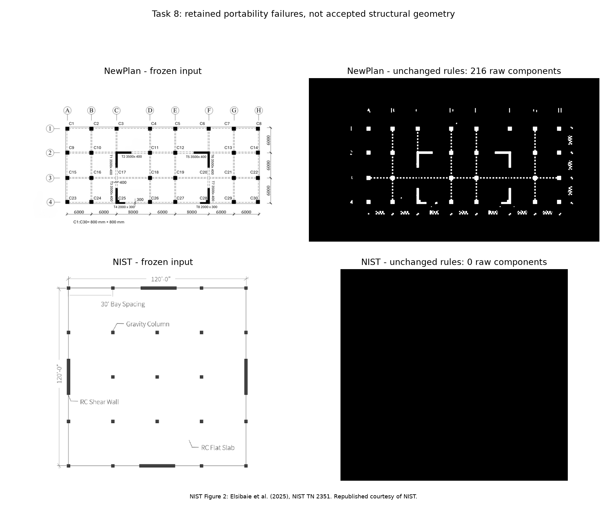

# Task 8 - Additional-plan portability checkpoint

Student: Fangyutong, 21353319. Date: 2026-11-10.

**Status: fixed-rule classical, OCR, bar-matching and retained-forest runs completed on both additional plans; independent-reference failures and reader inputs retained. Task 8 is incomplete. Neither additional-plan extraction is promoted; their CM, CR and eccentricity remain pending.**

## Briefing and source freeze before execution

The [execution brief](records/Task_08_Execution_Brief.md) distinguishes the student's request from the agent's proposed method and pre-run hypotheses. It and [the input/code/history freeze](records/Task_08_Input_Freeze.json) were committed as `2358ad8` before running the two additional plans. The freeze retains the source image hashes, original four script hashes, original Git revision and historic Plan 3 artifact hashes.

NewPlan is the course-provided `sources/assets/NewPlan.png`, processed at its original 8000 by 4500 pixels. The found plan is the unannotated NIST Figure 2 rendering, processed at its frozen 580 by 540 pixels. No post-result resizing was introduced to make either drawing fit the morphology kernels. The [found-plan selection record](records/Task_08_Found_Plan_Selection.md) gives the source, citation, reuse attribution, missing section data and the schematic/text column-count discrepancy.



The NIST panel reproduces Figure 2 from Elsibaie et al. (2025), [NIST TN 2351](https://doi.org/10.6028/NIST.TN.2351). Republished courtesy of the National Institute of Standards and Technology.

## What remained unchanged, and what code had to change

The original scripts embedded Plan 3 paths. A shared `--plan` / `--output-plan` router now selects sources and separate output directories. These settings were held fixed: threshold <225; diagonal kernel 11 px; close 17 px; open 21 px; wall aspect threshold 4; line-removal kernel 81 px; directional bar kernel 121 px; relative thickness gate 0.45; the existing label parser/cost and OCR engine; forest seed 5203, 60 trees, 15 features, 0.5 training-image resize and the original sampling caps.

Two defensive changes are disclosed: absent column-width/printed-column-size evidence produces JSON `null` rather than NaN and no fallback matches; a single-class forest produces a valid all-background probability map rather than indexing a nonexistent positive class. Neither change adds a geometry, size string or reader answer. The forest fitting procedure is repeated independently per drawing, with no claim of held-out classifier transfer accuracy.

Review-location parsing, query framing and portable text serialization required revisions after quality control. Their [revision record](records/Task_08_Reader_Package_Revision.md) preserves superseded v1/v2/v3 packages and explains the current v4 gate and UTF-8/LF serialization. V3 passed local checks but failed a Git-object reference hash check because of CRLF normalization. These revisions are an admitted portability limitation, not proof of a completely unchanged successful end-to-end pipeline. The main extraction remains unchanged.

## Measured results

| Evidence | Assigned Plan 3, retained baseline | Course NewPlan | Found NIST plan |
|---|---:|---:|---:|
| Raw classical connected components | 20 | 216 | 0 |
| Original / line-removed OCR detections | 52 / 61 | 61 / 116 | 6 / 6 |
| Main-parser labelled-size hypotheses | 21 | 2 | 0 |
| Bar/square candidates in the preliminary matching stage | See retained Plan 3 record | 225 | 0 |
| New provisional accepted bar claims in this run | Not rerun | 0 | 0 |
| Preliminary column-based scale seed in this run | Not rerun | null | null |
| Per-plan forest training pixels | 120000 | 120000 | 53562 |
| Forest selected as extraction | No | No | No |
| Current reader questions | Retained original package | 6 | 4 |
| Resolved alternative-classical references | Retained original reference | 5 of 6 | 0 of 4 |
| Actual additional-plan VLM runs | Not applicable | 0 | 0 |

NewPlan's raw OCR sees more text than the main parser accepts. Only T4/T8 become labelled-size hypotheses; the parser rejects several strings with different spacing/orientation conventions and does not expand the shared column schedule. Without a column-derived scale seed the matching stage makes no size-compatible claims. The 216 components are candidates and artifacts, not 216 real structural members.

NIST's solid, thin schematic symbols do not survive the fixed hatching/morphology procedure at the frozen input resolution. Its zero classical positives cause the retained random forest to train on a background-only target. All feature importances and predicted concrete probabilities are zero. The saved model is real but degenerate; it supplies no independent evidence and is never selected.

## Independent reference and reader packages

The alternative route uses threshold 180 on unmarked crops, separate OCR and the original 8 px interior trim/raw-ink axial occupancy rule. It shares the OCR engine and query locations with the main pipeline; it is neither CAD ground truth nor independent human signoff. No VLM answer supplies a reference value.

- **NewPlan:** six questions cover missed T1/T2/T3/T5/T6/T7 size strings. Five threshold-180 OCR references resolve; NP-F03 remains unresolved. The 1424 px-wide shared column schedule cannot fit the inherited 880 px crop, so it is rejected by the framing gate and remains an unresolved extraction issue in private metadata. It was not resized into a claimed recovery.
- **NIST:** four questions ask about visible wall continuity at agent-selected locations. They do not establish accepted wall coordinates or missing section sizes. The unchanged 8 px trim leaves no interior in the thin schematic symbols, so all four reference values remain unresolved. A plausible VLM answer must not be scored as reference-confirmed merely because it looks correct.

Current reader packages, identical for either model:

- [NewPlan V4 ZIP](HW3_Task_08_NewPlan_Reader_Package_V4.zip) and [questions](outputs/NewPlan/reader_package_v4/Questions.md).
- [NIST V4 ZIP](HW3_Task_08_NIST_Reader_Package_V4.zip) and [questions](outputs/NIST/reader_package_v4/Questions.md).

Each ZIP contains only common instructions, public manifest, ordered questions and marked images. Reference answers, candidate-label metadata and other-model answers are excluded. The private manifests retain source/crop/reference/instruction hashes, confidence threshold 0.8 and an empty `model_runs` list. No model result, winner, accuracy or promotion is fabricated.

The engineering agent has viewed source images, OCR/reference evidence and several crops during quality control. That inspection is not an isolated reader run. A formal first reader must receive only the public package in a fresh context; the other reader must be genuinely different. Record actual model identifiers, interface limitations and raw outputs. Outstanding references must be resolved by a defensible independently documented route before scoring those questions. A different reference method, larger crop or changed image-processing parameter requires a declared revision and cannot replace this frozen failure record.

## Verification and preservation

[The validation record](records/Task_08_Classical_Validation.json) passes **174/174 evidence-integrity checks**: 156 local artifact checks plus 18 checks against actual staged Git reference and reader-file bytes. They cover frozen sources, all historic Plan 3 artifacts, unchanged masks/components, binary/area closure, actual forest artifacts, strict JSON, unique claims, crop/reference hashes and answer-free reader ZIPs. These checks do not measure structural accuracy or complete Task 8.

The first validation attempt is [retained](records/Task_08_Validation_Attempt_01.json): it passed 154/155 because the regenerated Plan 3 component overlay differed at 2614 pixels. All six intermediate processing images are byte-identical and the complete component records are identical. The differences lie within ID text neighborhoods; the final validator records the exact-overlay comparison as a failed observation, not an exact-overlay pass. The old overlay is preserved. Existing Task 1 verification was rerun and still passes 71/71.

## Reproduction

Use the retained HW3 requirements and run from the repository root. To reproduce the additional-plan classical stages in their current directories:

```powershell
python HW3/scripts/task08_freeze.py
python HW3/scripts/stage01_classical.py --plan NewPlan
python HW3/scripts/stage02_ocr.py --plan NewPlan
python HW3/scripts/stage03_bars.py --plan NewPlan
python HW3/scripts/stage04_forest.py --plan NewPlan
python HW3/scripts/stage01_classical.py --plan NIST
python HW3/scripts/stage02_ocr.py --plan NIST
python HW3/scripts/stage03_bars.py --plan NIST
python HW3/scripts/stage04_forest.py --plan NIST
python HW3/scripts/task08_review_packages.py --revision v4
python HW3/scripts/verify_task08_classical.py
python HW3/scripts/plot_task08_classical.py
```

The reference/crop script verifies an existing frozen v4 package rather than overwriting it. The default verifier runs 156 local checks; run it with `--git-index` after staging the current files to include the 18 Git-byte checks. For a separately retained classical rerun, pass `--output-plan` to each of the four classical/OCR/bar/forest scripts. Forest elapsed times may vary; binary masks and geometry evidence are the reproducibility target. Earlier v1/v2/v3 ZIPs are audit evidence only and must not be distributed as current questions.

## Remaining work

Resolve the alternative-reference limitations and missing dimensions without inventing a student review or printed size; collect two real isolated VLM runs; score with the unchanged no-regression gate; establish whether any geometry can be promoted. Only then complete additional-plan tributary/mass calculations, hand CM/stiffness/CR, matching OpenSees checks and the three-plan engineering comparison. Until then, reporting numeric additional-plan CM/CR or declaring Task 8 complete would exceed the available evidence.
