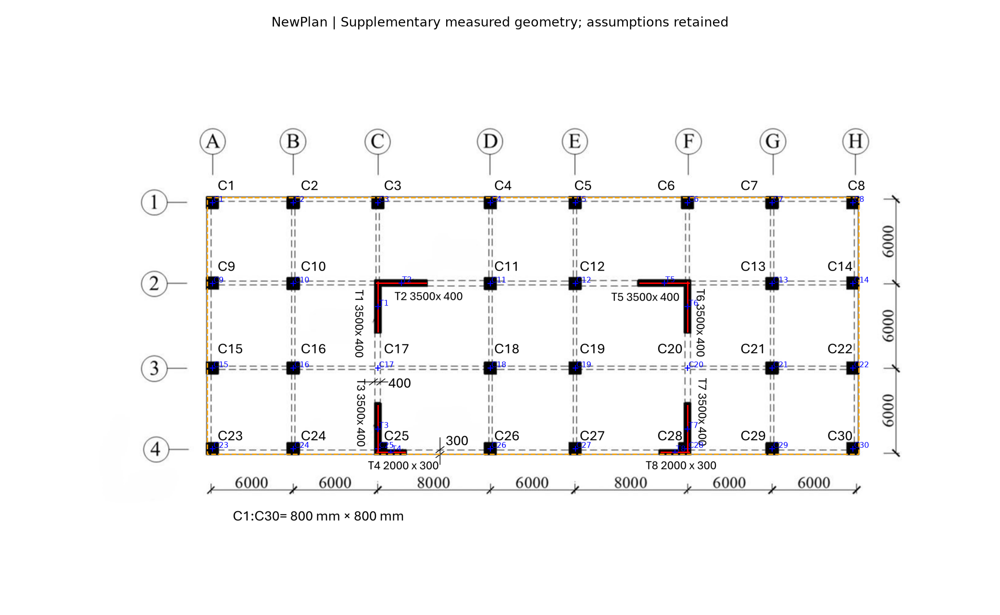
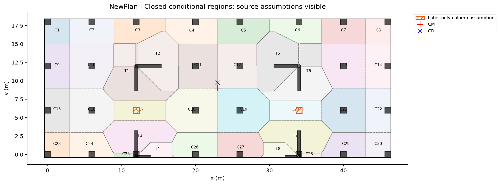
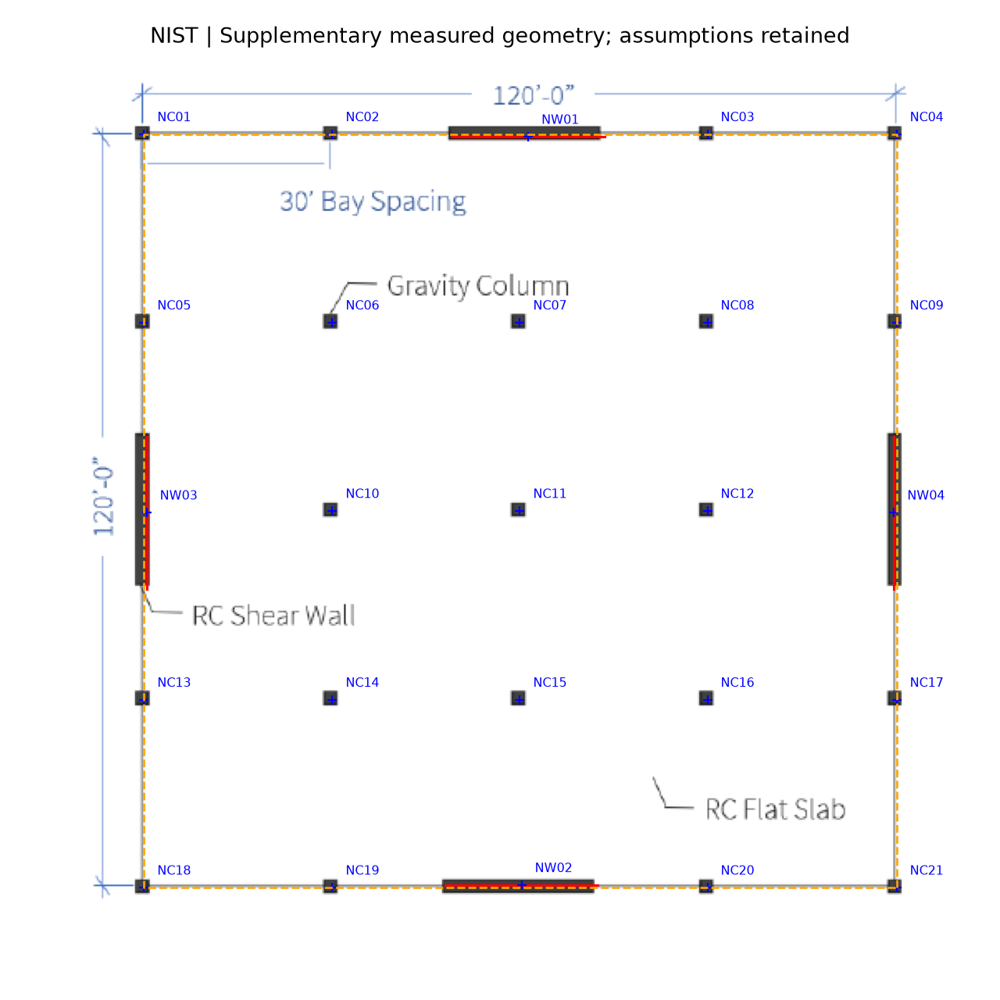
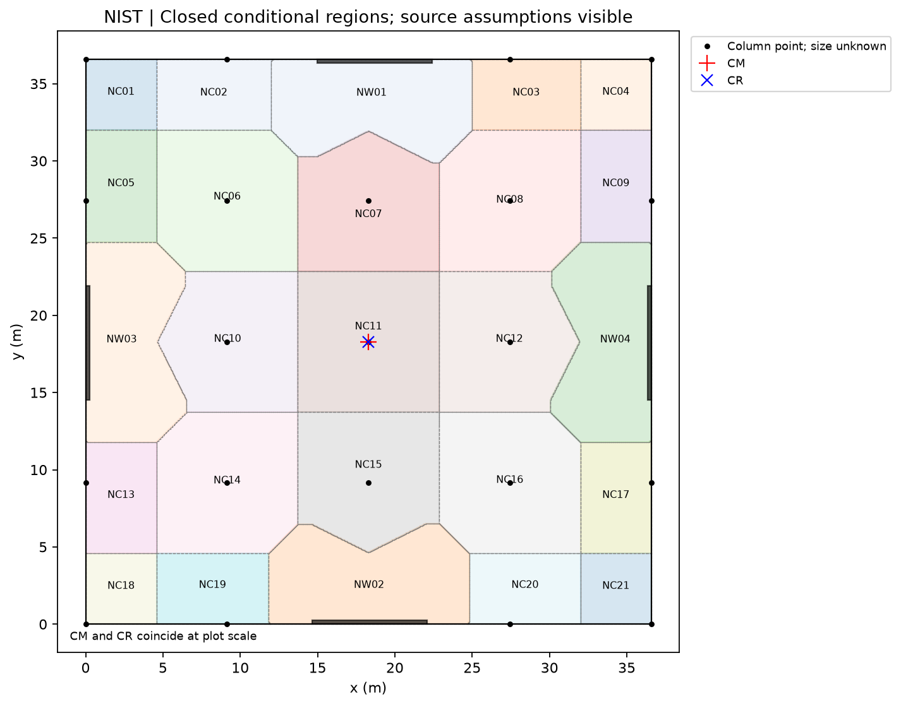
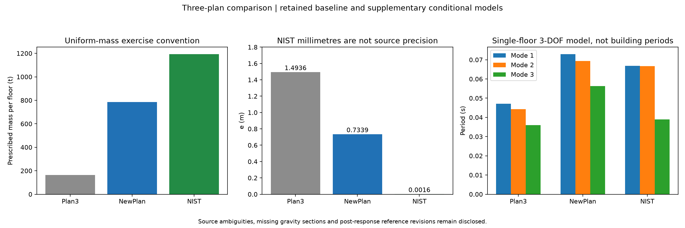

# Task 8 - Conditional geometry, closed areas and matched OpenSees comparison

Student: Fangyutong, 21353319. Date: 2026-11-11.

**Status:** the two additional plans now have complete conditional support schedules, closed tributary polygons, known gravity schedules, hand CM/K/CR and actual matched OpenSees runs. These are explicitly assumption-dependent engineering baselines. The original unchanged image pipeline failed and is not retroactively promoted. Source ambiguities and cross-harness/reference timing limits remain. This is not a claim that all HW3 rubric requirements are satisfied.

## Workflow and provenance

The prospective [geometry brief](records/Task_08_Geometry_Recovery_Brief_R1.md) and [parameter file](params_geometry_recovery_r1.json) were committed as `445eef6`. The new deterministic solid-symbol route is separate from the frozen hatching pipeline. It preserves all components, labelled bar assignments, measured grids, global-fit residuals, piecewise calibration and source overlays. A rejected label-centre guard is retained in [the attempt record](records/Task_08_Geometry_Assignment_Attempt.md); the masks and eight actual nearest-bar claims were unchanged.

Commit `0d7c45b` retained geometry before area calculations. Commit `f368008` retained the initial closed-region and hand results before numerical refinement. Commit `d66f7a1` froze refined regions, independent hand checks and conditional gates **before** the OpenSees runs. Original V4 inputs, failed classical masks, forests and earlier R2/R3 reader scores remain preserved.

The [two-reader R3 comparison](outputs/Task08/reader_comparison_r3/Comparison.md) is a tie on ten supplemented questions. Codex gpt-6.1-sol is runtime-evidenced; Grok 4.5 is student-reported. R2 source measurements and the human T3 review were post-response revisions, not blind pre-response truth. No accuracy winner or fully promoted unchanged-pipeline extraction is invented.

## Coordinate and source interpretations

- **NewPlan:** origin A4 column-grid centre; x right and y up. Dimensioned axes x=0/6/12/20/26/34/40/46 m, y=0/6/12/18 m. Printed sizes: C1:C30=800x800 mm; T1/T2/T3/T5/T6/T7=3500x400 mm; T4/T8=2000x300 mm. The main assumed outer-column-face slab bounds are [-0.4,46.4] x [-0.4,18.4] m. The grid-axis 828 m2 rectangle is a separate sensitivity.
- **NewPlan source ambiguity:** 26 standalone square bodies and two merged column/wall junctions are visible. C17/C20 are printed labels without clear filled square bodies, retained as grid-inferred supports; their omission sensitivity is exported. This is not a successful detection of two missing symbols. T4/T8 nominal rectangles protrude 13.636 mm beyond the assumed lower slab edge (0.054545 m2 combined); support axes are inside, and the small face discrepancy is not clipped away.
- **NIST:** origin lower-left footprint corner. The printed 120 ft square is 36.576 x 36.576 m, with 30 ft (9.144 m) bays. The visible model has 21 column points and four walls; adjacent source text describes 25 gravity columns. The four-column discrepancy and unknown column sections remain unresolved. NC/NW identifiers are analyst bookkeeping, not printed labels.
- **NIST wall geometry:** lengths are measured from schematic bars. Thickness 250 mm is the course default, not a pixel-derived or printed section. Perimeter outside faces are assumed on the footprint border; centre axes are inset by half that thickness. Raw ink centres and uncertainty are retained. Unknown columns have no invented footprint or self-weight.
- Neither extra drawing shows an opening/stair zone; their absence is a modelling assumption. Plan 3 O1/O2/S1 are not copied to the new plans.

NIST source: Elsibaie et al. (2025), [NIST TN 2351, Figure 2](https://doi.org/10.6028/NIST.TN.2351), printed page 9. Republished courtesy of the National Institute of Standards and Technology. This is a research archetype, not an identified surveyed building.

### NewPlan geometry and closed-area record





[Coordinates and section provenance](outputs/NewPlan/engineering_r1_refined/Coordinates_and_Size_Provenance.csv), [calibration](outputs/NewPlan/geometry_recovery_r1/Calibration.json), [geometry](outputs/NewPlan/geometry_recovery_r1/Elements_Conditional.json), [closed GeoJSON](outputs/NewPlan/engineering_r1_refined/Closed_Tributary_Regions.geojson), [area/load schedule](outputs/NewPlan/engineering_r1_refined/Tributary_and_Known_Loads.csv).

The declared floor area is 879.840000 m2. All 38 support IDs appear in the geometry, area and known-load records. L1 nearest finite-axis/point regions are closed, valid and non-overlapping. Known column footprints are removed from gravity wall-axis segments at joints; full labelled wall axes remain in the lateral model. Both conventions and the untrimmed-axis sensitivity are retained.

The adopted 0.025 m area grid was checked against 0.05 m; maximum relative per-support change is 0.935%. This is below the approximate 1% target.
The domain closes to numerical tolerance even though individual allocations are discretised. Source topology/size uncertainty is separate from mesh convergence.

### NIST geometry and closed-area record





[Coordinates and section provenance](outputs/NIST/engineering_r1_refined/Coordinates_and_Size_Provenance.csv), [calibration](outputs/NIST/geometry_recovery_r1/Calibration.json), [geometry](outputs/NIST/geometry_recovery_r1/Elements_Conditional.json), [closed GeoJSON](outputs/NIST/engineering_r1_refined/Closed_Tributary_Regions.geojson), [area/load schedule](outputs/NIST/engineering_r1_refined/Tributary_and_Known_Loads.csv).

The declared floor area is 1337.803776 m2. All 25 support IDs appear in the geometry, area and known-load records. L1 nearest finite-axis/point regions are closed, valid and non-overlapping. Known column footprints are removed from gravity wall-axis segments at joints; full labelled wall axes remain in the lateral model. Both conventions and the untrimmed-axis sensitivity are retained.

The adopted 0.025 m area grid was checked against 0.05 m; maximum relative per-support change is 1.090%. This is marginally above the approximate 1% target and is explicitly retained as an exception, not reported as a strict 1% pass.
The domain closes to numerical tolerance even though individual allocations are discretised. Source topology/size uncertainty is separate from mesh convergence.

## Gravity and floor-mass convention

The transferred HW1 exercise assumptions are G_slab=0.150*25=3.75 kN/m2, Q=5.0 kN/m2, H=3 m and five-storey gravity accumulation. These are assumptions for the comparison, not loads printed on either new drawing. No unspecified beams, finishes, foundations or earthquake demand are added. ULS factors remain unconfirmed in the retained project configuration; no new complete axial design certification is made.

Known vertical self-weight uses the union of section footprints, allocated to columns before remaining labelled walls to avoid overlap double counting. This is joint bookkeeping, not an indeterminate-junction force solution. NIST column self-weights remain null; all its gravity totals below are **known-only**, not complete totals.

| Plan | Slab area (m2) | Known net vertical section (m2) | Known vertical weight / storey (kN) | G known / floor (kN) | Q / floor (kN) |
|---|---:|---:|---:|---:|---:|
| NewPlan | 879.840 | 27.809000 | 2085.675 | 5385.075 | 4399.200 |
| NIST | 1337.804 | 7.423284 | 556.746 | 5573.510 | 6689.019 |

The exported [NewPlan accumulation](outputs/NewPlan/engineering_r1_refined/Known_Axial_Accumulation.csv) and [NIST known-only accumulation](outputs/NIST/engineering_r1_refined/Known_Axial_Accumulation.csv) follow 1:2:3:4:5. The prescribed lateral floor mass is separately (8.75/g)*floor area, in tonnes. Vertical-element weights are **not** silently added to this mass, matching the retained Plan 3 exercise convention.

## Hand calculation before the matching solver

E=30e6 kN/m2, nu=0.2, G=12.5e6 kN/m2, H=3 m, Av=(5/6)Lt. For each labelled rectangular wall: I_s=tL^3/12, I_w=Lt^3/12; k_b=3EI/H^3 and k_s=1/[H^3/(3EI)+H/(GAv)]. Both in-plane rectangular bending axes are retained; columns supply no lateral stiffness and intrinsic vertical-wall J is zero. Joined L bars are not treated as a detailed monolithic shell or full-building frame.

For wall offsets dx,dy from CM, K is assembled from kx*[1,0,-dy]^T*[1,0,-dy] and ky*[0,1,dx]^T*[0,1,dx]. Kxphi=-sum(kx*dy), Kyphi=sum(ky*dx), Kphiphi=sum(kx*dy^2+ky*dx^2). Thus xr=xm+Kyphi/Kyy and yr=ym-Kxphi/Kxx. With F=inv(K), xr=xm-Fphiy/Fphiphi, yr=ym+Fphix/Fphiphi. These flexibility ratios have units m; stiffness ratios with a rotational denominator cannot be added as coordinates.

Translation block units are kN/m, translation-rotation entries kN, rotational entry kN m; angles are radians. Mass and polar mass are t and t m2.

### NewPlan K about CM

```text
[[ 6.067853e+06  0.000000e+00 -4.453297e+06]
 [ 0.000000e+00  9.776675e+06  3.177007e+04]
 [-4.453297e+06  3.177007e+04  1.316006e+09]]
```

[Hand matrices, wall stiffnesses, mass integrals and cases](outputs/NewPlan/engineering_r1_refined/Hand_Analysis.json). CM=(23.000000,9.000000) m; CR=(23.003250,9.733916) m; e=0.733924 m.

### NIST K about CM

```text
[[1.061015e+07 0.000000e+00 5.137103e+03]
 [0.000000e+00 1.052759e+07 1.561011e+04]
 [5.137103e+03 1.561011e+04 6.930927e+09]]
```

[Hand matrices, wall stiffnesses, mass integrals and cases](outputs/NIST/engineering_r1_refined/Hand_Analysis.json). CM=(18.288000,18.288000) m; CR=(18.289483,18.287516) m; e=0.001560 m.

## Actual OpenSees verification

OpenSees 3.8.0 was actually run using one ElasticTimoshenkoBeam cantilever per wall, explicit rigidDiaphragm(3,1,*wall_top_nodes) and Transformation constraints. Bases are fixed; tops have [0,0,1,0,0,0] fixity. Three unit loads recover F and K. Assumed 100 kN x/y demonstration forces, loads through CR, separate push/turn cases, bending-only limits and isolated section limits were run and saved. The generic fullGenLapack speed warning occurred; all requested static/eigen cases returned valid results.

The actual modal calculation has one floor master with prescribed mass and polar inertia. Its periods are **single-floor 3-DOF diagnostics**, not the periods of a full five-storey building or the original multi-storey NIST archetype. Five-storey gravity accumulation is a separate bookkeeping calculation.

Independent geometry/area/load/hand checks pass 364/364; actual solver checks pass 140/140. The largest relative hand/model flexibility error is 6.41e-16; the largest CR-coordinate difference is 1.78e-15 m. Those numerical agreements validate the matched assumptions, not the source drawing interpretation.

[Engineering validation](records/Task_08_Engineering_Validation.json), [solver validation](records/Task_08_OpenSees_Validation.json). Raw unit loads, reactions, master/slave displacements and eigenvalues are in [NewPlan results](outputs/NewPlan/engineering_r1_refined/OpenSees_Result.json) and [NIST results](outputs/NIST/engineering_r1_refined/OpenSees_Result.json). Direct/torsional wall shares are exported in each folder as Wall_Force_Push_and_Turn.csv.

## Three-plan comparison

All rows use the same 3 m, uncracked-material, strong/weak/shear rectangular-wall convention and prescribed 8.75 kN/m2 uniform mass. Origins differ: compare eccentricity and layout rather than raw coordinate magnitudes. Plan 3 mass area includes the separately treated stair-equivalent mass; its ordinary slab tributary area is 179.25 m2.

| Plan | Effective mass area (m2) | Mass / floor (t) | CM x,y (m) | CR x,y (m) | e (m) | T1 / T2 / T3 (s) |
|---|---:|---:|---|---|---:|---|
| Plan3 | 184.615 | 164.667 | 4.9638, 8.3261 | 5.5633, 9.6941 | 1.4936 | 0.04717 / 0.04429 / 0.03598 |
| NewPlan | 879.840 | 784.771 | 23.0000, 9.0000 | 23.0032, 9.7339 | 0.7339 | 0.07293 / 0.06930 / 0.05629 |
| NIST | 1337.804 | 1193.250 | 18.2880, 18.2880 | 18.2895, 18.2875 | 0.0016 | 0.06689 / 0.06663 / 0.03893 |



NewPlan is nearly symmetric left/right but has unequal upper/lower horizontal wall lengths; its CR lies above CM. Plan 3 retains larger eccentricity from its irregular mass/wall arrangement. The nominal NIST layout is nearly symmetric: the measured millimetre-scale e must not be treated as established physical precision. Modal ordering also differs: the torsion-dominant conditional mode is mode 2 for NewPlan and mode 3 for NIST, rather than a universal mode number.

## Sensitivities and limits that change interpretation

- NewPlan grid-axis slab area 828 m2 gives 738.532 t/floor instead of 784.771 t. CM and CR do not change under this symmetric edge change, but the actual coupled periods change to 0.07031, 0.06625, 0.05461 s.
- Omitting C17/C20 reallocates 37.450 m2. The largest other-support area increase is 7.707 m2, or 67.441 kN service slab load/floor (337.203 kN over five floors). CM/CR stay unchanged **only because** mass is prescribed independently and columns are excluded from lateral stiffness. This is not a claim that missed columns are harmless.
- Global-affine instead of piecewise calibration moves NewPlan CR by 0.0746 m. Both routes and residuals are retained; image scaling is not CAD certainty.
- The ideal symmetric NIST sensitivity gives e=3.55e-15 m. The measured e=0.001560 m is below the source endpoint precision.
- A deterministic extreme-box sensitivity moves each schematic endpoint by +/-2 pixels, allowing each wall length +/-4 pixels with fixed centres/thickness/mass. Among the 16 independent sign combinations, maximum e is 1.523 m. This is **not** a probability or confidence interval; it demonstrates why a tiny baseline e cannot be certified without real wall dimensions. It also does not assert that the source building is asymmetric.
- NIST unknown column sections and the 21-symbol/25-column discrepancy prevent complete gravity certification. Wall lengths/thickness and floor-edge conventions are explicit assumptions/measurements, not a drawing-issued design schedule.
- Rectangular-bar, no-column-lateral, uncracked, single-floor models omit monolithic L-wall coupling, cracking, full-height interaction and real earthquake demands. Matching hand and solver does not remove these limits.

[NewPlan source sensitivities](outputs/NewPlan/engineering_r1_refined/Source_Uncertainty_Cases.json), [NIST endpoint cases](outputs/NIST/engineering_r1_refined/Source_Uncertainty_Cases.json), [column-omission gravity sensitivity](outputs/NewPlan/engineering_r1_refined/Label_Only_Column_Sensitivity.csv).

## Reproduce and review

All source/reader evidence is retained. Numerical workflow, from repository root with HW3 requirements installed:

```powershell
python HW3/scripts/task08_geometry_recovery.py
python HW3/scripts/task08_areas_and_hand.py
python HW3/scripts/task08_areas_and_hand.py --refined
python HW3/scripts/verify_task08_engineering.py
python HW3/scripts/task08_opensees.py
python HW3/scripts/verify_task08_opensees.py
python HW3/scripts/task08_source_sensitivity.py
python HW3/scripts/write_task08_engineering_report.py
```

Review geometry/source assumptions first, then exported closed regions and gravity, then the hand matrices, then actual solver checks. The original fixed-rule generalisation failure and experimental limitations remain part of the submission; do not describe the conditional recovery as a fully successful unchanged, blind, end-to-end promoted extraction.
