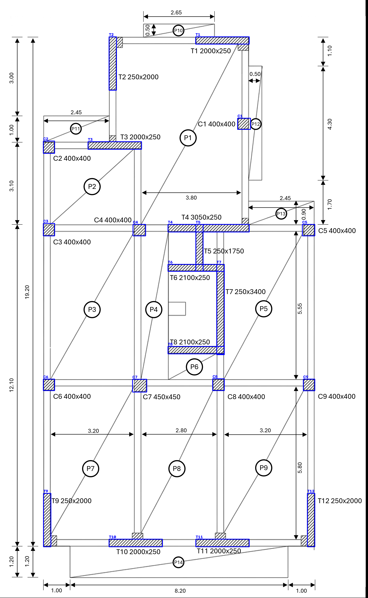
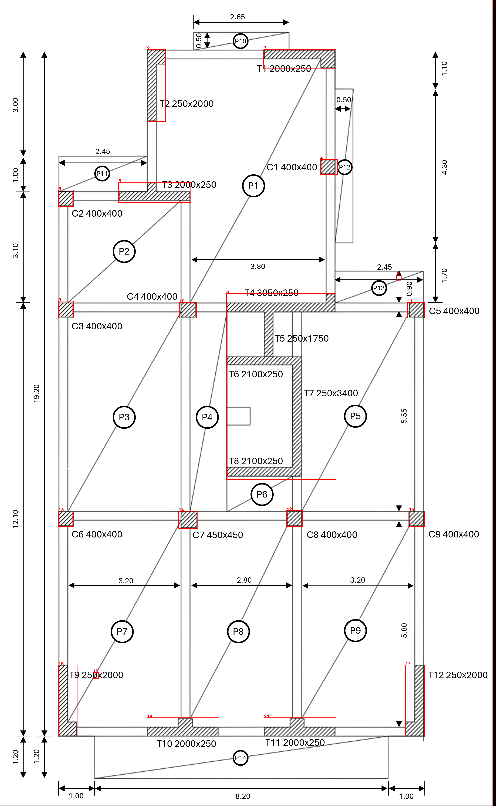

# HW3 - Audited extraction and rigid-diaphragm analysis

Student: Fangyutong, 21353319. Assigned drawing: Floor Plan 3.

## Current stage

Task 1A has an initial classical run: 20 connected components, including merged walls and artifacts. Labels, scale and element-level scores remain pending. No reader has been promoted; no final CM/CR has been calculated. DP v4.1 is the student's proposed second reader; exact service model ID and image capability must be recorded from the actual session.

Task 1B now has two raw OCR readings and 21 unique provisional label/bar matches. A preliminary 60-tree weakly supervised forest is retained but never selected. Five draft review flags are prepared; the independent reference, final scale and flag freeze remain pending.



## Reproduce current evidence

Install HW3/requirements.txt in a virtual environment, then run from the repository root:

```text
python HW3/scripts/stage01_classical.py
python HW3/scripts/stage02_ocr.py
python HW3/scripts/stage03_bars.py
python HW3/scripts/stage04_forest.py
python HW3/scripts/prepare_review_flags.py
python HW3/scripts/stage05_metric_geometry.py
python HW3/scripts/check_metric_reference.py
python HW3/scripts/verify_extraction_stage.py
```

## Current metric calibration

See [metric calibration review](outputs/Plan3/stage05/Metric_Geometry_Review.md) and [labelled-size overlay](outputs/Plan3/stage05/Labelled_Size_Rectangles.png). The two-stroke growth route failed the dimension-chain gate and is retained; a separately measured effective-bar-growth route passes. These are unpromoted candidates while floor extraction and independent reference review remain open.

The student can fill the [independent reference form](records/Independent_Reference_Form.md) directly from the source crops before viewing either model's answers.



## Evidence locations

- sources/: course brief and original drawing assets.
- records/: source hashes, iteration log and readable Git history.
- prompts/: identical instructions for both image readers.
- scripts/: extraction and deterministic validation.
- outputs/: actual extraction outputs; future OCR, flags, reference and forest artifacts.

## Hook installation

Run `git config core.hooksPath .githooks`. If the default Python lacks dependencies, set HW3_PYTHON to a suitable Python executable. The hook reads staged text rather than unstaged copies. It rejects non-English text, malformed JSON and conflict markers, and validates staged Python syntax. Full engineering verification is a separate documented gate once the calculation stages exist.

Do not call preparation records completed engineering results. Raw external-model responses are collected by the student and retained verbatim.
