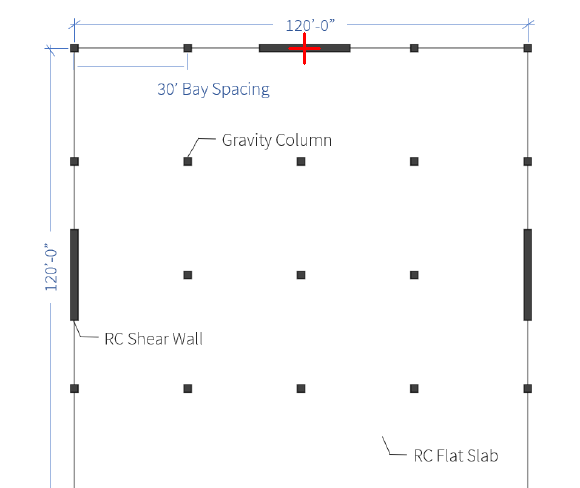
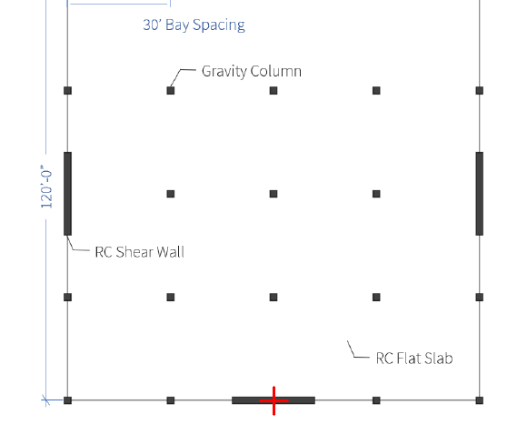
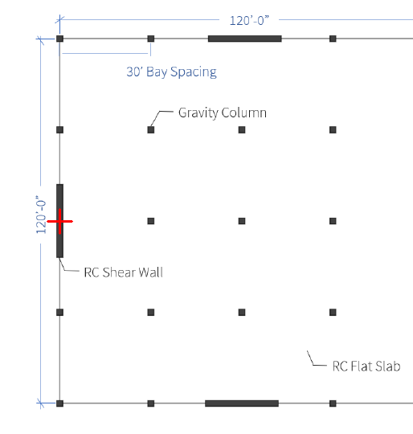
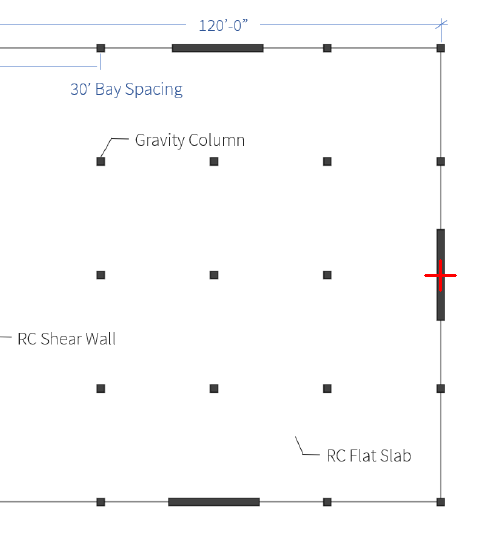

# Frozen image-reader questions

Use Reader_Instructions.md unchanged for both models. Submit one image and its question in the order below. Do not send evaluator metadata or reference answers.

## NI-F01

Is the concrete wall through the red cross continuous along its axis, or is there a genuine gap? Answer continuous only; keep label and size_mm null.

## NI-F02

Is the concrete wall through the red cross continuous along its axis, or is there a genuine gap? Answer continuous only; keep label and size_mm null.

## NI-F03

Is the concrete wall through the red cross continuous along its axis, or is there a genuine gap? Answer continuous only; keep label and size_mm null.

## NI-F04

Is the concrete wall through the red cross continuous along its axis, or is there a genuine gap? Answer continuous only; keep label and size_mm null.

