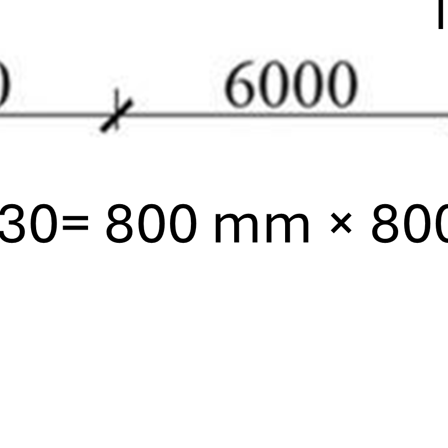
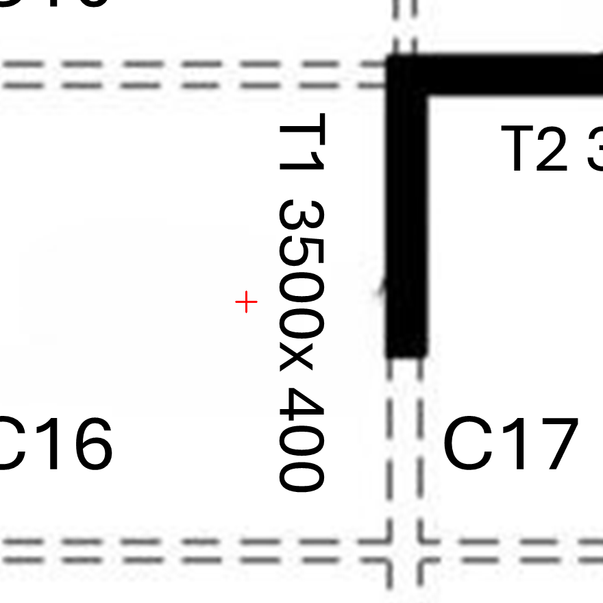
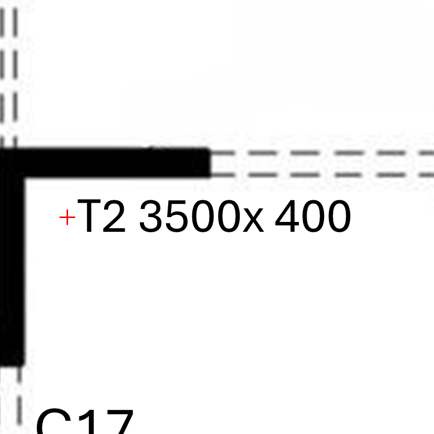
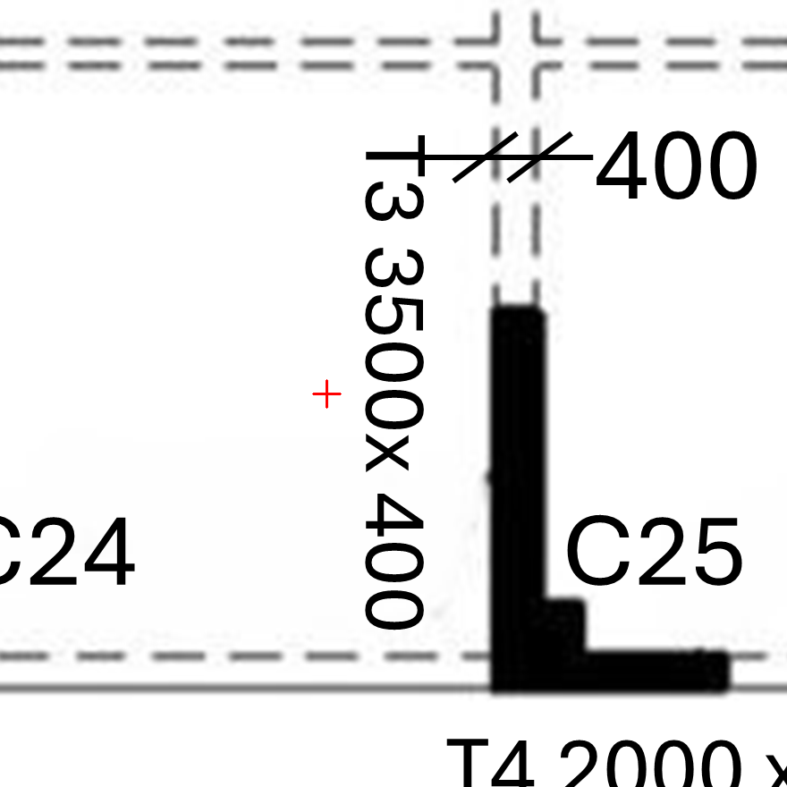
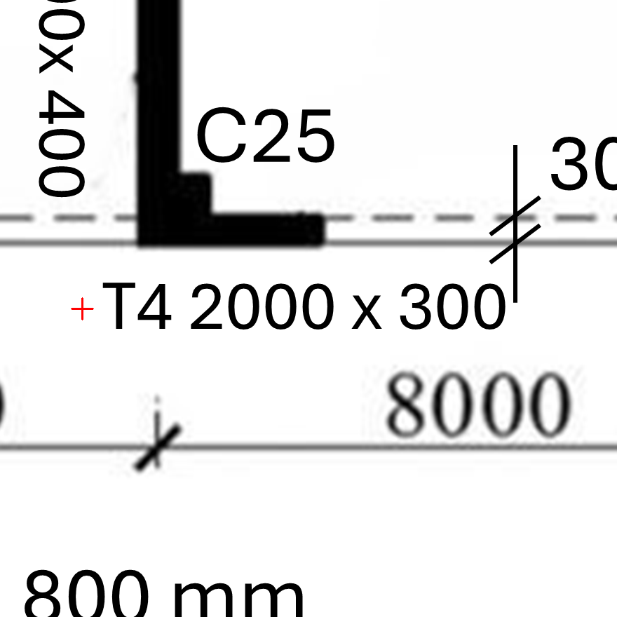
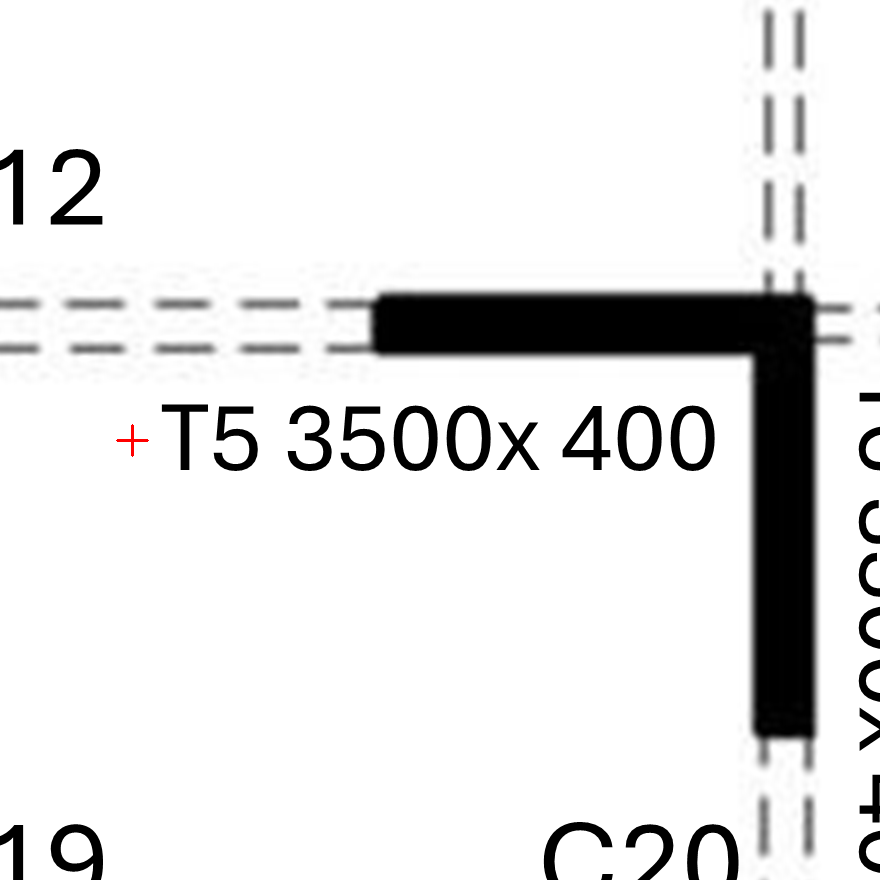
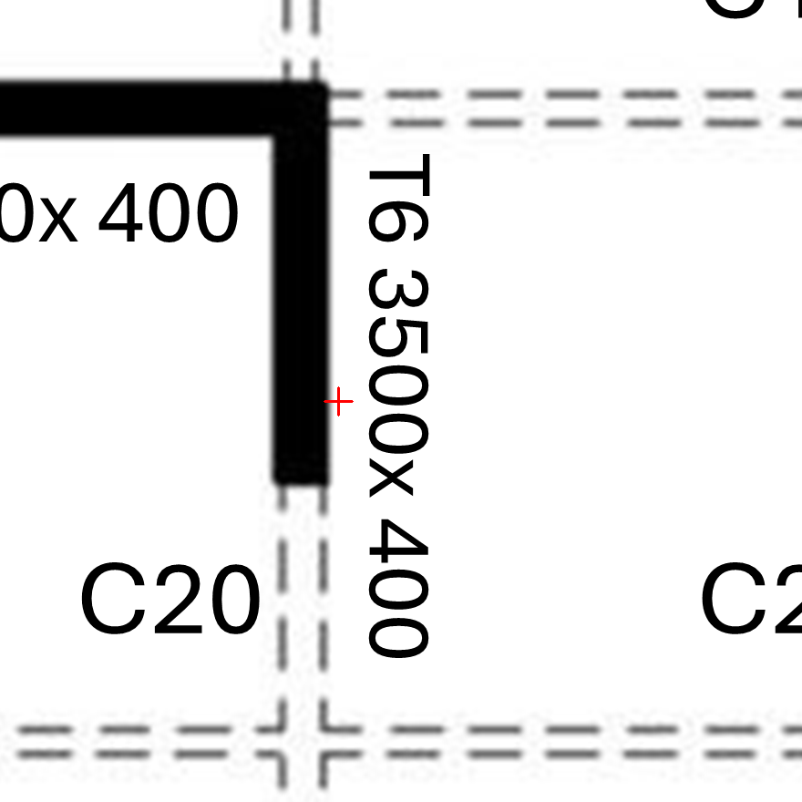
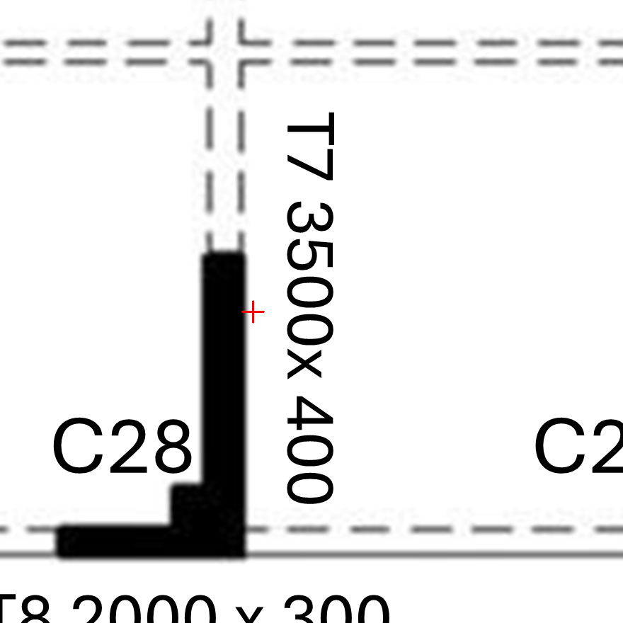
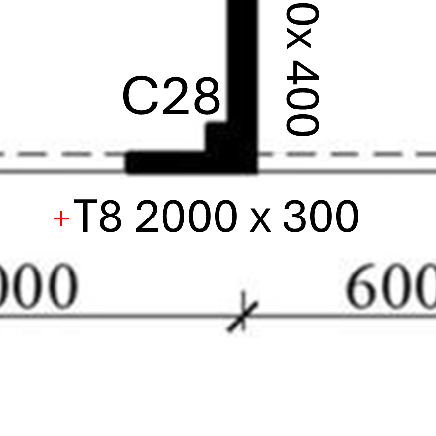

# Frozen image-reader questions

Use Reader_Instructions.md unchanged for both models. Submit one image and its question in the order below. Do not send evaluator metadata or reference answers.

## NP-F01

What element label (or label range) and size string are printed immediately to the right of the red cross? Answer label and size_mm; keep continuous null.

## NP-F02

What element label (or label range) and size string are printed immediately to the right of the red cross? Answer label and size_mm; keep continuous null.

## NP-F03

What element label (or label range) and size string are printed immediately to the right of the red cross? Answer label and size_mm; keep continuous null.

## NP-F04

What element label (or label range) and size string are printed immediately to the right of the red cross? Answer label and size_mm; keep continuous null.

## NP-F05

What element label (or label range) and size string are printed immediately to the right of the red cross? Answer label and size_mm; keep continuous null.

## NP-F06

What element label (or label range) and size string are printed immediately to the right of the red cross? Answer label and size_mm; keep continuous null.

## NP-F07

What element label (or label range) and size string are printed immediately to the right of the red cross? Answer label and size_mm; keep continuous null.

## NP-F08

What element label (or label range) and size string are printed immediately to the right of the red cross? Answer label and size_mm; keep continuous null.

## NP-F09

What element label (or label range) and size string are printed immediately to the right of the red cross? Answer label and size_mm; keep continuous null.

