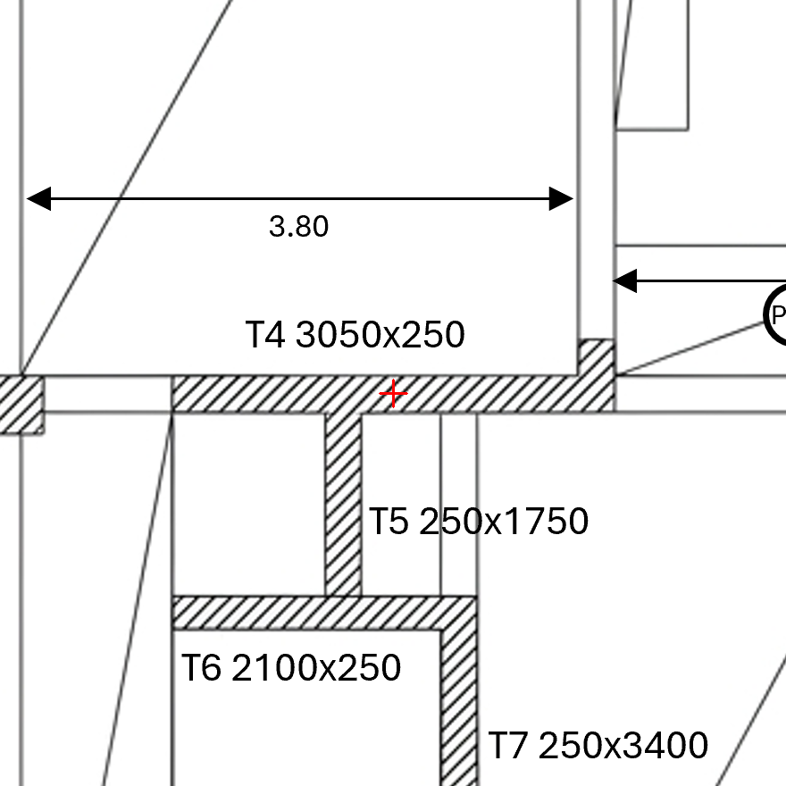
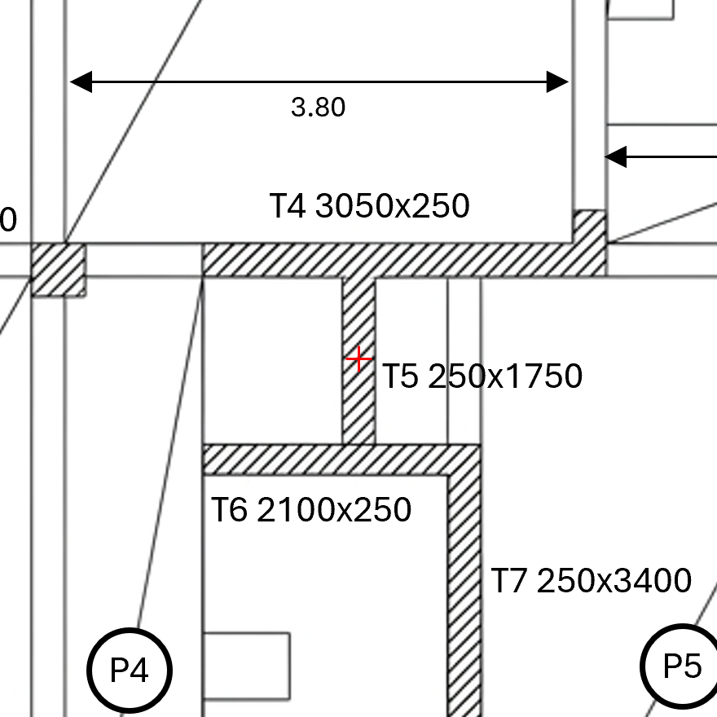
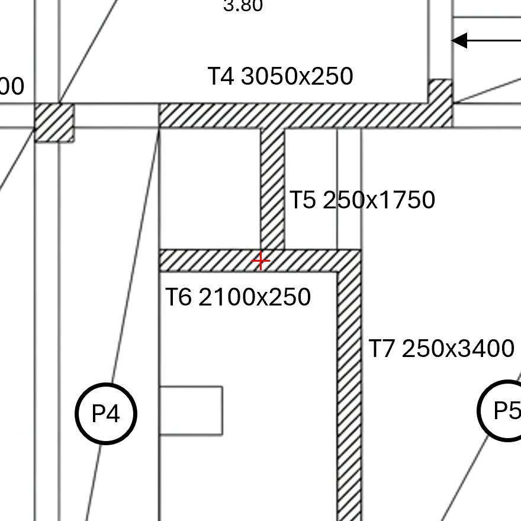
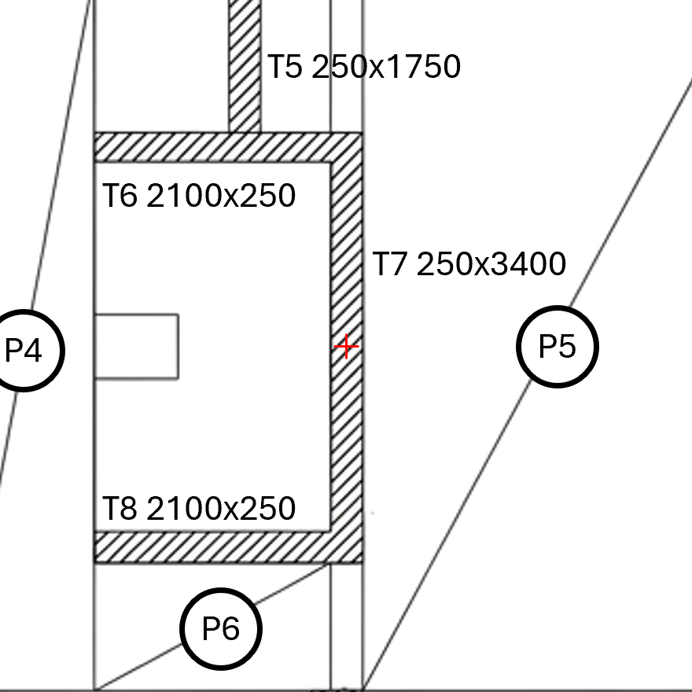
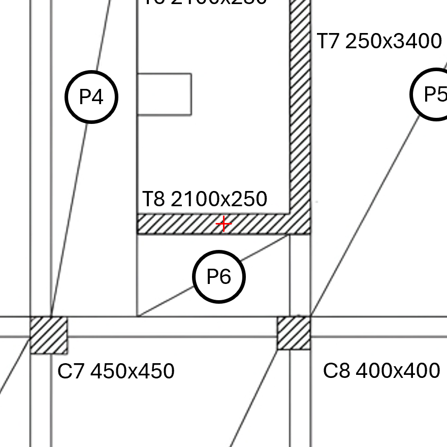

# Draft review package

DRAFT - independent reference must be frozen before reader runs

Use prompts/Reader_Instructions.md for both readers. Send only the crop and question below, not the independent reference or geometry match answers.

## P3-F01

Is the hatched wall through the red cross continuous along its axis, or is there a genuine gap in the concrete?

## P3-F02

What element label and size string are printed beside the element at the red cross?

## P3-F03

What element label and size string are printed beside the element at the red cross?

## P3-F04

Is the hatched wall through the red cross continuous along its axis, or is there a genuine gap in the concrete?

## P3-F05

What element label and size string are printed beside the element at the red cross?

