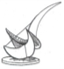

<p align="center">
	
</p>

**Computer (& AI) Methods for Structural Engineering (DISC 5203)**

**Fall 2026**

**Homework 3 - Due date: 5/11/2026 (1st) and 12/11/2026 (final)**

# Homework Assignment 3: From a Floor-Plan Image to the Centre of Stiffness, via a Rigid Diaphragm

## Context

Homework 1 read the floor plan into columns, walls and tributary areas, and computed
axial loads. Lectures 7–9 then turned that picture into one JSON file of structural
elements and showed where the lateral-load resistance of the floor acts — the **centre of
stiffness** (centre of rigidity, CR). This assignment is the continuation of HW1: it takes
the *same* floor plan and **mimics the L09 approach** — classical reading, the labels
supervising one element each, a *kept-but-never-chosen* random forest, and *only then* a
VLM that resolves the **flags** — checked at the end with **two different VLMs** (the one
that resolves more flags is kept), and feeds the promoted extraction into a **pertinent
OpenSees rigid-diaphragm model** to compute the **centre of
mass (CM)** and the **centre of stiffness (CR)**, then **modifies the structural system so
that CM and CR coincide** and explains why.

Two things make this task different from HW1 and must not be skipped:

- **You can mimic the L09 approach, or invent yours, but it has to be of similar premise (not a black-box approach using a foundation model).**
- L09 method: The classical rules of L07 do the  reading; the labels supervise **one element per label**; a random forest is trained and
  **kept but never chosen**; and *only the VLM resolves the flags*. 
- **Two VLMs, one gate.** Two different vision-language models are offered the flagged cases,
  one question and one checkable answer each. The extraction is *not* "the VLM reading the
  whole plan"; it is "the classical pipeline, cleaned by two readers, and the one that
  resolves more flags without breaking another is kept." The reference against which they are
  judged is independent of them (Task 1).
- The **structural calculation** (CM, CR, the diaphragm) is a model you can check. The
  extraction is only as good as the question it answers: *a missed wall moves CR by metres; a
  missed column moves the gravity load by hundreds of kN* (L09, "which error matters?").

The course strongly encourages an AI agent. As in HW1, the agent reads files, writes scripts,
runs code, checks results and iterates inside the project folder.

## Input

The **same floor plan image as in HW1**, selected by the last digit of your student ID:

| Last digit | Floor plan |
| --- | --- |
| 1, 2, 3 | `assets/FloorPlan1.png` (10.90 × 15.90 m, ~189 m² )
| 4, 5, 6 | `assets/FloorPlan2.png` |
| 7, 8, 9, 0 | `assets/FloorPlan3.png` |

Assume the floor is **3 m** high. 
Material for the lateral model, as used in Lecture 8: concrete
$E = 30\ \text{GPa}$, $\nu = 0.2$ (uncracked), $G = E/(2(1+\nu))$; wall thickness
$t = 250\ \text{mm}$ unless the plan prints otherwise; storey height $H = 3\ \text{m}$.

## The pipeline

This assignment is the *full pipeline of L09, end to end*: the classical rules of L07, with
the labels supervising **one element per label**, a learned random forest that is **kept but
never chosen**, and *only then* a vision-language model that resolves the **flags**. The
reader is not asked to *build* a vision approach from scratch; the approach is fixed by
L09. The new requirement is that **two different VLMs are asked the same flagged
questions, and the one that resolves more flags — and never breaks one the other cleared —
is promoted**, while the other is kept as a witness:

```
drawing ── classical rules (L07) ── labels supervise     ── learned random forest ──
 PNG   threshold→morphology→components → one element/label    (kept, never chosen)  │
                                                                                   ▼
                 two VLMs ask the flags only  ──► more flags resolved & none broken  ──► JSON
   (one crop, one question, one checkable answer)   (the winner)                    (audit;
                                                                                   flags + score)
  ──► tributary areas & axial loads (HW1) ──► CM
  ──► walls as beam/shell elements + ops.rigidDiaphragm ──► K, CR (3 unit loads)
  ──► modify so that CM = CR ──► report why
```

Everything from "JSON" onward follows the conventions of HW1 and Lectures 7–9:
tributary areas by bisecting lines, the wall stiffness with shear for squat walls,
the 3×3 diaphragm about the centre of mass, and the flexibility method to locate CR.

## Tasks

### 1 · Run the L09 pipeline: classical reading, supervised by the labels, kept forest, then the VLM

Mimic the **full L09 pipeline**, end to end. Do **not** ask a VLM to read the whole plan; a
VLM estimates coordinates, it does not measure them (L09, "ask a vision model to read, not
to measure"). Instead run the pipeline below, in order, and keep every output.

**A. The classical steps (L07).** On the assigned plan: threshold (`ink = grey < 225`) →
morphology (an 11-px 45° line keeps the hatching; open 17, open 21) → connected components →
shape rules (4 : 1, `E₂` — a wall is at least four times its thickness) → the grid from the
columns → tributary areas. Record the **score sheet** as of L07 (named elements found, and
how many merged or broken) and the **scale** `s = median_k (e_k − g)/L_k` from the labels
(L09 "growth, measured").

**B. The labels supervise one element per label (L09, section 3).** Every element carries its
size string in millimetres; use it. Read the text **twice** — once on the drawing, once with
the long lines removed — so `T9 250x4500` is recovered where a single reading gave `19`.
Split each object into horizontal and vertical bars; each label claims **one** bar of its own
thickness class; a 250 label cannot claim a 400 bar. Cut or complete each bar to its labelled
length **along its axis**, where the 45° strokes support it. The pixels place it; the text
sizes it. Write the **record** — one JSON file in the **exact schema of L07 section 6**:

```json
{
  "source":      {"file": "FloorPlan1.png"},
  "scale_px_per_m": {"x": 130.5, "y": 130.7},
  "elements": [
    {"id": 5, "labels": ["C1"], "class": "column",
     "centre_m": [1.0, 7.5], "size_mm": [400, 400]},
    {"id": 6, "labels": ["T9"], "class": "wall",
     "centre_m": [4.8, 11.0], "size_mm": [250, 4500], "angle_deg": 90.0,
     "continuous": true, "audit": {"merged": false, "partly_missed": []}}
  ],
  "floor": {"outline_area_m2": 189.0, "load_kN_m2": 8.75, "storeys": 5},
  "checks": {"sum_areas_m2": 189.0, "sum_axial_kN": 8300}
}
```

The **audit** block records what is **flagged**: a misread label, a thickness mismatch, a
wall in pieces along an axis, a bar no label claims, or a low-support completion. Each
flagged element lists its flag and its source.

**C. Train the random forest, but keep it, do not choose it (L09, section 2).** Build
per-pixel features (grey, edge strength, ink density at several window sizes, 45° strokes),
label them "concrete / not" from the classical rules, and fit a `RandomForestClassifier`
on the assigned plan. Report the feature importance (L09: the 45°-stroke and ink-density
features dominate — the forest *re-learns* the hand rule). **Keep the forest and its results
in the repository, but never choose the extraction from it** — its labels came from the rules,
so it copies the rules' mistakes (L09, "the catch"). It is the "kept but never chosen" step.

**D. VLM resolves the flags only (L09, section 4).** Ask a VLM **only the flags**, each as
*one crop, one question, one checkable answer*, in the fixed form:

```json
{ "label": "T9", "size_mm": "250x4500", "continuous": true,
  "confidence": 1.0, "reason": "..." }
```

Rules (L09, sections 4, 5):

- **One crop, one question, one checkable answer, per flag**, and only answers above a stated
  confidence threshold, applied to a **copy** of the JSON; the original is never touched, and
  every applied answer records its source (`"corrected by <model>"`).
- **The VLM reads and names; it moves no vertex.** It decides "continuous?" and reads the
  printed size string; the *rules take the pixels from there*.
- **The floor outline stays classical.** It is *not* taken from the contour that follows
  dimension lines; it is "the floor the outside cannot reach" (ring of supports, plus
  balconies), or read and **checked** against the printed dimensions.

### 2 · Check the flags with TWO different VLMs: which resolves more?

Run step D **twice, with two different vision-language models** — for example `gemma4:31b`
and `claude` (the requirement is *two, not the same model twice*), each through the same
harness. Do **not** ask the VLMs to read the plan; give each the **same list of flags**, the
**same crops and the same questions**, in identical order, so the only thing that differs is
the model. For every flag, record which model resolved it (accepted above threshold and the
result agrees with the drawing's own printed size) and which left it unresolved or wrong.

**The gate (L09, section 5).** Per plan, the extraction that is kept is the one with the
higher score on an **independent reference**, and **no pass may regress a plan**. The
reference is a defensible reading **built by a different route** — a hand reading of the
drawn elements against their printed size strings, **or** a second independent classical pass
(tuned *separately* so it is not the very kernel that produced the flags). The reference is
not "the true drawing"; it is one reading you can defend. State that.

For each model, per plan, report:

- **flags resolved** (the headline number that decides the winner): of the $N$ flags, how
  many each model resolved with an answer above threshold that **agrees with the reference**;
- **flags broken**: a resolution that *disagrees* with the reference (a wrong size, a false
  "continuous"). A model that resolves **more** but also **breaks** one the other cleared has
  not won — *a change that lowers any plan's score fails the gate*;
- a **performance table**, per model and per plan: flags resolved, flags broken, mean
  `confidence`, and size error (printed `size_mm` vs the model's reading), in the L09
  score-sheet format;
- **how each model's extraction moves the centre of stiffness** relative to the reference
  (L09, "which error matters?": losing wall T9 shifts CR ~4 m; losing a column removes
  374–568 kN of axial load on 5 storeys), so the flag comparison is tied to its structural
  consequence, not just its count;
- **the verdict**: *which* model is promoted to the calculation and *why* — it resolved more
  flags **and** broke fewer (ideally none) of the other's. The losing model is kept in the
  repository as a **witness**.

The pipeline then continues from the promoted JSON: tributary areas and axial loads are the
HW1 values; CM and CR follow in Task 3.

### 3 · From the chosen JSON to the two centres

From the **chosen** extraction, compute the **centre of mass** and the **centre of
stiffness**, with the conventions of L08.

**Centre of mass, CM** (L08 slide "the floor for today"; L09 "the two centres"). Mass acts
where the floor's gravity and, in an earthquake, its inertia force pass.
Assuming uniformly distributed floor mass, determine the center of mass of the irregular diaphragm by dividing its plan into non-overlapping rectangular regions. Calculate each region’s area $A_j$ and centroid coordinates 
$(x_j,y_j)$ relative to a common origin. The diaphragm’s center of mass is then obtained from the area-weighted averages:
$$
x_m = \frac{\sum_j m_j\, x_j}{\sum_j m_j},\qquad
y_m = \frac{\sum_j m_j\, y_j}{\sum_j m_j},
$$
and report mass per storey $\,M = w\,A_{\text{floor}}\,n/\,g\,$ in tonnes ($n=5$ storeys,
$w\approx 8.75$ kN/m²). Include balconies in the outline area, as in L07. An *unbalanced*
plan (asymmetric openings, a corner wall) gives an off-grid CM.

**Centre of stiffness, CR.** The point about which a horizontal force moves the floor
**without turning it**: the point at which the 3×3 diaphragm stiffness has no coupling,
$K_{\phi x}=K_{\phi y}=0$. Two routes, and they must agree to within centimetres.

*(a) By hand.* Each wall is a cantilever of length $L$, thickness $t$, storey height $H$:
second moment $I = tL^3/12$, shear area $A_v=\kappa A$ with $\kappa=5/6$. **Include shear**
because the walls are squat ($H/L < 3$):
$$
k = \frac{1}{\,H^3/(3EI) + H/(G A_v)\,}.
$$
For walls that run only along $x$ or $y$, the per-wall contribution to the
storey stiffness is
$$
\mathbf a = \begin{pmatrix}1&0&-y\end{pmatrix}
\ (\text{wall along }x),\qquad
\mathbf a = \begin{pmatrix}0&1&x\end{pmatrix}
\ (\text{wall along }y),
$$
and the 3×3 matrix about the origin O is
$$
\mathbf K = \sum_i k_i\,\mathbf a_i\,\mathbf a_i^T,\qquad
K_{xx}=\sum_{x\text{-walls}}k,\quad K_{yy}=\sum_{y\text{-walls}}k,\quad
K_{\phi\phi}=\sum_i k_i\,d_i^2,\quad K_{xy}=0,
$$
with $d_i$ the in-plane distance from O to wall $i$ (across the wall). With coupling the
coordinates of CR are
$$
x_r = x_m - \frac{K_{\phi x}}{K_{\phi\phi}},\qquad
y_r = y_m + \frac{K_{\phi y}}{K_{\phi\phi}}.
$$
(For the exercise floor of L08, bending + shear: $x_r=9.10$, $y_r=4.66$ m;
without shear, $x_r=6.13$ m — shear moves CR toward the middle and by *metres*.)

*(b) From a model.* Three unit loads on one node at CM — $P_x=1$, $P_y=1$, $M_z=1$ — give the
3×3 flexibility $\mathbf F$; $\mathbf K=\mathbf F^{-1}$, and
$$
x_r = x_m - \frac{f_{\phi y}}{f_{\phi\phi}},\qquad y_r = y_m + \frac{f_{\phi x}}{f_{\phi\phi}},
$$
read directly from the model's output (no inversion on screen). The hand and model values
must agree to within a few centimetres; if they do not, an assumption differs (usually
shear).

**Eccentricity**, $e = \sqrt{(x_r-x_m)^2+(y_r-y_m)^2}$, is the distance the load passes
from CR. Report it for your plan. (In the L09 running example, two detection fixes and one
mechanics assumption each moved CR by more than a metre; the drawing was the same.)

### 4 · A pertinent OpenSees model

Build **one OpenSees model per storey** that reproduces the hand result, following L08
section 7 exactly. The walls are vertical elements **meshed as Timoshenko beam elements**
(`ElasticTimoshenkoBeam`, shear included) — or as shells (`ShellDKGQ`, 0.25 m mesh) for the
reference case; one wall one element, fixed at the base. The **floor is a rigid diaphragm**:

```tcl
ops.node(m, xm, ym, h)                 # master node at the centre of mass
ops.fix(m, 0, 0, 1, 1, 1, 0)          # keep u, v, phi; the rest fixed
ops.rigidDiaphragm(3, m, *wall_top_nodes)   # 3: the floor normal is z
ops.constraints('Transformation')     # remove the slave freedoms
```

Then:

1. **describe the floor** — `params.py`: plan, walls (`("dir", xc, yc, L)`), concrete;
2. **build the walls** — `build('Timos' | 'shell')`, each a vertical element with length
   along local $y$ so $I_{in}=tL^3/12$ resists the push (get the orientation vector right,
   or a wall is 576× too soft);
3. **tie the wall tops to the floor** — `ops.rigidDiaphragm`;
4. **three unit loads** — the flexibility $\mathbf F$ → $\mathbf K$, CR;
5. **the design load**, $F$ at CM → wall forces;
6. **compare with the hand calculation**.

State the element type, mesh, the **shear assumption**, the load pattern and the load
magnitude with every CR you report. OpenSees is the *check*: it must agree with your hand
calculation to round-off, and the diaphragm must be *declared* (`ops.rigidDiaphragm` with
`Transformation`), not modelled as a very stiff slab. Report, per wall, the share of the
push ($k/\Sigma k$) and of the turn ($k d/J$), and check equilibrium: the wall forces in $y$
sum to the applied $F$, and the cross-walls are equal and opposite.

### 5 · The point where a force causes no rotation: CR = CM

The point about which a force moves the floor without turning it is the centre of rigidity.
It is the point of *no rotation*, so:

- **Push–turn decoupling.** Apply a unit push through CR and confirm the rotation $\phi=0$;
  apply a unit push through CM and confirm $\phi\neq 0$ if $e\neq 0$. This is the check the
  flexibility method is built on.
- **The push and the turn.** Split any load at CM into a push through CR plus a torque
  $T = e\,F$ about CR; solve the two cases and add the wall forces (L08, "push, then turn").

### 6 · Modify the structural system so that CM coincides with CR

Keep the mass layout fixed. 
Add, thicken, or relocate walls (or change a squat wall to a stiffer one) so that the centre of stiffness lands on CM.
Re-run both the hand matrix and the OpenSees model for the *new* layout; report the new CR
and the new wall-force shares. Note where you would not move structure (existing columns,
architectural grid) and why.

In both routes, **state what you moved and by how much**, and show the before/after
eccentricity.

### 7 · Explain why CM = CR matters

For a floor with an eccentricity $e = \|\mathbf c_r - \mathbf c_m\|$, a horizontal load $F$
produces a torque $T = e\,F$ and the floor both translates and **rotates**; the wall forces
are the sum of the transverse push and the torsional turn, $f_{\text{turn}} \propto k d / J$.
Explain, in your report, the following — not as slogans, with the numbers from your plan:

- **torsion and the corner walls.** A non-zero $e$ makes the far-in-both-directions
  walls carry far more than stiffness alone predicts (in L08, W3 carried 72 % more than
  $k/\Sigma k$). Which walls on *your* plan are most penalised?
- **the torsion amplification.** The peak wall force is $f + T d / J$; for a wall whose
  distance from CR is $d_r$, give the amplification factor $1 + e d_r / r_t$, with $r_t$ the
  radius of torsion; show how the **design** force on the most-loaded wall changes as you
  reduce $e$ from its original value to zero.
- **the modes.** In a model whose torsion mode sits near the first translational modes, a
  large $e$ can make a torsion mode first ($T_\theta/T_x \gtrsim 1$); give the period ratio for
  your plan and the effect CM = CR has on it.
- **the cost and the limits.** CM = CR removes *torsion on a single uniform floor under a
  uniform earthquake*. State what it does **not** fix: torsion still arises from storeys
  with different mass layouts (asymmetry that varies with height) and from a ground motion
  that is not uniform; CM = CR on one floor does not make the building torsion-free.
- **why the choice was asked.** A missed or mis-placed wall in the *extraction* moves CR by
  metres (Task 2); CM = CR then tells you the floor would turn by an amount that depends on
  where CR actually is. So the exercise ties the vision task back to a *consequence* of its
  own error.

### 8 · Run the same pipeline on a new plan, and on one you find yourself

You have run the L09 pipeline once, on your assigned HW1 plan. Now run **the exact same
pipeline** — same classical rules, same label supervision, same kept-but-never-chosen
random forest, same flag list, same two VLMs, same gate and same independent-reference
route — on two plans you have **not** tuned it for:

1. **The course's extra plan**, `assets/NewPlan.png`

2. **A plan you find and justify yourself** (open-source datasets, public buildings, or a
   scan you may use). State in the report: what the building is, where you got it,
   and its difference with your main plan (different scale, an asymmetric
   outline, a different wall set, a missing size string, …).

For each of the three plans (your HW1 plan, `NewPlan.png`, and your found plan) assume the
floor is 3 m high and use the same material as the rest of the assignment, unless the plan prints otherwise.

Then **discuss the results across the three plans**: what generalised and what did not, the
flags each VLM resolved or broke per plan, and how CM, CR and $e$ compare to your HW1 plan.
## Deliverables

Submit a Markdown report containing:

- **The L09 pipeline and the two VLM runs on the flags**: the classical outputs (threshold,
  morphology scale, connected components, shape rules), each model's prompt form, crops used,
  and the JSON each model produced (two files on the flags, not pasted); the kept-but-never-
  chosen forest and its feature importance; the comparison table (Task 2) with flags
  **resolved** and flags **broken**, the gate, the verdict and the reason; and a plan with
  CM, CR and $e$ marked.
- **The hand calculation**: wall stiffnesses with and without shear, the 3×3 $\mathbf K$,
  CR by hand, CM and $e$, and the wall-force shares (push and turn), in a table.
- **The OpenSees model**: the script, the three unit loads, $\mathbf F,\mathbf K$, CR
  (must agree with the hand), the design load and the wall forces; a check that they sum to
  $F$ and that the cross-walls are equal and opposite.
- **The modification** (Route A and/or B), before and after, with $e$ reduced.
- **The "why" section**, with the numbers above and the limits stated.
- **Units, assumptions and checks** sufficient to reproduce: the element type, mesh,
  shear flag, load pattern and the load, with every CR.
- **Git repository** with the two flag-resolution JSON outputs, the kept reference JSON and
  the kept (never-chosen) forest, the scripts, the plots, the model, and the report.

## Rules & Expectations

- **Individual work.**
- **You must be able to defend your submitted work**, including the *choice of reference*,
  *which VLM was promoted and why*, and the *choice of modification*.
- **Verify all AI outputs.** A VLM answer resolves a flag only above a stated confidence and
  only where it agrees with the drawing's own printed size; each of the two models is checked
  against an independent reference, and the other model is the witness that a third reader
  is worth keeping, not trusting. Report, per model, what each resolved and what each broke.
- The **known input** is your assigned plan; an **unknown, more complex plan** is worth
  ~20 %, so the pipeline must generalise: the JSON schema is fixed, the gate is fixed, the
  reference route is fixed, the calculation is fixed.
- The **OpenSees result is the check, not the answer.** Report the hand calculation first,
  then the model; they must agree to within centimetres when the assumptions match.

## Suggested Workflow

1. Initialise Git in a project folder; put the plan image, an `AGENTS.md` guidance file and
   `skills.md` at the root.
2. Run the **classical L07 steps** on the assigned plan (threshold → morphology → components
   → shape rules → grid → tributary areas); record the scale and the L07 score sheet.
3. Let **the labels supervise one element per label** (read text twice; split into bars;
   one claim per label of its own thickness class; cut or complete to the labelled length);
   write the record JSON with the **audit** block and the flags.
4. **Train the random forest**, report its feature importance, and keep it — **never chosen**.
5. **Assemble the flag list**, and **offer each flag to two different VLMs** the same way
   (one crop, one question, one checkable answer, per flag), recording each model's resolution
   and confidence on a *copy* of the JSON.
6. **Score both models** against an **independent reference**; promote the model that resolves
   the most flags without breaking another; keep the other as a witness.
7. Run tributary areas and axial loads (HW1 values) on the **promoted** extraction.
8. Build the hand calculation of CM, $\mathbf K$, CR and $e$; then the OpenSees model of the
   same plan; compare, and fix the assumption if they disagree.
9. Apply the chosen modification (A and/or B); report before/after.
10. Write the "why" with the amplification, the modes and the limits.
11. Commit after each step.

## Deadline & Checkpoint

| Milestone | Due |
| --- | --- |
| Checkpoint - the L07 classic outputs, the flag list, the two VLMs on the flags, a first comparison, and the hand CM/CR | 5/11/2026 |
| Final submission - full report, model, modification, Git repository | 12/11/2026 |

## What This Assignment Builds

- **Reading a drawing with a VLM is a measurement, not a transcription.** Every coordinate
  is a word the model estimates; every *printed* size is a check. In L09 order: the classical
  rules read, the labels supervise, the forest is kept but never chosen, and only the VLM
  resolves the flags; two VLMs, and the one that resolves more (and breaks none) is kept.
- **The stiffness of a floor is the sum of its walls, where the walls sit, not only how
  stiff they are.** The 3×3 diaphragm and its single point of no rotation; a missed wall and
  a wrong shear assumption each move CR by metres.
- **OpenSees is a check on the hand calculation.** The rigid-diaphragm model, three unit
  loads, $F$ and CR; the hand and the model must agree.
- **CM = CR is a design decision, not a fact.** Removing the eccentricity removes the
  torsion on that floor under a uniform load; what is not fixed stays to be fixed.
- **The consequence of the vision task is the consequence of the calculation.** A wall the
  reader missed is a mill of CR that moves the corner wall's force, and the modification
  task makes that movement a number you can show.

---

*Note: the two vision-language models, the random-forest training, the OpenSees environment,
and the `visionprobe`/`lecturekit` wrappers will be available in the next session.*
