# DISC 5203 Homework 3 - Continuous Submission Report

**Student:** Fangyutong  
**Student ID:** 21353319  
**Date assembled:** 12 November 2026  
**Assigned drawing:** Floor Plan 3  
**Repository:** [DISC5203-HW1](https://github.com/fangyutong2003-blip/DISC5203-HW1)

## Current result and honest submission status

This report consolidates the completed calculations and the actual image-reader/process evidence. The retained main-plan model has CM=(4.963771,8.326083) m, CR=(5.563280,9.694116) m and e=1.493628 m. A fixed-mass T9/T10 thickening proposal aligns the ideal model numerically; the 5 mm-rounded proposal leaves e=0.007113 m. NewPlan and the found NIST plan have supplementary conditional geometry, closed regions, known gravity, hand CM/K/CR and actual matched OpenSees calculations.

The original main-plan contextual reader is preserved. A fresh history-free gpt-6.1-sol reader actually completed its five frozen questions on 11 November, before the pause; its recorded evidence was ingested on 12 November. It and student-reported Grok 4.5 resolve all five against the original separately generated reference, and both applied mechanical geometries match the geometry already used in the calculations. No model answer or original geometry is rewritten to force agreement.

Both models also agree on the ten additional-plan flags under the separately recorded R2/R3 supplements. These are ties, not evidence of a more accurate winner. The native and web interfaces differ; Grok's exact backend is unverified. Additional-plan R2 and human-reference supplements are post-response audits. The unchanged image rules failed complete extraction on the extra drawings; later solid-symbol recovery is a disclosed supplementary method. C17/C20 assumptions, NIST missing column information and schematic wall uncertainty remain material limitations. This is a submission of actual conditional work, not a claim of unconditional rubric compliance or design certification.

**Start here for evidence:** [requirement audit](HW3/records/Submission_Requirements_Audit.md), [reproduction/no-Git guide](HW3/records/Submission_Reproduction.md), [task status](HW3/records/Task_Status.md), [iteration log](HW3/records/Iteration_Log.md).

**The two model-output JSON files:** [Reader A - isolated Codex, all three plans](HW3/outputs/final_reader_records/Reader_A_Codex_Flags.json) and [Reader B - student-reported Grok, all three plans](HW3/outputs/final_reader_records/Reader_B_Grok_Flags.json). These are mechanical aggregations of retained original JSON, with [source hashes](HW3/outputs/final_reader_records/Provenance.json); NIST Grok entries are complete follow-ups and its abbreviated originals remain retained.

## Report structure and authorship

The chapters below contain the analytical derivations, actual solver checks and numerical interpretation in one continuous Markdown file. Their original stage reports and all earlier outputs remain available. Historical status lines inside retained chapters describe that stage; the current result and requirement audit above control. No student-signed prediction, independent CAD survey, API call, earlier timestamp or human review is invented. Agent-authored pre-solve proposals and actual student instructions are separated in the linked records.

The 100 kN forces are assumed linear-analysis demonstrations, not prescribed code seismic demands. Periods are single-floor 3-DOF diagnostics, not whole-building periods. NIST gravity output is known-only because column sections/weights are missing. Independent numerical agreement checks the stated idealisation; it does not authenticate source geometry or remove experimental limits.

## 1. Assigned-plan extraction and retained forest

Source stage: [HW3_Task_01_Report.md](HW3/HW3_Task_01_Report.md). Historical status statements describe that stage; the current status/audit at the start of this report controls.

**Status:** Task 1 pipeline completed for the assigned plan, including one documented crop-only VLM review. Task 2 model comparison and final promotion are not complete.

### A. Classical reading, grid and closed regions

The source image is unchanged. Ink threshold is grey < 225; the 11-pixel 45-degree opening isolates hatching, followed by close17/open21. An open17 alternative is preserved because the brief and L09 recap use different wording. The aspect-ratio wall rule is 4:1. No VLM supplies coordinates.

[Raw components and parameters](HW3/outputs/Plan3/stage01/Classical_Components.json) record 20 connected objects. A retrospective label audit finds 21 element labels across 17 named objects: 16 single-label objects and one object merging T4-T8, plus 3 unlabelled artifacts. No matched main wall is broken along its axis. These are declared association-based scores, not an unseen benchmark.

The L09 label score (single labels - shared labels - unlabelled objects) rises from 8 to 21 after bar/label association.

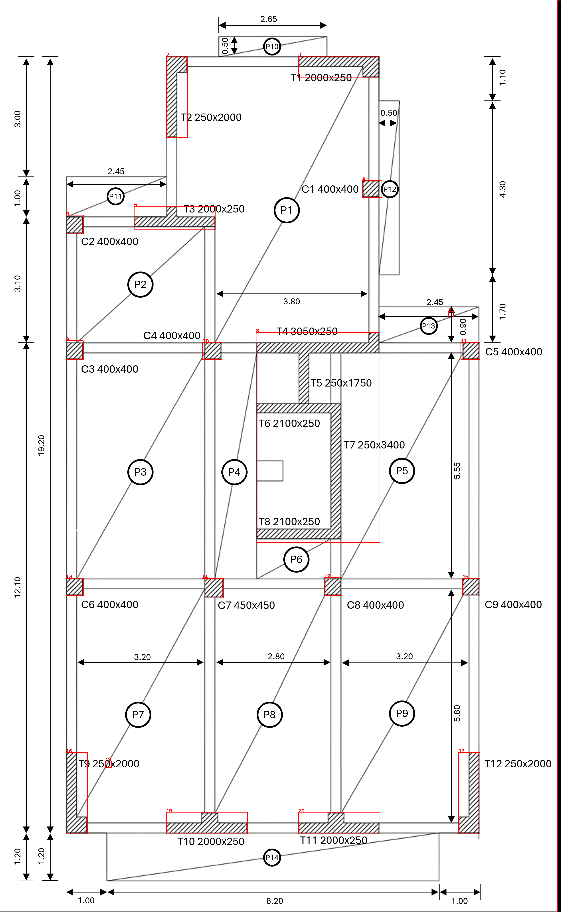

[Measured column grid](HW3/outputs/Plan3/task1/Column_Grid.json) clusters only axes within 0.15 m; no individual centre is snapped.

#### Floor, balconies and exclusions

The floor is reconstructed by a deterministic union of the archived HW1 dimension-chain rectangles, not by tracing all ink. The three body rectangles and five projections P10-P14 retain their dimensions. P10 placement and short returns remain image-derived assumptions. This is a reused, documented source reading rather than a claim of fully automatic outline detection.

| Quantity | Area (m2) |
|---|---:|
| Gross outline including five balconies | 186.615000 |
| O1/O2 voids | 2.000000 |
| Separate stair/core S1 | 5.365000 |
| Ordinary flat slab | 179.250000 |
| Net horizontal area including separate S1 | 184.615000 |

See [dimension records and assumptions](HW3/outputs/Plan3/task1/Floor_Dimension_Record.json) and [floor polygons](HW3/outputs/Plan3/task1/Floor_Zones.geojson). S1 is not a zero-load void; it is kept separate from ordinary slab allocation.

L1 midpoint-distance allocation to the new measured column centres and finite main-wall axes produces 21 closed, non-overlapping regions. The 0.01 m polygon union equals 179.250000 m2, with no gaps or overlaps above 1e-7 m2. The largest element-area change from a 0.02 m grid is 0.0602 m2.

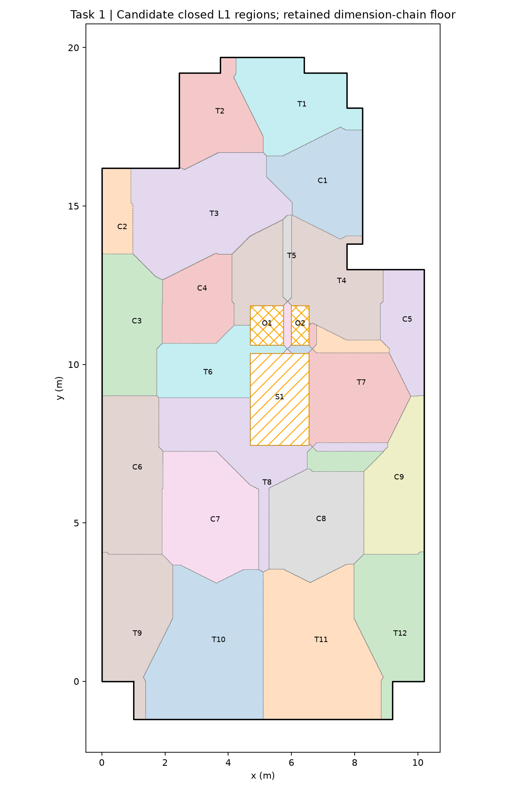

[Closed region GeoJSON](HW3/outputs/Plan3/task1/Closed_Tributary_Regions.geojson) and [area table with differences from HW1](HW3/outputs/Plan3/task1/Candidate_Tributary_Areas.csv) are saved. The new geometry omits historic approximate returns, so its per-element diagnostic areas need not equal the accepted HW1 areas. [Inherited HW1 loads](HW3/outputs/Plan3/task1/Inherited_HW1_Loads.csv) remain unchanged. The JSON check sum_axial_kN is explicitly the five-storey ordinary-slab G+Q contribution only; stair and element self-weight are separate in the inherited table.

### B. Labels, scale and element record

Local RapidOCR reads the original and long-line-removed images separately: 52 and 61 text detections. The raw strings, boxes, confidence and source hashes are preserved. Parsing was revised after concatenated IDs and dimensions generated implausible splits; the final result contains 21 label/size hypotheses. Directional openings split the merged core into bars. Unique assignment and nominal thickness classes prevent a 250 mm label from claiming a 400 mm bar.

[Dual OCR evidence](HW3/outputs/Plan3/stage02/Dual_OCR.json) and [bar associations](HW3/outputs/Plan3/stage03/Bar_Label_Matches.json) retain the actual outputs.

#### Scale rejection and revision

Thin-line sampling measured 6 px, so the L09 two-stroke growth route uses g=12 px. Its label-median scales (159.5 and 159.0 px/m) fail the 2% overall dimension-chain check and are retained as rejected. A separate effective bar-growth fit gives label-median scales x=163.194599 and y=162.568259 px/m. Although these pass the scale check, they produce five small footprint/floor inconsistencies.

The final coordinate transform is therefore anchored globally to the printed 1.00+8.20+1.00 m width and 19.20 m height: x=164.411765, y=164.114583 px/m. All centres use this same affine transform; no per-element snapping, clipping or VLM coordinate is used. All 21 labelled rectangles are inside the retained outline at the 1e-6 m2 footprint-area tolerance.

[Local calibration](HW3/outputs/Plan3/stage05/Metric_Calibration.json), [final global anchor](HW3/outputs/Plan3/task1/Global_Dimension_Anchor.json), [before/after footprint audit](HW3/outputs/Plan3/task1/Calibration_Revision_Audit.json) and [final geometry audit](HW3/outputs/Plan3/task1/Element_Geometry_Audit.json) record the revisions. Every main bar has at least 85% axial support in the original diagonal-hatch image (100% here). This does not prove the dimensions or eliminate source-reading uncertainty.

The origin is the bottom-left exterior datum of the main structural footprint; x points right and y up. The bottom balcony reaches y=-1.2 m. Coordinates are image-derived, not CAD.

#### Final Task 1 element schedule

| Label | Class | Centre x (m) | Centre y (m) | Printed size (mm) |
|---|---|---:|---:|---|
| C1 | column | 7.5420 | 15.9248 | 400x400 |
| C2 | column | 0.2129 | 15.0444 | 400x400 |
| C3 | column | 0.2129 | 11.9398 | 400x400 |
| C4 | column | 3.6068 | 11.9215 | 400x400 |
| C5 | column | 9.9658 | 11.9215 | 400x400 |
| C6 | column | 0.2129 | 6.0964 | 400x400 |
| C7 | column | 3.6190 | 6.0659 | 450x450 |
| C8 | column | 6.5810 | 6.1024 | 400x400 |
| C9 | column | 9.9841 | 6.0933 | 400x400 |
| T1 | wall | 6.7301 | 19.0629 | 2000x250 |
| T10 | wall | 3.4730 | 0.1432 | 2000x250 |
| T11 | wall | 6.7331 | 0.1432 | 2000x250 |
| T12 | wall | 10.0601 | 1.0054 | 250x2000 |
| T2 | wall | 2.6093 | 18.1946 | 250x2000 |
| T3 | wall | 2.6853 | 15.1083 | 2000x250 |
| T4 | wall | 6.2100 | 11.9947 | 3050x250 |
| T5 | wall | 5.8664 | 11.2543 | 250x1750 |
| T6 | wall | 5.7417 | 10.5018 | 2100x250 |
| T7 | wall | 6.6571 | 8.9328 | 250x3400 |
| T8 | wall | 5.7417 | 7.4034 | 2100x250 |
| T9 | wall | 0.1460 | 1.0054 | 250x2000 |

[Original classical JSON](HW3/outputs/Plan3/task1/Elements_Classical.json) follows the required source/scale/elements/floor/checks structure. [Reader-A copy](HW3/outputs/Plan3/task1/Elements_After_Reader_A.json) adds field-specific provenance while preserving original geometry and all flag evidence. Unknown wall continuity is kept null where it was not queried.

### C. Retained forest - never selected

The actual run trains 60 trees on 120000 weak-labelled pixels with 15 features and seed 5203, at half image resolution. Labels come from the classical mask. The model, probability image and thresholded mask are retained; none is promoted. This is a training-plan experiment, not a generalisation score.

| Feature | Importance |
|---|---:|
| blur_8 | 0.214736 |
| blur_4 | 0.159159 |
| ink_density_9 | 0.155277 |
| ink_density_17 | 0.100935 |
| directional_17_1 | 0.081785 |
| directional_1_9 | 0.063869 |
| blur_2 | 0.057987 |
| directional_1_17 | 0.049527 |
| grey | 0.030546 |
| edge_strength | 0.030482 |
| ink_density_5 | 0.022220 |
| blur_1 | 0.016880 |
| diagonal_45_17 | 0.011135 |
| diagonal_45_9 | 0.003170 |
| diagonal_45_5 | 0.002291 |

Blur and ink density dominate this actual run; diagonal features do not dominate. The difference from the lecture is reported, not tuned away. See [forest report](HW3/outputs/Plan3/stage04_forest/Forest_Report.json), [retained model](HW3/outputs/Plan3/stage04_forest/Forest_Never_Selected.joblib) and [probability image](HW3/outputs/Plan3/stage04_forest/Forest_Probability.png).

### D. Crop-only VLM review and preserved originals

A second classical reference pass uses threshold180 on unmarked source crops, fresh local OCR without line removal, and interior raw-ink axial occupancy for continuity. It resolves five reference questions before the recorded Task 1 answer file. It shares the OCR engine and query locations with the main pipeline, so it is an alternative defensible reading, not statistically independent ground truth or student hand signoff. Its raw readings and decisions are retained in [Reference.json](HW3/outputs/Plan3/independent_reference/Reference.json).

[Frozen input package](HW3/outputs/Plan3/reader_package_v1/Questions.md) contains five crops, questions in fixed order, common instructions, hashes and a confidence threshold of 0.80. Only queried fields are scored and applied. The reference is excluded from the answer-free reader ZIP.

The GPT-6 Codex session actually inspected the five frozen crops using native image viewing and supplied [structured answers](HW3/outputs/Plan3/reader_A_task1/Raw_Answers.json). Five answers passed the threshold and agreed with the alternative reference. The application rule writes a copy, changes no centre, and records corrected-by provenance. See [application log](HW3/outputs/Plan3/reader_A_task1/Application_Log.json).

**Exposure limit:** this engineering session had previously seen the draft crops and OCR/historical audit. This is a real Task 1 reading, not a blinded Task 2 comparison. [Run metadata](HW3/outputs/Plan3/reader_A_task1/Run_Metadata.json) discloses this. For formal Task 2, collect both readers in isolated sessions with the identical answer-free input package. DP has not been run or promoted. No student review or external API request is fabricated.

### Verification and iteration evidence

Task 1 verification: 71/71 checks passed; final listed geometry warnings: 0. These check artifact integrity, declared assumptions, closure and preservation; they do not establish an unknown-plan result or a Task 2 winner.

See [verification details](HW3/records/Task1_Verification.json), [iteration log](HW3/records/Iteration_Log.md), [readable Git history](HW3/records/Git_History.md), [project guidance](AGENTS.md), [reusable procedures](skills.md) and the tracked pre-commit hook. Historic steps are retained.

### Reproduction

Run from the repository root with HW3/requirements.txt installed:

```text
python HW3/scripts/stage01_classical.py
python HW3/scripts/stage02_ocr.py
python HW3/scripts/stage03_bars.py
python HW3/scripts/stage04_forest.py
python HW3/scripts/prepare_review_flags.py
python HW3/scripts/stage05_metric_geometry.py
python HW3/scripts/check_metric_reference.py
python HW3/scripts/stage06_independent_reference.py
python HW3/scripts/stage07_floor_and_record.py
python HW3/scripts/apply_task1_reader.py
python HW3/scripts/verify_task1.py
python HW3/scripts/write_task1_report.py
```

Raw VLM answers are retained observations. The reproduction scripts validate and reapply those answers; they do not silently call or simulate a fresh model inference.

## 2. Final isolated two-reader comparison on Plan 3

Source stage: [Report.md](HW3/outputs/Plan3/reader_A_isolated_final/Report.md). Historical status statements describe that stage; the current status/audit at the start of this report controls.

Native model run: 2026-11-11. Evidence recovered and ingested: 2026-11-12. The reader completed all five flags before the pause. No model response was invented or relabelled as a new run.

| Reader | Resolved | Incorrect | Unscorable |
|---|---:|---:|---:|
| gpt-6.1-sol, runtime-evidenced isolated native run | 5 | 0 | 0 |
| Grok 4.5, student-reported web replies | 5 | 0 | 0 |

Tie on all five reference questions; no superiority-based winner. Both applied mechanical geometries match the retained numerical baseline.

Each reader was applied independently to a copy of the classical JSON. No coordinate moved. Labels/sizes/continuity match the exact mechanical signature already used for hand/OpenSees/modification calculations, so this corroboration introduces zero conditional CR shift. This is not full-plan ground truth.

The old contextual GPT-6 reading is retained as earlier process evidence. The new reader received only frozen crops/questions/common instructions and a no-tools control, one image per turn, with no history fork or reader tool calls. Runtime logs confirm gpt-6.1-sol; the raw version-unknown preface is retained. All delivered image pixels match the frozen crops.

The web/native interfaces and system environments still differ. Grok identity remains student-reported and no full website transcript is fabricated. The identical-harness requirement is therefore a disclosed deviation, not a box marked fully satisfied.

[Raw model JSON](HW3/outputs/Plan3/reader_A_isolated_final/Raw_Answers.json), [actual input/output transcript](HW3/outputs/Plan3/reader_A_isolated_final/Raw_Transcript.json), [runtime evidence](HW3/outputs/Plan3/reader_A_isolated_final/Runtime_Metadata.json), [comparison and applied-copy audit](HW3/outputs/Plan3/reader_A_isolated_final/Comparison_and_Application.json).

## 3. Hand mass, stiffness and centre of rigidity

Source stage: [HW3_Task_03_Analytical_Report.md](HW3/HW3_Task_03_Analytical_Report.md). Historical status statements describe that stage; the current status/audit at the start of this report controls.

Status: provisional common-geometry baseline; formal Task 2 promotion remains pending. This is an agent-generated analytical calculation, not claimed as handwritten student work.

### Assumptions and mass

The floor reuses the retained HW1 dimension-chain rectangles including balconies. O1/O2 are voids. S1 is deducted from ordinary slab and added separately as an equivalent-horizontal mass zone, with the inherited 8.75 kN/m2 service intensity. No vertical-member self-weight is added to this prescribed uniform floor mass. Full G+Q mass is an exercise convention, not a code seismic combination.

Net equivalent mass area = 184.615000 m2. CM = (4.963771, 8.326083) m. One-storey mass = 164.666794 t; five-storey sum = 823.333970 t. The assignment's factor n=5 produces a total, not a per-storey mass. Polar mass moment about CM = 6416.764916 t m2.

See [signed rectangle calculation](HW3/outputs/Plan3/task3/Mass_Rectangles.csv). Positive body/balcony rectangles, negative void rectangles and a separately added S1 make the accounting explicit.

### Wall stiffness and matrix derivation

E=30e6 kN/m2, nu=0.2, G=12.5e6 kN/m2, H=3 m, Av=(5/6)Lt. Walls are cantilevers: k_b=3EI/H^3 and k_bs=1/[H^3/(3EI)+H/(GAv)]. Strong I=tL^3/12; weak I=Lt^3/12. The matched rectangular-wall baseline retains both bending directions, excludes intrinsic vertical wall torsion, columns, approximate short returns and cracking. The brief's strong-direction-only construction is reported separately as a sensitivity case.

About CM, q=(u,v,phi), a_x=(1,0,-dy), a_y=(0,1,dx). Assemble K=sum[kx outer(a_x,a_x)+ky outer(a_y,a_y)]. Thus Kxphi=-sum(kx*dy), Kyphi=sum(ky*dx). For orthogonal walls, xr=xm+Kyphi/Kyy and yr=ym-Kxphi/Kxx. From F=inv(K), xr=xm-Fphiy/Fphiphi and yr=ym+Fphix/Fphiphi. The two routes must agree.

The brief's stiffness ratio Kphix/Kphiphi has units 1/m, so it cannot be added to a coordinate. The flexibility ratios above have units m. K uses mixed translational/rotational units: its 2x2 translational block is kN/m, translation-rotation entries kN and the rotational entry kN m. Angles are radians.

[Per-wall stiffness table](HW3/outputs/Plan3/task3/Wall_Stiffnesses.csv) includes bending-only and shear-inclusive values and the shear fraction of strong-axis flexibility.

| Assumption | CR x (m) | CR y (m) | Eccentricity (m) |
|---|---:|---:|---:|
| matched_rectangular_shear | 5.563280 | 9.694116 | 1.493628 |
| matched_rectangular_bending_only | 5.756626 | 9.893719 | 1.756731 |
| brief_strong_direction_only_shear | 5.566963 | 9.714323 | 1.513623 |
| brief_strong_direction_only_bending | 5.761623 | 9.909434 | 1.773012 |

#### Matched baseline K about CM

```text
[[ 3.812103e+06  0.000000e+00 -5.215082e+06]
 [ 0.000000e+00  3.045466e+06  1.825785e+06]
 [-5.215082e+06  1.825785e+06  1.714294e+08]]
```

#### Matched baseline flexibility F about CM

```text
[[ 2.737900100832e-07 -5.025404745675e-09  8.382531457602e-09]
 [-5.025404745675e-09  3.305592905931e-07 -3.673452953916e-09]
 [ 8.382531457602e-09 -3.673452953916e-09  6.127433809332e-09]]
```

### Demonstration force shares

A separately declared demonstration force Fy=100.0 kN acts at CM. It is an assumed linear-analysis test, not a code design demand. Torque about CR is (xm-xr)*Fy=-59.950920 kN m. In general Tz=(xm-xr)*Fy-(ym-yr)*Fx; e*F is a maximum lever-arm envelope, not the torque for every force direction.

At CR, direct y force share is ky/sum(ky), torsional y coefficient is ky*dx/J, and torsional x coefficient is -kx*dy/J. [Force-share table](HW3/outputs/Plan3/task3/Wall_Force_Shares.csv) records direct and torsional components separately. Unit-torque coefficients have units 1/m, not dimensionless percentages.

### Reproduction and verification

Run python HW3/scripts/task03_centres.py, then python HW3/scripts/verify_task03.py. The independent checker uses polygon boundary integrals, direct weighted CR and separately assembled equilibrium equations. OpenSees matching is a later stage, not asserted by this analytical report.

The [pre-solve briefing](HW3/records/Task_03_PreSolve_Briefing.md) and params_mechanics.json were committed before this calculation. Input hashes and all intermediate matrices are retained in [Analytical_Result.json](HW3/outputs/Plan3/task3/Analytical_Result.json).

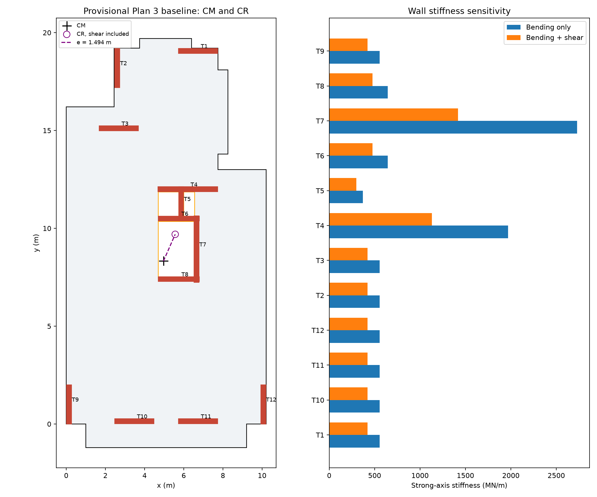

## 4. Actual main-plan OpenSees and load decomposition

Source stage: [HW3_Task_04_05_OpenSees_Report.md](HW3/HW3_Task_04_05_OpenSees_Report.md). Historical status statements describe that stage; the current status/audit at the start of this report controls.

Status: verified numerical model of the provisional common-geometry baseline. Task 2 experiment-control and identity limits remain documented.

### Model and conventions

OpenSeesPy engine 3.8.0; 3D, six DOF per node, one 3 m vertical ElasticTimoshenkoBeam per wall, 12 main-wall rectangles, fixed bases. E=30e6 kN/m2, nu=0.2, G=12.5e6 kN/m2, shear area=(5/6)Lt in each principal direction. Local y follows the wall length; Iz=tL^3/12 is strong and Iy=Lt^3/12 weak. Both are retained. Intrinsic vertical wall torsion J=0 is excluded consistently with the analytical model. Short returns, columns, cracking and slab flexibility are excluded.

The CM master has fixity (0,0,1,1,1,0). Wall-top z is fixed, bending rotations remain free. ops.rigidDiaphragm(3, master, *tops) and Transformation constraints explicitly enforce the floor plane. This is not a very-stiff-slab substitute or fixed-fixed wall model.

The command usage follows the official [ElasticTimoshenkoBeam documentation](https://openseespydoc.readthedocs.io/en/latest/src/ElasticTimoshenkoBeam.html) and [rigidDiaphragm documentation](https://openseespydoc.readthedocs.io/en/latest/src/rigidDiaphragm.html). The [model briefing](HW3/records/Task_04_Model_Briefing.md) and analytical result were committed before executing OpenSees.

### Three independent unit loads

Three rebuilt models apply Px=1 kN, Py=1 kN and Mz=1 kN m at CM. Master u, v and phi are the columns of F. K=inv(F). Units are kN, m and radians; mixed matrix entries carry their corresponding translational/rotational units.

```text
F about CM:
[[ 2.737900100832e-07 -5.025404745675e-09  8.382531457602e-09]
 [-5.025404745675e-09  3.305592905931e-07 -3.673452953916e-09]
 [ 8.382531457602e-09 -3.673452953916e-09  6.127433809332e-09]]

K about CM:
[[ 3.812103e+06  3.801578e-11 -5.215082e+06]
 [ 5.354295e-10  3.045466e+06  1.825785e+06]
 [-5.215082e+06  1.825785e+06  1.714294e+08]]
```

CM=(4.963771, 8.326083) m. Flexibility-derived CR=(5.563280, 9.694116) m; e=1.493628 m. Maximum analytical/OpenSees CR difference is 0.000e+00 m; relative flexibility error is 1.602e-16.

[Raw solver responses](HW3/outputs/Plan3/task4/OpenSees_Result.json) retain unit loads, master and wall-top displacements, base reactions and element end forces. The no-shear sensitivity is an actual rebuilt elasticBeamColumn model; isolated strong/weak cantilever tests also check local-axis orientation and shear compliance.

### Assumed 100 kN y demonstration

The test force is explicitly assumed for linear verification; it is not a specified code design earthquake load. The same wall geometry and shear assumptions apply to every CR reported above.

Master response: u=-0.000503 mm, v=0.033056 mm, phi=-3.67345295e-07 rad. Positive demand values below are minus the corresponding base reaction. The raw six-component base reactions are retained in [the reaction table](HW3/outputs/Plan3/task4/Demonstration_Wall_Reactions.csv).

| Wall | Push y (kN) | Turn y (kN) | Total y (kN) | Total x (kN) |
|---|---:|---:|---:|---:|
| T1 | 0.283614 | -0.003702 | 0.279912 | 1.448476 |
| T10 | 0.283614 | 0.006632 | 0.290246 | -1.476636 |
| T11 | 0.283614 | -0.003712 | 0.279902 | -1.476636 |
| T12 | 13.819740 | -0.695239 | 13.124501 | -0.027568 |
| T2 | 13.819740 | 0.456704 | 14.276444 | 0.026971 |
| T3 | 0.283614 | 0.009131 | 0.292746 | 0.837076 |
| T4 | 0.432511 | -0.003129 | 0.429382 | 0.954657 |
| T5 | 9.815866 | -0.033283 | 9.782582 | 0.004332 |
| T6 | 0.297795 | -0.000594 | 0.297200 | 0.141053 |
| T7 | 46.562357 | -0.569765 | 45.992592 | -0.004107 |
| T8 | 0.297795 | -0.000594 | 0.297200 | -0.400050 |
| T9 | 13.819740 | 0.837551 | 14.657291 | -0.027568 |

Total y resistance equals 100 kN. Total x resistance is zero, with positive and negative cross-direction forces balancing. In an asymmetric layout individual walls need not form equal pairs; the full signed group must balance. Base force/moment sums and each top node's rigid-plane displacement relation are independently checked.

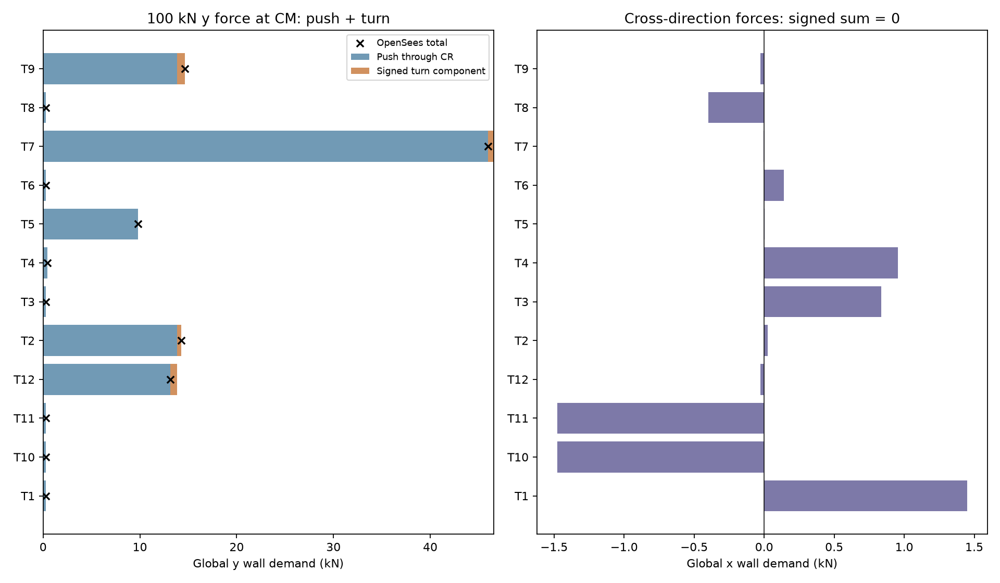

### Task 5 - push through CR, and push plus turn

A force at a plan offset is applied at the CM master with its equivalent signed moment. Unit Px through CR has moment -(yr-ym); unit Py through CR has moment +(xr-xm). Their rotations are:

| Case | Rotation (rad) |
|---|---:|
| unit_x_through_CR | 1.801349e-24 |
| unit_y_through_CR | 7.192448e-25 |

The direct 100 kN force at CM decomposes into a push through CR plus signed torque T=(xm-xr)*Fy=-59.950920 kN m. Rebuilt push and torque runs superpose to the direct run in all master responses and all wall forces. General torque is ex*Fy-ey*Fx; total eccentricity times force applies only for a perpendicular force direction.

### Verification and reproduction

75/75 checks passed. See [verification record](HW3/records/Task4_5_Verification.json) for flexibility symmetry, positive stiffness, hand/model agreement, single-wall limits, actual bending-only limit, reaction closure, rigid-plane kinematics, zero rotation through CR and load decomposition.

```text
python HW3/scripts/task04_opensees.py
python HW3/scripts/verify_task04.py
python HW3/scripts/write_task04_report.py
```

This validates the declared numerical idealisation; it does not certify the image-derived source geometry or complete the remaining HW3 tasks.

## 5. Fixed-mass modification and why alignment matters

Source stage: [HW3_Task_06_07_Modification_Report.md](HW3/HW3_Task_06_07_Modification_Report.md). Historical status statements describe that stage; the current status/audit at the start of this report controls.

Status: verified modification of the declared provisional common-geometry model. Task 2's formal experiment-control limitations and Task 8 remain open. This is a mathematical design proposal, not a construction design or student-signed hand prediction.

### 1. Frozen design intent and constraints

The [pre-solve design briefing](HW3/records/Task_06_PreSolve_Design_Briefing.md) and [modification parameters](HW3/params_modification.json) were committed before optimisation. Only T9 and T10 thicknesses may increase (0.25 to 1.00 m). Main lengths, directions, columns, voids, S1 and the mass layout remain fixed. T9 grows inward from its exterior left face; T10 grows upward from its exterior bottom face. Their axes therefore move by half the thickness increase, a declared geometric rule rather than a reader edit.

These locations were chosen because CR initially lies right and above CM. Increasing y stiffness at the left-side T9 and x stiffness at the bottom-side T10 should pull CR left/down. Both strong and weak rectangular-wall stiffnesses and shear flexibility are recalculated at every step. No columns or architectural grid lines are relocated, and no new wall is inserted through the core openings.

### 2. Modification and cost

| Wall | Original thickness (mm) | Ideal thickness (mm) | 5 mm rounded (mm) | Centre shift dx,dy (m) | Added concrete per storey (m3) |
|---|---:|---:|---:|---|---:|
| T9 | 250.0 | 463.564916 | 465.0 | (0.106782, 0.000000) | 1.281389 |
| T10 | 250.0 | 618.147922 | 620.0 | (0.000000, 0.184074) | 2.208888 |

The ideal proposal adds 3.490277 m3 concrete and 87.256926 kN dead weight per storey (25 kN/m3). That is approximately 8.894692 t, or 5.40% of the prescribed equivalent floor mass. This increase is quantified separately and is **not** added to the fixed mass in the exercise. A real design must revisit the additional mass, gravity/foundation loads, connections, reinforcement and architectural clearances.

All proposed main rectangles remain inside the retained floor and avoid O1/O2, S1 and existing columns; no new main-wall overlap is introduced. See the saved geometry audits in [Modification_Result.json](HW3/outputs/Plan3/task6/Modification_Result.json). These checks address the available image-derived geometry, not unprovided architectural/reinforcement details.

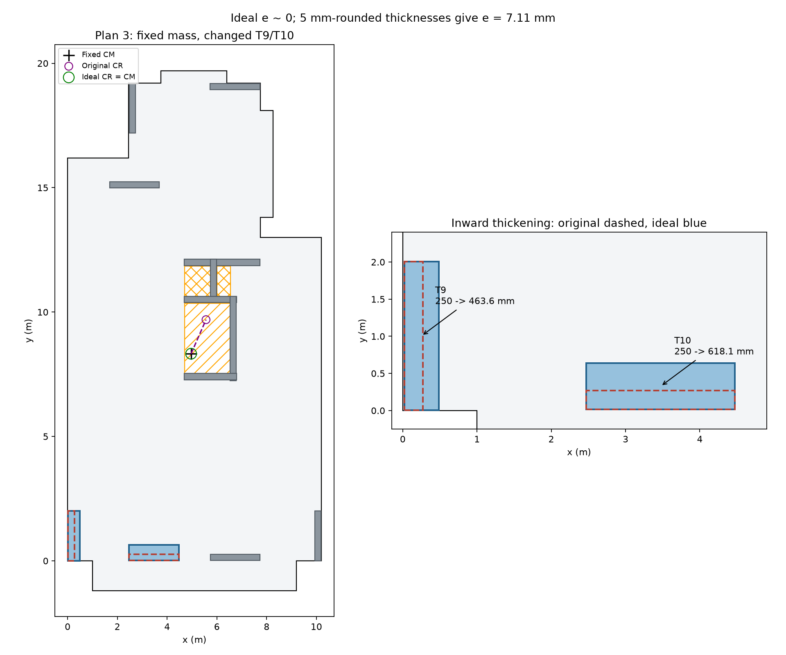

### 3. CM/CR before and after

The unchanged CM is (4.963771, 8.326083) m; one-storey mass is 164.666794 t. All models use E=30e6 kN/m2, nu=0.2, H=3 m, both principal bending axes and shear, 12 main-wall Timoshenko cantilevers, zero intrinsic vertical wall torsion, fixed bases and an explicit Transformation rigid diaphragm. No lateral columns or cracking are introduced.

| Layout | Hand CR x,y (m) | OpenSees CR x,y (m) | Eccentricity (m) | Rotation under 100 kN x (rad) | Rotation under 100 kN y (rad) |
|---|---|---|---:|---:|---:|
| before | (5.563280, 9.694116) | (5.563280, 9.694116) | 1.4936283 | 8.382531e-07 | -3.673453e-07 |
| ideal_aligned | (4.963771, 8.326083) | (4.963771, 8.326083) | 3.55271368e-15 | 1.275919e-21 | 8.060658e-24 |
| rounded_5mm | (4.960227, 8.319914) | (4.960227, 8.319914) | 0.00711348134 | -2.799220e-09 | 1.607852e-09 |

The ideal target e<=1e-6 m is met. The 5 mm-rounded proposal leaves e=7.113 mm rather than claiming exact coincidence after rounding. Numerical alignment does not imply millimetre accuracy of the source image. [Optimisation_Trajectory.json](HW3/outputs/Plan3/task6/Optimisation_Trajectory.json) preserves all actual residual evaluations and termination status.

### 4. Why the forces change

The load tests are separately assumed 100 kN forces in x and y at CM, not code earthquake design demands. The signed torque about CR is T=(xm-xr)Fy-(ym-yr)Fx. The maximum magnitude envelope is e*F only when the force is perpendicular to the eccentricity vector.

For a y force: f_i,dir=(ky_i/Kyy)F, f_i,turn=ky_i*(x_i-xr)*T/J, and factor=1+(xm-xr)*(x_i-xr)/r_ty^2 with r_ty^2=J/Kyy. For an x force the factor is 1+(ym-yr)*(y_i-yr)/r_tx^2 with r_tx^2=J/Kxx. Here J is floor torsional stiffness about CR, not an individual wall's section torsion constant. The brief's radius-only denominator is dimensionally inconsistent; a squared radius is required. The wall stiffness factor cannot be omitted from the force term.

| Force | Most amplified original wall(s) | Original factor | Increase over direct share |
|---|---|---:|---:|
| x | T10, T11 | 1.305200 | 30.520% |
| y | T9 | 1.060605 | 6.061% |

This identifies the plan-specific penalty: the low-y walls T10/T11 are amplified for the x push; low-x T9 is amplified for the y push. A negative torsional increment can instead relieve another wall. After ideal alignment all aligned-force factors equal 1 and the cross-direction turn vanishes.

#### Peak aligned wall force

| Assumed force | Peak before (wall, kN) | Peak ideal after (wall, kN) | Change |
|---|---|---|---:|
| x, 100 kN | T4, 27.454585 | T4, 25.228452 | -8.108% |
| y, 100 kN | T7, 45.992592 | T7, 40.243008 | -12.501% |

The reduction in the peaks combines torsion removal **and** stiffness redistribution. It must not all be attributed to removing e. The thickened walls attract more direct load; not every wall demand decreases. [Force_Amplification_Comparison.csv](HW3/outputs/Plan3/task6/Force_Amplification_Comparison.csv) reports each wall's direct share, torsional increment, final force, squared torsional radius and analytical/observed factors for both directions and all three layouts.

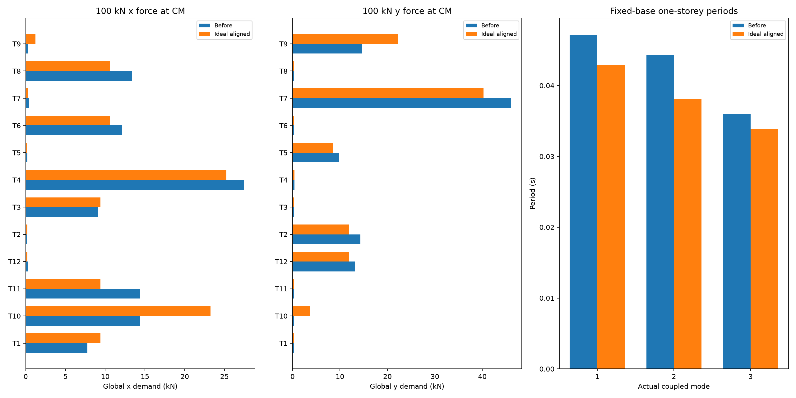

### 5. Modes and period ratios

The mass matrix is diag(M,M,I_CM), identical in all layouts. The analytical generalized eigenproblem and actual OpenSees eigenanalysis with mass at the diaphragm master are both retained. The official [eigen command documentation](https://openseespydoc.readthedocs.io/en/latest/src/eigen.html) explains the fullGenLapack option used to obtain all three inertial modes. These are one-storey fixed-base subsystem periods, not five-storey building periods.

| Layout | Coupled periods T1,T2,T3 (s) | Torsion-dominant mode | Rotational mass fraction of that mode | Characteristic Ttheta/Tx | Characteristic Ttheta/Ty |
|---|---|---:|---:|---:|---:|
| before | 0.047167, 0.044287, 0.035985 | 3 | 0.666618 | 0.954062 | 0.852749 |
| ideal_aligned | 0.042952, 0.038103, 0.033926 | 3 | 1.000000 | 0.890374 | 0.789853 |
| rounded_5mm | 0.042930, 0.038088, 0.033906 | 3 | 0.999985 | 0.890205 | 0.789781 |

The actual torsion-dominant mode is mode 3 before and after this proposal; it was not the first mode on this plan. Its original rotational mass fraction is approximately 0.667 and becomes 1 after ideal alignment: the floor's translational and rotational motions decouple. Aligning centres does not guarantee a particular mode ordering. Characteristic ratios use Ttheta=2*pi*sqrt(I_CM/J), Tx=2*pi*sqrt(M/Kxx), Ty=2*pi*sqrt(M/Kyy); for the eccentric floor they are labelled scales, not replacements for the actual coupled modes.

### 6. Scope, cost and the vision link

CM=CR removes the eccentric torque for a pure horizontal force on this uniform rigid floor. It does not remove torsional resistance or the torsional natural mode. It does not make a building immune to accidental eccentricity, cracking, mass/stiffness changes over height, nonuniform or rotational ground motion, or different storey layouts. A wall-position or size error in extraction would change K and CR and therefore change this numerical design target. This design is conditional on the retained image-derived rectangles and modelling assumptions; final reader-promotion and independent-plan evidence are still separate requirements.

Added concrete and its 87.257 kN per-storey weight are the principal quantified cost here. The fixed-mass instruction is a controlled exercise assumption. A practical redesign that includes this new mass must recalculate CM and repeat the alignment, rather than claiming the fixed-mass optimum is automatically a final building design.

### 7. Verification and reproduction

133/133 independent checks passed. See [Task6_7_Verification.json](HW3/records/Task6_7_Verification.json). Checks cover preserved baseline, mass, lengths, growth faces, geometry/clashes, independently assembled K, hand/model F and CR, static equilibrium, signed amplification, modal eigenvalues/shapes and ideal zero rotation. All baseline outputs remain intact.

```text
python HW3/scripts/task06_modify.py
python HW3/scripts/verify_task06.py
python HW3/scripts/write_task06_report.py
```

The code is parameterised by saved inputs; the T9/T10 growth choice is a disclosed Plan 3 design decision, not a general automatically selected wall strategy. [Iteration log](HW3/records/Iteration_Log.md) and [readable Git history](HW3/records/Git_History.md) retain the chronology.

## 6. Additional plans and the conditional three-plan comparison

Source stage: [HW3_Task_08_Conditional_Engineering_Report.md](HW3/HW3_Task_08_Conditional_Engineering_Report.md). Historical status statements describe that stage; the current status/audit at the start of this report controls.

**Status:** the two additional plans now have complete conditional support schedules, closed tributary polygons, known gravity schedules, hand CM/K/CR and actual matched OpenSees runs. These are explicitly assumption-dependent engineering baselines. The original unchanged image pipeline failed and is not retroactively promoted. Source ambiguities and cross-harness/reference timing limits remain. This is not a claim that all HW3 rubric requirements are satisfied.

### Workflow and provenance

The prospective [geometry brief](HW3/records/Task_08_Geometry_Recovery_Brief_R1.md) and [parameter file](HW3/params_geometry_recovery_r1.json) were committed as `445eef6`. The new deterministic solid-symbol route is separate from the frozen hatching pipeline. It preserves all components, labelled bar assignments, measured grids, global-fit residuals, piecewise calibration and source overlays. A rejected label-centre guard is retained in [the attempt record](HW3/records/Task_08_Geometry_Assignment_Attempt.md); the masks and eight actual nearest-bar claims were unchanged.

Commit `0d7c45b` retained geometry before area calculations. Commit `f368008` retained the initial closed-region and hand results before numerical refinement. Commit `d66f7a1` froze refined regions, independent hand checks and conditional gates **before** the OpenSees runs. Original V4 inputs, failed classical masks, forests and earlier R2/R3 reader scores remain preserved.

The [two-reader R3 comparison](HW3/outputs/Task08/reader_comparison_r3/Comparison.md) is a tie on ten supplemented questions. Codex gpt-6.1-sol is runtime-evidenced; Grok 4.5 is student-reported. R2 source measurements and the human T3 review were post-response revisions, not blind pre-response truth. No accuracy winner or fully promoted unchanged-pipeline extraction is invented.

### Coordinate and source interpretations

- **NewPlan:** origin A4 column-grid centre; x right and y up. Dimensioned axes x=0/6/12/20/26/34/40/46 m, y=0/6/12/18 m. Printed sizes: C1:C30=800x800 mm; T1/T2/T3/T5/T6/T7=3500x400 mm; T4/T8=2000x300 mm. The main assumed outer-column-face slab bounds are [-0.4,46.4] x [-0.4,18.4] m. The grid-axis 828 m2 rectangle is a separate sensitivity.
- **NewPlan source ambiguity:** 26 standalone square bodies and two merged column/wall junctions are visible. C17/C20 are printed labels without clear filled square bodies, retained as grid-inferred supports; their omission sensitivity is exported. This is not a successful detection of two missing symbols. T4/T8 nominal rectangles protrude 13.636 mm beyond the assumed lower slab edge (0.054545 m2 combined); support axes are inside, and the small face discrepancy is not clipped away.
- **NIST:** origin lower-left footprint corner. The printed 120 ft square is 36.576 x 36.576 m, with 30 ft (9.144 m) bays. The visible model has 21 column points and four walls; adjacent source text describes 25 gravity columns. The four-column discrepancy and unknown column sections remain unresolved. NC/NW identifiers are analyst bookkeeping, not printed labels.
- **NIST wall geometry:** lengths are measured from schematic bars. Thickness 250 mm is the course default, not a pixel-derived or printed section. Perimeter outside faces are assumed on the footprint border; centre axes are inset by half that thickness. Raw ink centres and uncertainty are retained. Unknown columns have no invented footprint or self-weight.
- Neither extra drawing shows an opening/stair zone; their absence is a modelling assumption. Plan 3 O1/O2/S1 are not copied to the new plans.

NIST source: Elsibaie et al. (2025), [NIST TN 2351, Figure 2](https://doi.org/10.6028/NIST.TN.2351), printed page 9. Republished courtesy of the National Institute of Standards and Technology. This is a research archetype, not an identified surveyed building.

#### NewPlan geometry and closed-area record

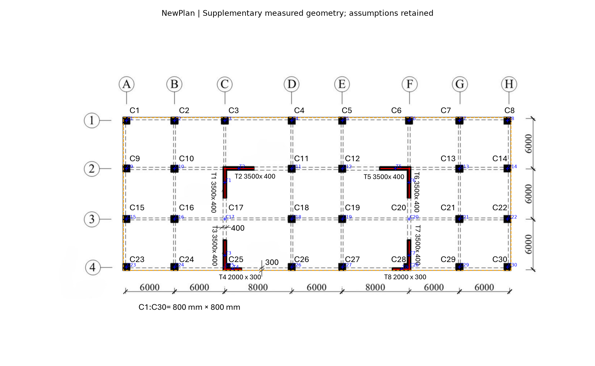

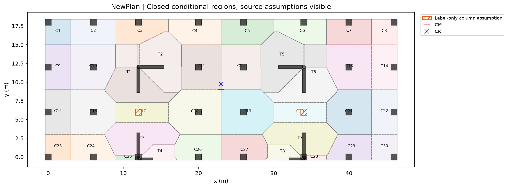

[Coordinates and section provenance](HW3/outputs/NewPlan/engineering_r1_refined/Coordinates_and_Size_Provenance.csv), [calibration](HW3/outputs/NewPlan/geometry_recovery_r1/Calibration.json), [geometry](HW3/outputs/NewPlan/geometry_recovery_r1/Elements_Conditional.json), [closed GeoJSON](HW3/outputs/NewPlan/engineering_r1_refined/Closed_Tributary_Regions.geojson), [area/load schedule](HW3/outputs/NewPlan/engineering_r1_refined/Tributary_and_Known_Loads.csv).

The declared floor area is 879.840000 m2. All 38 support IDs appear in the geometry, area and known-load records. L1 nearest finite-axis/point regions are closed, valid and non-overlapping. Known column footprints are removed from gravity wall-axis segments at joints; full labelled wall axes remain in the lateral model. Both conventions and the untrimmed-axis sensitivity are retained.

The adopted 0.025 m area grid was checked against 0.05 m; maximum relative per-support change is 0.935%. This is below the approximate 1% target.
The domain closes to numerical tolerance even though individual allocations are discretised. Source topology/size uncertainty is separate from mesh convergence.

#### NIST geometry and closed-area record

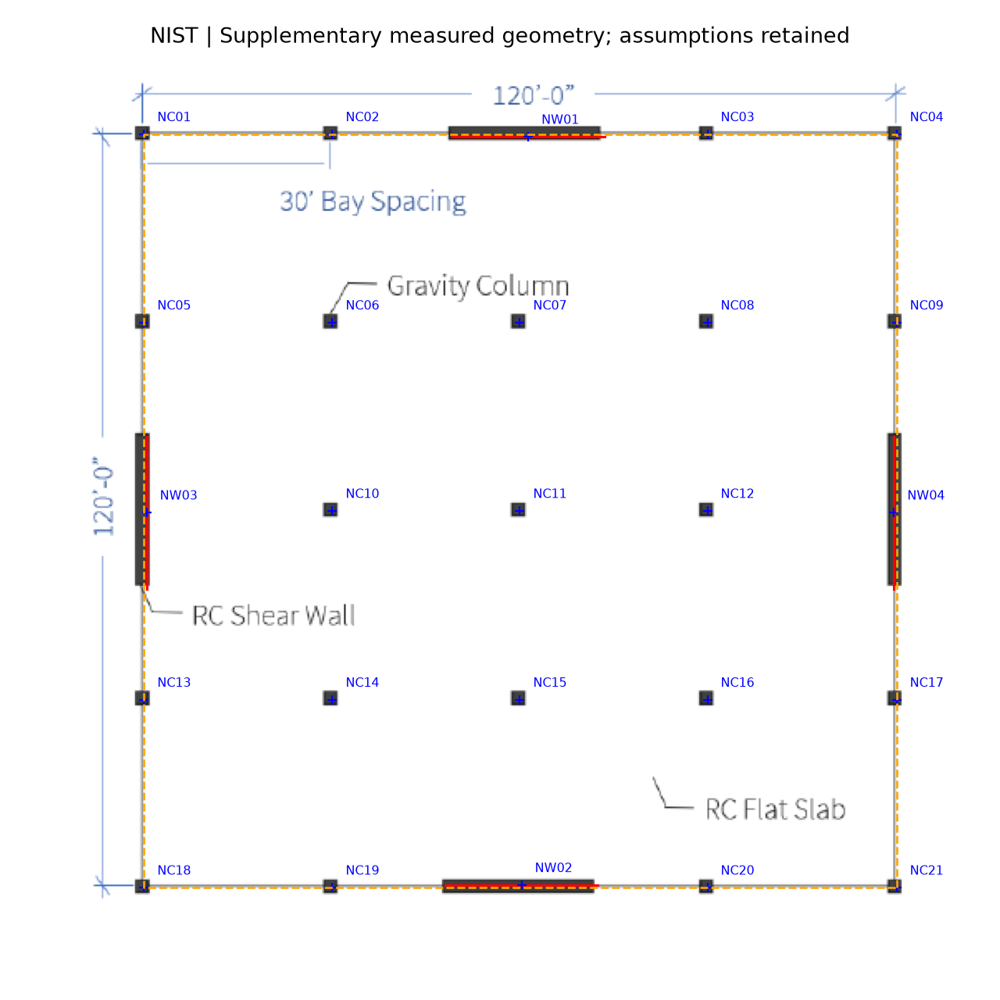

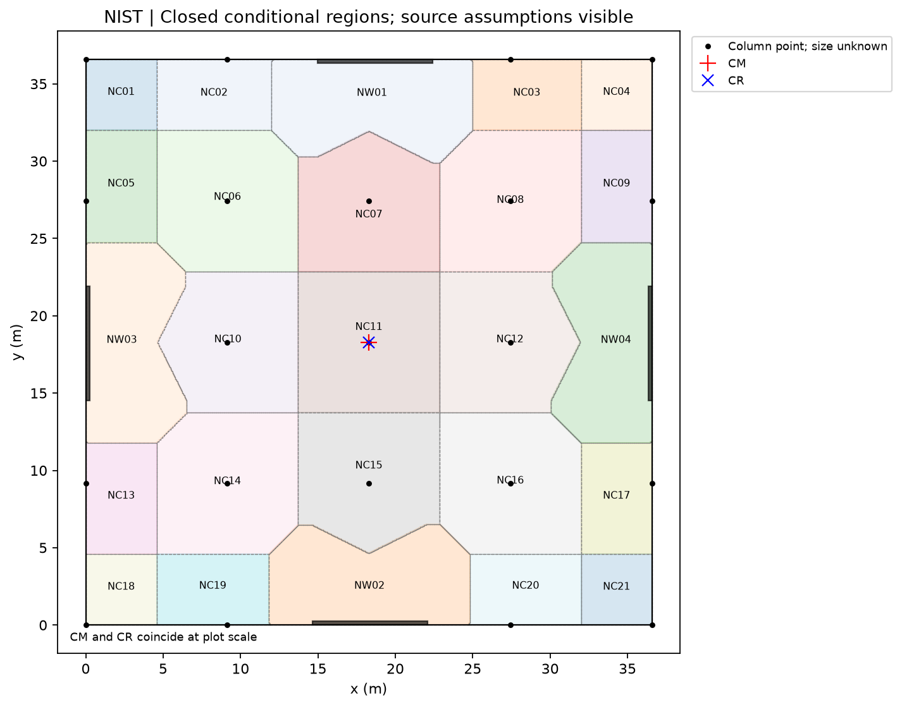

[Coordinates and section provenance](HW3/outputs/NIST/engineering_r1_refined/Coordinates_and_Size_Provenance.csv), [calibration](HW3/outputs/NIST/geometry_recovery_r1/Calibration.json), [geometry](HW3/outputs/NIST/geometry_recovery_r1/Elements_Conditional.json), [closed GeoJSON](HW3/outputs/NIST/engineering_r1_refined/Closed_Tributary_Regions.geojson), [area/load schedule](HW3/outputs/NIST/engineering_r1_refined/Tributary_and_Known_Loads.csv).

The declared floor area is 1337.803776 m2. All 25 support IDs appear in the geometry, area and known-load records. L1 nearest finite-axis/point regions are closed, valid and non-overlapping. Known column footprints are removed from gravity wall-axis segments at joints; full labelled wall axes remain in the lateral model. Both conventions and the untrimmed-axis sensitivity are retained.

The adopted 0.025 m area grid was checked against 0.05 m; maximum relative per-support change is 1.090%. This is marginally above the approximate 1% target and is explicitly retained as an exception, not reported as a strict 1% pass.
The domain closes to numerical tolerance even though individual allocations are discretised. Source topology/size uncertainty is separate from mesh convergence.

### Gravity and floor-mass convention

The transferred HW1 exercise assumptions are G_slab=0.150*25=3.75 kN/m2, Q=5.0 kN/m2, H=3 m and five-storey gravity accumulation. These are assumptions for the comparison, not loads printed on either new drawing. No unspecified beams, finishes, foundations or earthquake demand are added. ULS factors remain unconfirmed in the retained project configuration; no new complete axial design certification is made.

Known vertical self-weight uses the union of section footprints, allocated to columns before remaining labelled walls to avoid overlap double counting. This is joint bookkeeping, not an indeterminate-junction force solution. NIST column self-weights remain null; all its gravity totals below are **known-only**, not complete totals.

| Plan | Slab area (m2) | Known net vertical section (m2) | Known vertical weight / storey (kN) | G known / floor (kN) | Q / floor (kN) |
|---|---:|---:|---:|---:|---:|
| NewPlan | 879.840 | 27.809000 | 2085.675 | 5385.075 | 4399.200 |
| NIST | 1337.804 | 7.423284 | 556.746 | 5573.510 | 6689.019 |

The exported [NewPlan accumulation](HW3/outputs/NewPlan/engineering_r1_refined/Known_Axial_Accumulation.csv) and [NIST known-only accumulation](HW3/outputs/NIST/engineering_r1_refined/Known_Axial_Accumulation.csv) follow 1:2:3:4:5. The prescribed lateral floor mass is separately (8.75/g)*floor area, in tonnes. Vertical-element weights are **not** silently added to this mass, matching the retained Plan 3 exercise convention.

### Hand calculation before the matching solver

E=30e6 kN/m2, nu=0.2, G=12.5e6 kN/m2, H=3 m, Av=(5/6)Lt. For each labelled rectangular wall: I_s=tL^3/12, I_w=Lt^3/12; k_b=3EI/H^3 and k_s=1/[H^3/(3EI)+H/(GAv)]. Both in-plane rectangular bending axes are retained; columns supply no lateral stiffness and intrinsic vertical-wall J is zero. Joined L bars are not treated as a detailed monolithic shell or full-building frame.

For wall offsets dx,dy from CM, K is assembled from kx*[1,0,-dy]^T*[1,0,-dy] and ky*[0,1,dx]^T*[0,1,dx]. Kxphi=-sum(kx*dy), Kyphi=sum(ky*dx), Kphiphi=sum(kx*dy^2+ky*dx^2). Thus xr=xm+Kyphi/Kyy and yr=ym-Kxphi/Kxx. With F=inv(K), xr=xm-Fphiy/Fphiphi, yr=ym+Fphix/Fphiphi. These flexibility ratios have units m; stiffness ratios with a rotational denominator cannot be added as coordinates.

Translation block units are kN/m, translation-rotation entries kN, rotational entry kN m; angles are radians. Mass and polar mass are t and t m2.

#### NewPlan K about CM

```text
[[ 6.067853e+06  0.000000e+00 -4.453297e+06]
 [ 0.000000e+00  9.776675e+06  3.177007e+04]
 [-4.453297e+06  3.177007e+04  1.316006e+09]]
```

[Hand matrices, wall stiffnesses, mass integrals and cases](HW3/outputs/NewPlan/engineering_r1_refined/Hand_Analysis.json). CM=(23.000000,9.000000) m; CR=(23.003250,9.733916) m; e=0.733924 m.

#### NIST K about CM

```text
[[1.061015e+07 0.000000e+00 5.137103e+03]
 [0.000000e+00 1.052759e+07 1.561011e+04]
 [5.137103e+03 1.561011e+04 6.930927e+09]]
```

[Hand matrices, wall stiffnesses, mass integrals and cases](HW3/outputs/NIST/engineering_r1_refined/Hand_Analysis.json). CM=(18.288000,18.288000) m; CR=(18.289483,18.287516) m; e=0.001560 m.

### Actual OpenSees verification

OpenSees 3.8.0 was actually run using one ElasticTimoshenkoBeam cantilever per wall, explicit rigidDiaphragm(3,1,*wall_top_nodes) and Transformation constraints. Bases are fixed; tops have [0,0,1,0,0,0] fixity. Three unit loads recover F and K. Assumed 100 kN x/y demonstration forces, loads through CR, separate push/turn cases, bending-only limits and isolated section limits were run and saved. The generic fullGenLapack speed warning occurred; all requested static/eigen cases returned valid results.

The actual modal calculation has one floor master with prescribed mass and polar inertia. Its periods are **single-floor 3-DOF diagnostics**, not the periods of a full five-storey building or the original multi-storey NIST archetype. Five-storey gravity accumulation is a separate bookkeeping calculation.

Independent geometry/area/load/hand checks pass 364/364; actual solver checks pass 140/140. The largest relative hand/model flexibility error is 6.41e-16; the largest CR-coordinate difference is 1.78e-15 m. Those numerical agreements validate the matched assumptions, not the source drawing interpretation.

[Engineering validation](HW3/records/Task_08_Engineering_Validation.json), [solver validation](HW3/records/Task_08_OpenSees_Validation.json). Raw unit loads, reactions, master/slave displacements and eigenvalues are in [NewPlan results](HW3/outputs/NewPlan/engineering_r1_refined/OpenSees_Result.json) and [NIST results](HW3/outputs/NIST/engineering_r1_refined/OpenSees_Result.json). Direct/torsional wall shares are exported in each folder as Wall_Force_Push_and_Turn.csv.

### Three-plan comparison

All rows use the same 3 m, uncracked-material, strong/weak/shear rectangular-wall convention and prescribed 8.75 kN/m2 uniform mass. Origins differ: compare eccentricity and layout rather than raw coordinate magnitudes. Plan 3 mass area includes the separately treated stair-equivalent mass; its ordinary slab tributary area is 179.25 m2.

| Plan | Effective mass area (m2) | Mass / floor (t) | CM x,y (m) | CR x,y (m) | e (m) | T1 / T2 / T3 (s) |
|---|---:|---:|---|---|---:|---|
| Plan3 | 184.615 | 164.667 | 4.9638, 8.3261 | 5.5633, 9.6941 | 1.4936 | 0.04717 / 0.04429 / 0.03598 |
| NewPlan | 879.840 | 784.771 | 23.0000, 9.0000 | 23.0032, 9.7339 | 0.7339 | 0.07293 / 0.06930 / 0.05629 |
| NIST | 1337.804 | 1193.250 | 18.2880, 18.2880 | 18.2895, 18.2875 | 0.0016 | 0.06689 / 0.06663 / 0.03893 |

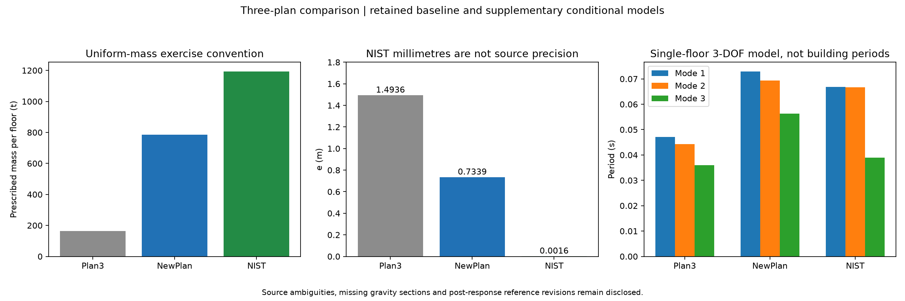

NewPlan is nearly symmetric left/right but has unequal upper/lower horizontal wall lengths; its CR lies above CM. Plan 3 retains larger eccentricity from its irregular mass/wall arrangement. The nominal NIST layout is nearly symmetric: the measured millimetre-scale e must not be treated as established physical precision. Modal ordering also differs: the torsion-dominant conditional mode is mode 2 for NewPlan and mode 3 for NIST, rather than a universal mode number.

### Sensitivities and limits that change interpretation

- NewPlan grid-axis slab area 828 m2 gives 738.532 t/floor instead of 784.771 t. CM and CR do not change under this symmetric edge change, but the actual coupled periods change to 0.07031, 0.06625, 0.05461 s.
- Omitting C17/C20 reallocates 37.450 m2. The largest other-support area increase is 7.707 m2, or 67.441 kN service slab load/floor (337.203 kN over five floors). CM/CR stay unchanged **only because** mass is prescribed independently and columns are excluded from lateral stiffness. This is not a claim that missed columns are harmless.
- Global-affine instead of piecewise calibration moves NewPlan CR by 0.0746 m. Both routes and residuals are retained; image scaling is not CAD certainty.
- The ideal symmetric NIST sensitivity gives e=3.55e-15 m. The measured e=0.001560 m is below the source endpoint precision.
- A deterministic extreme-box sensitivity moves each schematic endpoint by +/-2 pixels, allowing each wall length +/-4 pixels with fixed centres/thickness/mass. Among the 16 independent sign combinations, maximum e is 1.523 m. This is **not** a probability or confidence interval; it demonstrates why a tiny baseline e cannot be certified without real wall dimensions. It also does not assert that the source building is asymmetric.
- NIST unknown column sections and the 21-symbol/25-column discrepancy prevent complete gravity certification. Wall lengths/thickness and floor-edge conventions are explicit assumptions/measurements, not a drawing-issued design schedule.
- Rectangular-bar, no-column-lateral, uncracked, single-floor models omit monolithic L-wall coupling, cracking, full-height interaction and real earthquake demands. Matching hand and solver does not remove these limits.

[NewPlan source sensitivities](HW3/outputs/NewPlan/engineering_r1_refined/Source_Uncertainty_Cases.json), [NIST endpoint cases](HW3/outputs/NIST/engineering_r1_refined/Source_Uncertainty_Cases.json), [column-omission gravity sensitivity](HW3/outputs/NewPlan/engineering_r1_refined/Label_Only_Column_Sensitivity.csv).

### Reproduce and review

All source/reader evidence is retained. Numerical workflow, from repository root with HW3 requirements installed:

```powershell
python HW3/scripts/task08_geometry_recovery.py
python HW3/scripts/task08_areas_and_hand.py
python HW3/scripts/task08_areas_and_hand.py --refined
python HW3/scripts/verify_task08_engineering.py
python HW3/scripts/task08_opensees.py
python HW3/scripts/verify_task08_opensees.py
python HW3/scripts/task08_source_sensitivity.py
python HW3/scripts/write_task08_engineering_report.py
```

Review geometry/source assumptions first, then exported closed regions and gravity, then the hand matrices, then actual solver checks. The original fixed-rule generalisation failure and experimental limitations remain part of the submission; do not describe the conditional recovery as a fully successful unchanged, blind, end-to-end promoted extraction.

## 7. Reproduction, process record and remaining limits

Use the [reproduction guide](HW3/records/Submission_Reproduction.md) and [observed runtime versions](HW3/records/Submission_Runtime_Versions.json). The package includes a plain-readable Git history/change export in addition to a full Git bundle. The [installed hook](.githooks/pre-commit), [actual damaged-fixture rejection/repair log](HW3/records/Task_08_Actual_Hook_Exercise.json), [project guidance](AGENTS.md) and [reusable project procedures](skills.md) are retained. The package's START_HERE.md identifies its exact source snapshot and manifest.

The final audit distinguishes delivered work from open methodology/source deviations. In particular, it does not claim an identical execution harness, a uniquely higher-score reader, an unchanged-pipeline success on both added drawings, complete NIST gravity information or surveyed precision of image-derived coordinates. These limits are part of the engineering argument and must remain visible when submitting or defending the work.
