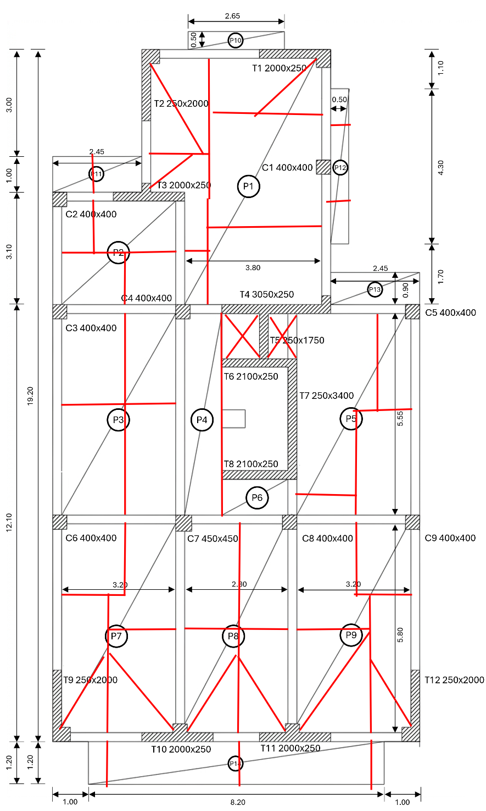
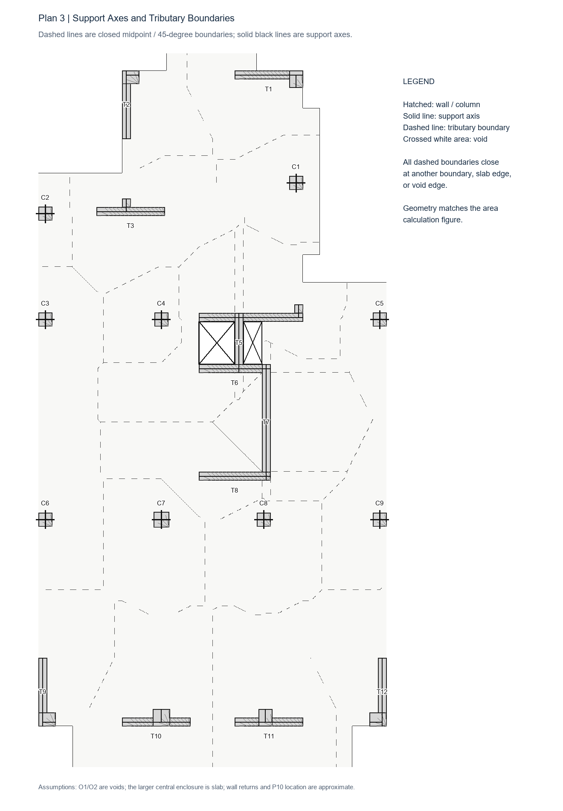
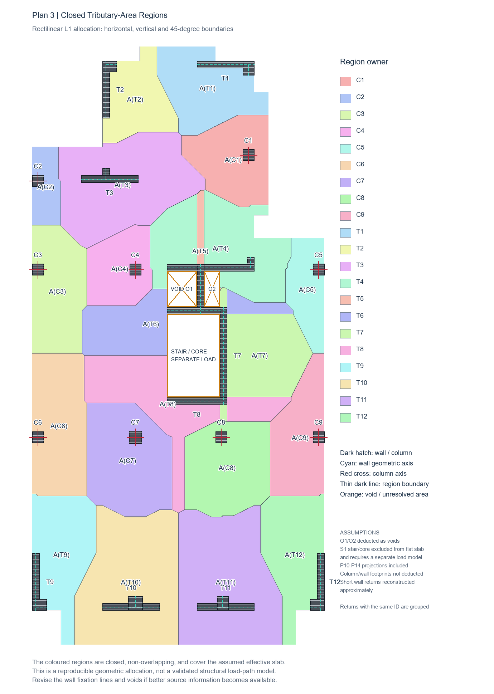

# HW1 - Plan 3 Geometry and Preliminary Tributary-Area Partition

## 1. Units and coordinate system

The drawing does not state its units explicitly. Based on the scale of the dimensions, plan dimensions such as 3.20, 5.80, and 19.20 are interpreted in metres, while column and wall section dimensions such as 400×400 and 2000×250 are interpreted in millimetres. All dimensions are converted to metres before calculation.

The origin is set at the lower-left corner of the main building footprint, excluding projection P14. The x-axis points to the right and the y-axis points upward.

| Outline vertex | x (m) | y (m) |
|---|---:|---:|
| V1 | 0.00 | 0.00 |
| V2 | 10.20 | 0.00 |
| V3 | 10.20 | 12.10 |
| V4 | 7.75 | 12.10 |
| V5 | 7.75 | 19.20 |
| V6 | 2.45 | 19.20 |
| V7 | 2.45 | 15.20 |
| V8 | 0.00 | 15.20 |

## 2. Slab area

The main footprint is decomposed into three rectangles:

\[
A_\mathrm{body}=10.20(12.10)+7.75(3.10)+5.30(4.00)=168.645\ \mathrm{m^2}
\]

| Panel | Dimensions (m) | Area (m²) |
|---|---|---:|
| P10 | 2.65×0.50 | 1.325 |
| P11 | 2.45×1.00 | 2.450 |
| P12 | 0.50×4.30 | 2.150 |
| P13 | 2.45×0.90 | 2.205 |
| P14 | 8.20×1.20 | 9.840 |
| Total | | 17.970 |

The gross slab area before deducting openings is:

\[
A_\mathrm{gross}=168.645+17.970=186.615\ \mathrm{m^2}
\]

Following the marked-up reference, O1 and O2 between T4 and T6 are provisionally treated as voids. Under the current wall reconstruction, O1 is 1.05×1.25 m and O2 is 0.55×1.25 m:

\[
A_\mathrm{void}=1.05(1.25)+0.55(1.25)=2.000\ \mathrm{m^2}
\]

The adopted effective slab area is:

\[
\boxed{A_\mathrm{effective}=186.615-2.000=184.615\ \mathrm{m^2}}
\]

The larger enclosure bounded by T6, T7, and T8 is provisionally treated as slab because the source drawing does not provide enough evidence to classify it as a void.

## 3. Support axes and tributary boundaries

Columns are represented by their centre points. Walls are reconstructed using their section outlines and represented by finite geometric centreline segments. Main wall segments and short returns carrying the same ID are grouped as one structural element.

### Manual review and correction

The first agent-generated diagram showed support axes and several local midpoint boundaries, but it did not form closed tributary-area polygons. I manually marked the expected wall centre axes, midpoint divisions, and 45-degree divisions at orthogonal wall corners to identify the missing connections.

This sketch was used as a review document rather than as direct calculation input. It records the human checking and correction stage of the AI-assisted workflow. The final boundaries were then reconstructed computationally, closed at actual intersections, and checked by area conservation.

The first figure shows only the structural elements, support axes, and closed dashed boundaries. It is intended to resemble the construction shown in the assignment example.

The closed partition uses rectilinear (L1) distance. Each slab point is assigned to the nearest column centre or finite wall-axis segment. For an orthogonal layout, this produces midpoint boundaries, horizontal or vertical segments, 45-degree wall-corner divisions, and actual intersections that close every tributary-area polygon.

The partition is clipped by the slab outline and O1/O2. A 0.01 m calculation grid is used. Recalculation with a 0.02 m grid changes the area of any single element by no more than approximately 0.049 m².

## 4. Tributary areas

The second figure applies colour to the same closed regions used for area calculation.

| Element | Tributary area (m²) | Element | Tributary area (m²) |
|---|---:|---|---:|
| C1 | 7.2973 | T1 | 8.3630 |
| C2 | 2.6293 | T2 | 6.3181 |
| C3 | 7.8498 | T3 | 14.1177 |
| C4 | 5.4765 | T4 | 12.1027 |
| C5 | 4.3862 | T5 | 1.1977 |
| C6 | 9.2966 | T6 | 8.6437 |
| C7 | 10.4308 | T7 | 10.8267 |
| C8 | 9.0280 | T8 | 12.0618 |
| C9 | 7.3866 | T9 | 8.4668 |
| | | T10 | 15.1329 |
| | | T11 | 15.1360 |
| | | T12 | 8.4668 |

Area-conservation check:

\[
\sum A_i=184.615\ \mathrm{m^2}=A_\mathrm{effective}
\]

All assumed slab cells are assigned exactly once. The closed regions do not overlap and collectively cover the complete effective slab area adopted in this model.

## 5. Assumptions requiring confirmation

1. O1 and O2 are provisionally deducted as voids based on the marked-up reference; the source drawing itself does not contain an explicit OPEN or VOID note.
2. The larger enclosure bounded by T6, T7, and T8 is provisionally treated as slab.
3. Short wall returns are reconstructed approximately from the image and should be checked against the original CAD drawing or instructor guidance.
4. The horizontal location of P10 is not fully dimensioned. This does not affect its area but affects its local tributary partition.
5. Geometric wall centrelines are used. If the required fixation lines differ, the support axes and tributary regions must be recalculated.
6. Column and wall footprints remain within the plan allocation. Their self-weight must be handled consistently later to avoid double-counting material volumes.
7. This is a reproducible geometric partition based on the stated assumptions. It is not, by itself, a validated stiffness-based structural load-path model.
