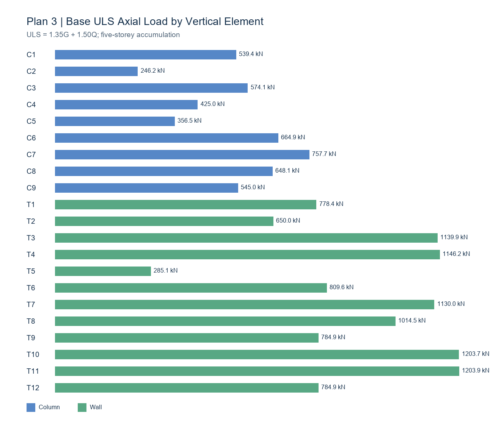

# Step 02 - Vertical Load and Axial Force Calculation

## 1. Scope and load path

The ordinary slab load is assigned to C1-C9 and T1-T12 through the reviewed tributary areas from Step 01. Each element also carries its own storey-height self-weight. Loads are accumulated downward through five identical storeys, so the axial compression is greatest at the base.

The stair/core zone S1 is not treated as ordinary flat slab. Because stair slope and reinforcement geometry are unavailable, this calculation uses a transparent provisional equivalent-horizontal-area model. The S1 load is shared by T6, T7, and T8 in proportion to their bordering lengths (2.10:3.40:2.10). This assumption must be replaced if detailed stair geometry becomes available.

## 2. Input values

| Parameter | Value |
|---|---:|
| Concrete unit weight | 25.00 kN/m³ |
| Slab thickness | 0.150 m |
| Slab self-weight | 3.750 kN/m² |
| Live area load | 5.00 kN/m² |
| Storey height | 3.00 m |
| Number of storeys | 5 |
| S1 plan area | 5.365 m² |

No finishes, beams, masonry partitions, façade loads, or live-load reduction are included because HW1 does not provide those inputs.

## 3. Equations

Ordinary slab dead load assigned to element i:

\[G_{s,i}=A_i(0.15)(25)=3.75A_i\]

Column or wall self-weight per storey:

\[G_{e,i}=V_i(25)\]

Characteristic loads per storey:

\[G_i=G_{s,i}+G_{e,i}+G_{S1,i},\qquad Q_i=5A_i+Q_{S1,i}\]

At a level supporting n identical floors:

\[N_G=nG_i,\qquad N_Q=nQ_i\]

Reported combinations:

\[N_{service}=G+Q\]
\[N_{ULS}=1.35G+1.50Q\]
\[N_{mass}=G+0.30Q\]

## 4. Five-storey base axial loads

| Element | Area (m²) | G/floor (kN) | Q/floor (kN) | Base G (kN) | Base Q (kN) | G+Q (kN) | 1.35G+1.50Q (kN) |
|---|---:|---:|---:|---:|---:|---:|---:|
| C1 | 7.2973 | 39.36 | 36.49 | 196.82 | 182.43 | 379.26 | 539.36 |
| C2 | 2.6293 | 21.86 | 13.15 | 109.30 | 65.73 | 175.03 | 246.15 |
| C3 | 7.8498 | 41.44 | 39.25 | 207.18 | 196.25 | 403.43 | 574.07 |
| C4 | 5.4765 | 32.54 | 27.38 | 162.68 | 136.91 | 299.60 | 424.99 |
| C5 | 4.3862 | 28.45 | 21.93 | 142.24 | 109.65 | 251.90 | 356.51 |
| C6 | 9.2966 | 46.86 | 46.48 | 234.31 | 232.41 | 466.73 | 664.94 |
| C7 | 10.4308 | 54.30 | 52.15 | 271.51 | 260.77 | 532.28 | 757.70 |
| C8 | 9.0280 | 45.86 | 45.14 | 229.28 | 225.70 | 454.98 | 648.07 |
| C9 | 7.3866 | 39.70 | 36.93 | 198.50 | 184.66 | 383.16 | 544.97 |
| T1 | 8.3630 | 68.86 | 41.81 | 344.31 | 209.07 | 553.38 | 778.43 |
| T2 | 6.3181 | 61.19 | 31.59 | 305.96 | 157.95 | 463.92 | 649.98 |
| T3 | 14.1177 | 90.44 | 70.59 | 452.21 | 352.94 | 805.15 | 1139.89 |
| T4 | 12.1027 | 102.57 | 60.51 | 512.86 | 302.57 | 815.43 | 1146.22 |
| T5 | 1.0133 | 36.61 | 5.07 | 183.06 | 25.33 | 208.39 | 285.13 |
| T6 | 7.1752 | 71.84 | 43.29 | 359.21 | 216.44 | 575.65 | 809.59 |
| T7 | 8.7395 | 105.52 | 55.70 | 527.62 | 278.49 | 806.11 | 1130.02 |
| T8 | 10.4369 | 84.07 | 59.60 | 420.36 | 297.98 | 718.35 | 1014.46 |
| T9 | 8.4668 | 69.25 | 42.33 | 346.25 | 211.67 | 557.92 | 784.95 |
| T10 | 15.1329 | 94.25 | 75.66 | 471.24 | 378.32 | 849.56 | 1203.66 |
| T11 | 15.1360 | 94.26 | 75.68 | 471.30 | 378.40 | 849.70 | 1203.86 |
| T12 | 8.4668 | 69.25 | 42.33 | 346.25 | 211.67 | 557.92 | 784.95 |
| **Total** | **179.2500** | **1298.49** | **923.07** | **6492.47** | **4615.38** | **11107.84** | **15687.90** |

The complete floor-by-floor schedule is provided in `Step_02_Axial_Loads_by_Level.csv`.

## 5. Verification checks

- Tributary-area sum: 179.250 m² = reviewed ordinary flat-slab area.
- Ordinary slab dead load: 672.188 kN = 179.250×3.75.
- Ordinary slab live load before S1: 896.250 kN = 179.250×5.00.
- S1 equivalent dead/live loads: 20.119/26.825 kN per floor.
- Vertical-element self-weight: 606.188 kN per floor.
- Total characteristic base loads: G=6492.469 kN and Q=4615.375 kN.
- The sum of element loads equals the independently calculated whole-floor load for every reported component.

## 6. Limitations requiring review

1. S1 is represented by horizontal plan area; the actual inclined stair-slab self-weight may be higher.
2. S1 is distributed to T6-T8 by bordering length, not stiffness analysis.
3. Nominal labelled wall lengths are used for wall self-weight. Approximate short returns are excluded to avoid uncertain overlap and double-counting.
4. Finishes, beams, partitions, façade, and other permanent loads are outside the current HW1 input set.
5. Axial forces are reported at the bottom of each storey segment and therefore include that segment's self-weight.
