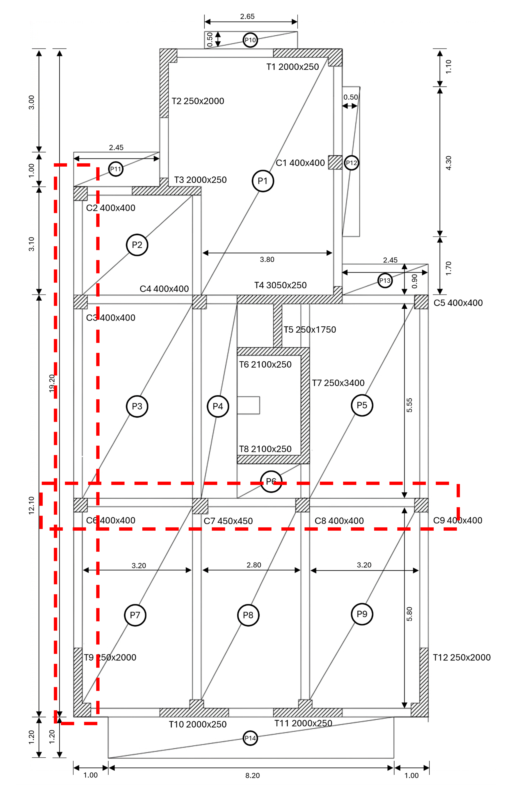
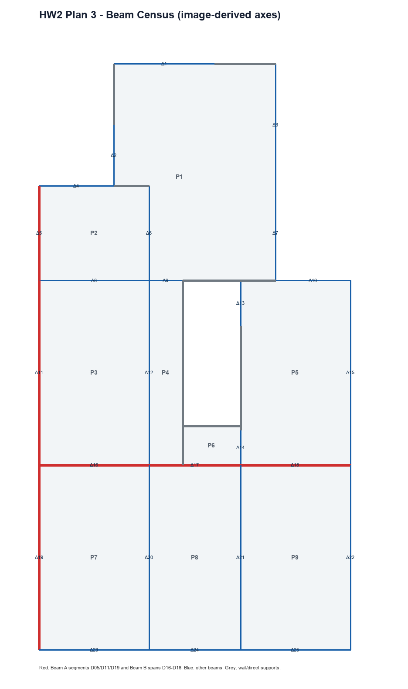

# Step 04 - Beam Census and Beam Tributary Areas

## 1. Scope and continuity from HW1

This step extends the reviewed HW1 coordinate system. The floor outline, columns, walls, openings, and ordinary flat-slab area are reused; they are not re-derived. The detailed structural drawing identifies 25 beam segments, labelled D01-D25 here to represent drawing labels Δ1-Δ25 in machine-readable files.

## 2. Beam identification

Beam axes and endpoints are image-derived. D05, D11, and D19 form the marked left vertical peripheral line (Beam A). D16-D18 form the marked horizontal interior continuous line (Beam B).

| Beam | Start (m) | End (m) | Span (m) | Section (mm) | Bordering panels | Classification |
|---|---|---|---:|---:|---|---|
| D01 | (2.45, 19.20) | (5.75, 19.20) | 3.30 | 250x700 | P1, P10 | perimeter/root; two-sided including cantilever |
| D02 | (2.45, 15.20) | (2.45, 17.20) | 2.00 | 250x700 | P1 | perimeter; one-sided |
| D03 | (7.75, 15.20) | (7.75, 19.20) | 4.00 | 250x700 | P1, P12 | perimeter/root; two-sided including cantilever |
| D04 | (0.00, 15.20) | (2.45, 15.20) | 2.45 | 250x700 | P2, P11 | perimeter/root; two-sided including cantilever |
| D05 | (0.00, 12.10) | (0.00, 15.20) | 3.10 | 250x700 | P2 | perimeter; one-sided; Beam A segment |
| D06 | (3.60, 12.10) | (3.60, 15.20) | 3.10 | 250x600 | P1, P2 | interior; two-sided |
| D07 | (7.75, 12.10) | (7.75, 15.20) | 3.10 | 250x600 | P1, P12 | perimeter/root; two-sided including cantilever |
| D08 | (0.00, 12.10) | (3.60, 12.10) | 3.60 | 250x600 | P2, P3 | interior; two-sided |
| D09 | (3.60, 12.10) | (4.70, 12.10) | 1.10 | 250x600 | P1, P4 | core-side; two-sided |
| D10 | (7.75, 12.10) | (10.20, 12.10) | 2.45 | 250x700 | P5, P13 | perimeter/root; two-sided including cantilever |
| D11 | (0.00, 6.05) | (0.00, 12.10) | 6.05 | 250x700 | P3 | perimeter; one-sided; Beam A segment |
| D12 | (3.60, 6.05) | (3.60, 12.10) | 6.05 | 250x600 | P3, P4 | interior; two-sided |
| D13 | (6.60, 10.60) | (6.60, 12.10) | 1.50 | 250x600 | P5 | core-side; one-sided |
| D14 | (6.60, 6.05) | (6.60, 7.20) | 1.15 | 250x600 | P5, P6 | core-side; one slab-bearing side adopted |
| D15 | (10.20, 6.05) | (10.20, 12.10) | 6.05 | 250x700 | P5 | perimeter; one-sided |
| D16 | (0.00, 6.05) | (3.60, 6.05) | 3.60 | 250x600 | P3, P7 | interior; two-sided; Beam B span 1 |
| D17 | (3.60, 6.05) | (6.60, 6.05) | 3.00 | 250x600 | P6, P8 | interior; P8 is one-way to vertical beams; Beam B span 2 |
| D18 | (6.60, 6.05) | (10.20, 6.05) | 3.60 | 250x600 | P5, P9 | interior; two-sided; Beam B span 3 |
| D19 | (0.00, 0.00) | (0.00, 6.05) | 6.05 | 250x700 | P7 | perimeter; one-sided; Beam A segment |
| D20 | (3.60, 0.00) | (3.60, 6.05) | 6.05 | 250x600 | P7, P8 | interior; two-sided |
| D21 | (6.60, 0.00) | (6.60, 6.05) | 6.05 | 250x600 | P8, P9 | interior; two-sided |
| D22 | (10.20, 0.00) | (10.20, 6.05) | 6.05 | 250x700 | P9 | perimeter; one-sided |
| D23 | (0.00, 0.00) | (3.60, 0.00) | 3.60 | 250x700 | P7, P14 | perimeter/root; two-sided including cantilever |
| D24 | (3.60, 0.00) | (6.60, 0.00) | 3.00 | 250x700 | P8, P14 | perimeter/root; cantilever load only from P14 |
| D25 | (6.60, 0.00) | (10.20, 0.00) | 3.60 | 250x700 | P9, P14 | perimeter/root; two-sided including cantilever |

## 3. Panel classification and allocation rule

Each panel is classified before any load is assigned. Two-way panels with matched orthogonal supports are divided by nearest finite support-edge distance, producing midpoint and 45-degree boundaries. P8 is one-way because 6.05/3.00 > 2 and therefore loads only D20 and D21. The narrow P4 and P6 core-side strips are treated as one-way between their stated opposite supports. Cantilevers P10-P14 load their root supports.

| Panel | Classification | Exact model area (m2) | Grid-assigned area (m2) |
|---|---|---:|---:|
| P1 | two-way, matched supports, L-shaped | 34.0650 | 34.0650 |
| P2 | two-way, matched supports | 11.1600 | 11.1600 |
| P3 | two-way, matched supports | 21.7800 | 21.7800 |
| P4 | one-way core-side strip | 6.6550 | 6.6550 |
| P5 | two-way, matched supports | 21.7800 | 21.7800 |
| P6 | one-way between T8 and D17 | 2.4225 | 2.4130 |
| P7 | two-way, matched supports | 21.7800 | 21.7800 |
| P8 | one-way; 6.05/3.00 > 2 | 18.1500 | 18.1500 |
| P9 | two-way, matched supports | 21.7800 | 21.7800 |
| P10 | cantilever, 0.50 m projection | 1.3250 | 1.3250 |
| P11 | cantilever, 1.00 m projection | 2.4500 | 2.4500 |
| P12 | cantilever, 0.50 m projection | 2.1500 | 2.1500 |
| P13 | cantilever, 0.90 m projection | 2.2050 | 2.2050 |
| P14 | cantilever, 1.20 m projection | 9.8400 | 9.8400 |

Walls and core boundaries are retained as direct supports in the allocation. Grey regions in the following figure therefore do not load a beam; this prevents wall-supported slab load from being reassigned incorrectly to a nearby beam.

## 4. Beam tributary-area results

| Beam | Tributary area (m2) | Mean width (m) | Load shape |
|---|---:|---:|---|
| D01 | 6.0049 | 1.8197 | trapezoidal/truncated + partial cantilever UDL |
| D02 | 2.7052 | 1.3526 | triangular/truncated, one-sided |
| D03 | 8.7583 | 2.1896 | trapezoidal + cantilever UDL |
| D04 | 4.9717 | 2.0293 | triangular/truncated + cantilever UDL |
| D05 | 2.3992 | 0.7739 | triangular, one-sided |
| D06 | 8.7323 | 2.8169 | two-sided triangular/trapezoidal |
| D07 | 4.4440 | 1.4335 | trapezoidal/truncated + short cantilever UDL |
| D08 | 6.4238 | 1.7844 | two-sided triangular |
| D09 | 0.6049 | 0.5499 | truncated triangular, core-side |
| D10 | 4.7921 | 1.9560 | truncated triangular + cantilever UDL |
| D11 | 7.6476 | 1.2641 | trapezoidal, one-sided |
| D12 | 10.9761 | 1.8142 | two-sided trapezoidal + one-way strip |
| D13 | 1.1248 | 0.7499 | truncated triangular, one-sided |
| D14 | 0.6662 | 0.5793 | truncated triangular, one-sided |
| D15 | 7.6522 | 1.2648 | trapezoidal, one-sided |
| D16 | 6.4915 | 1.8032 | two-sided triangular |
| D17 | 1.2160 | 0.4053 | partial uniform one-way strip |
| D18 | 6.4812 | 1.8003 | two-sided triangular |
| D19 | 7.6513 | 1.2647 | trapezoidal, one-sided |
| D20 | 16.7187 | 2.7634 | trapezoidal + one-way UDL, two-sided |
| D21 | 16.7174 | 2.7632 | trapezoidal + one-way UDL, two-sided |
| D22 | 7.6518 | 1.2648 | trapezoidal, one-sided |
| D23 | 6.3483 | 1.7634 | triangular + partial cantilever UDL |
| D24 | 3.6000 | 1.2000 | partial cantilever UDL only |
| D25 | 6.3538 | 1.7649 | triangular + partial cantilever UDL |

## 5. Area checks and limitations

- Area assigned to beams: 157.1333 m2.
- Area assigned directly to walls/core/support residual: 22.1167 m2.
- Total reconciled ordinary slab area: 179.2500 m2 = 179.2500 m2 from HW1.
- Maximum panel grid-area error at 0.01 m resolution: 0.009500 m2.
- D01-D25 endpoints and panel support conditions are image-derived. Original CAD beam axes would supersede these values.
- P4/P6 and the short core-side members are the most interpretation-sensitive regions and must be checked before the OpenSees model is frozen.
- Equivalent beam areas exclude slab load assigned directly to structural walls. This is intentional and preserves the slab-to-support load path.

The detailed contribution schedule is stored in `Step_04_Beam_Tributary_Area_Contributions.csv`.
