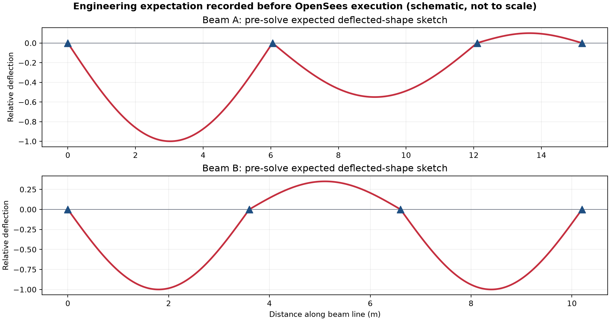
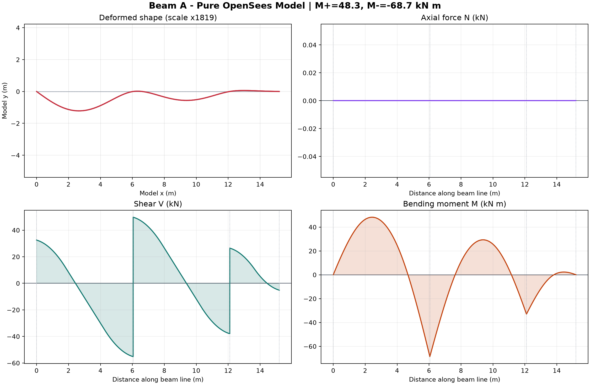
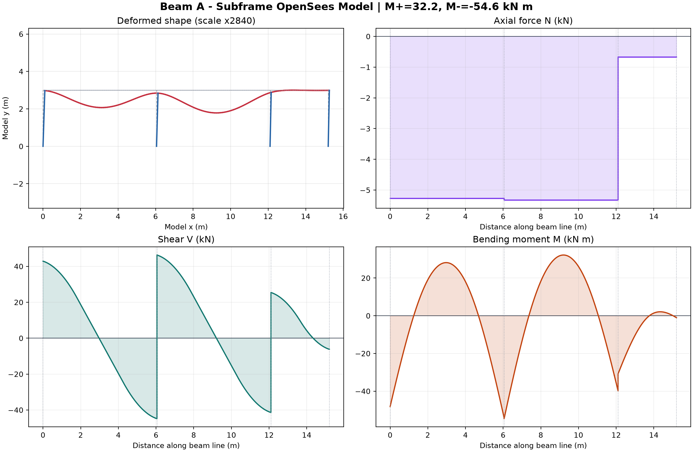
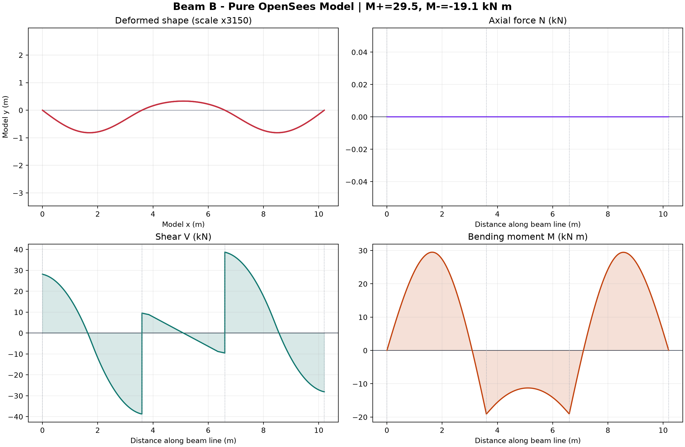
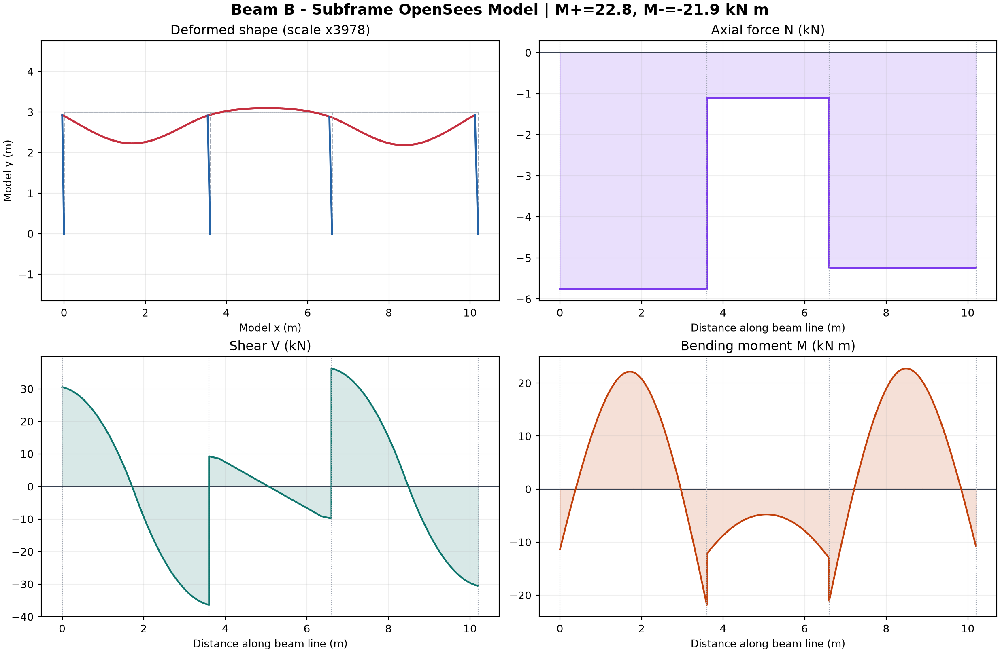
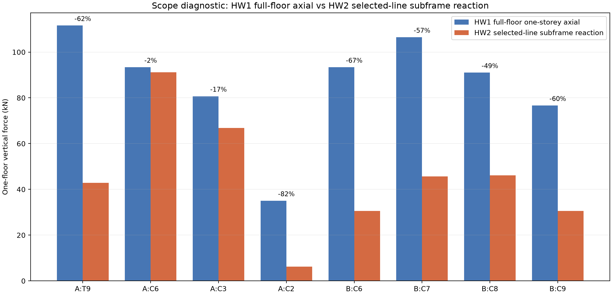

# Step 06 - OpenSees Pure-Beam and One-Storey Subframe Models

## 1. Scope

This step implements HW2 Task 3 for both marked lines. Beam A is D19-D11-D05, the three-span peripheral edge beam. Beam B is D16-D17-D18, the three-span interior beam. The models reuse the Step 04 geometry and Step 05 service line loads rather than re-deriving the floor plan.

The structural briefing and the pre-solve hand bounds were recorded before execution in `Step_06_OpenSees_Briefing_and_Iteration_Log.md`.

## 2. Model assumptions

- Units: kN and m; stress and elastic modulus in kN/m2.
- Concrete: linear elastic, E = 30,000,000 kN/m2.
- Beam A section: 250 x 700 mm; Beam B section: 250 x 600 mm.
- Load case: service G+Q, including slab load and beam-stem self-weight.
- The non-uniform profiles are discretised into 60 uniform elasticBeamColumn elements per span.
- The pure models are continuous beams with vertical simple supports at all grid points.
- Each subframe places the beam at the top of one 3.0 m storey; the support members have fixed bases and there are no upper-storey columns.
- Positive plotted moment is sagging; negative plotted moment is hogging.

The configuration is machine-readable in `Step_06_OpenSees_Model_Config.json`.

## 3. Pre-solve expectation



The governing simply-supported moment bounds were 79.287 kN m for Beam A and 38.621 kN m for Beam B. Continuity was expected to introduce negative moments over the interior supports and reduce span sagging relative to isolated simply-supported spans. Beam B's lightly loaded central D17 span was expected to be strongly influenced by the two loaded outer spans.

## 4. Solver results

| Beam | Model | Applied G+Q (kN) | Reaction sum (kN) | M+ (kN m) | M- (kN m) | max |V| (kN) | max |N| (kN) | max vertical deflection (mm) | Bound check |
|---|---|---:|---:|---:|---:|---:|---:|---:|:---:|
| Beam A | pure | 207.108 | 207.108 | 48.297 | -68.664 | 55.222 | 0.000 | 0.668 | PASS |
| Beam A | subframe | 207.108 | 207.108 | 32.201 | -54.615 | 46.302 | 5.325 | 0.428 | PASS |
| Beam B | pure | 152.839 | 152.839 | 29.497 | -19.104 | 38.770 | 0.000 | 0.259 | PASS |
| Beam B | subframe | 152.839 | 152.839 | 22.760 | -21.851 | 36.379 | 5.758 | 0.205 | PASS |


Maximum vertical equilibrium error across the four models was 5.852e-09 kN. Maximum reconstructed element-end moment error was 4.619e-14 kN m. All four peak moments passed the deliberately broad pre-solve order-of-magnitude gate.

The independent reference suite in `Step_06_OpenSees_Verification.csv` also passed 17/17 checks, including the closed-form (qL^2/8), (-qL^2/12), and (qL^2/24) limits for a 4 m beam under 10 kN/m.

### Beam A - pure continuous beam



### Beam A - one-storey subframe



### Beam B - pure continuous beam



### Beam B - one-storey subframe



## 5. Pure beam versus subframe

For Beam A, the peak absolute moment changed from 68.66 to 54.62 kN m and maximum vertical deflection changed from 0.668 to 0.428 mm. The stiff T9 boundary member and the finite column rotational stiffness redistribute both the support and span moments. For Beam B, the subframe reduced the peak sagging moment from 29.50 to 22.76 kN m while increasing the peak hogging magnitude from 19.10 to 21.85 kN m. This is the expected transfer from span moment into support moment. The beam remains rotation-compatible at each support and does not form a displacement kink; the frame columns sway and rotate with the beam nodes.

The subframe is the more defensible of these two models for beam-force distribution because it includes support stiffness and frame action. It is still only a one-line, one-storey approximation and is not a substitute for a full floor-grid or multi-storey model.

## 6. Support reactions and HW1 cross-check

The detailed reactions are in `Step_06_OpenSees_Support_Reactions.csv`.



| Beam | Grid point | HW1 full-floor one-storey axial (kN) | HW2 selected-line reaction (kN) | Difference |
|---|---|---:|---:|---:|
| Beam A | T9 | 111.58 | 42.89 | -61.6% |
| Beam A | C6 | 93.35 | 91.16 | -2.3% |
| Beam A | C3 | 80.69 | 66.84 | -17.2% |
| Beam A | C2 | 35.01 | 6.22 | -82.2% |
| Beam B | C6 | 93.35 | 30.55 | -67.3% |
| Beam B | C7 | 106.46 | 45.64 | -57.1% |
| Beam B | C8 | 91.00 | 46.09 | -49.4% |
| Beam B | C9 | 76.63 | 30.57 | -60.1% |


This is a scope diagnostic, not an expected equality. The HW1 value contains the full floor tributary load plus vertical-member self-weight. The Step 06 subframe contains only the selected marked beam line and omits reactions arriving from orthogonal and neighbouring beams. The generally smaller HW2 reactions therefore identify missing floor-grid scope rather than a vertical-equilibrium failure. A full Task 12 equality check requires either a larger grid model or equivalent nodal loads from every omitted adjoining beam.

The assignment wording refers to beam axial N at the support, but the quantity physically comparable with a column axial force is the vertical support reaction, or equivalently the column axial force. Beam-local N is horizontal and is reported separately in the N diagram.

## 7. Reproduction

Run all models and rebuild the tables and figures:

```powershell
python step06_run_all.py
python verify_step06_opensees.py
```

The four explicit OpenSees entry points are:

- `Step_06_BeamA_Pure_OpenSees.py`
- `Step_06_BeamA_Subframe_OpenSees.py`
- `Step_06_BeamB_Pure_OpenSees.py`
- `Step_06_BeamB_Subframe_OpenSees.py`

## 8. Items requiring student sign-off

1. Confirm the image-derived mapping of Beam A to D19-D11-D05 and Beam B to D16-D17-D18.
2. Confirm the T9 strong-axis wall-equivalent representation in the Beam A subframe.
3. Confirm that the W5 convention intends fixed bases with no upper-storey columns.
4. Add the student's hand-drawn deformed-shape sketches. The pre-solve schematic above records the engineering prediction but is not a substitute for the required hand drawing.
5. Decide whether Task 12 should be extended to a full floor-grid reaction model or completed with equivalent nodal loads from omitted beams.
