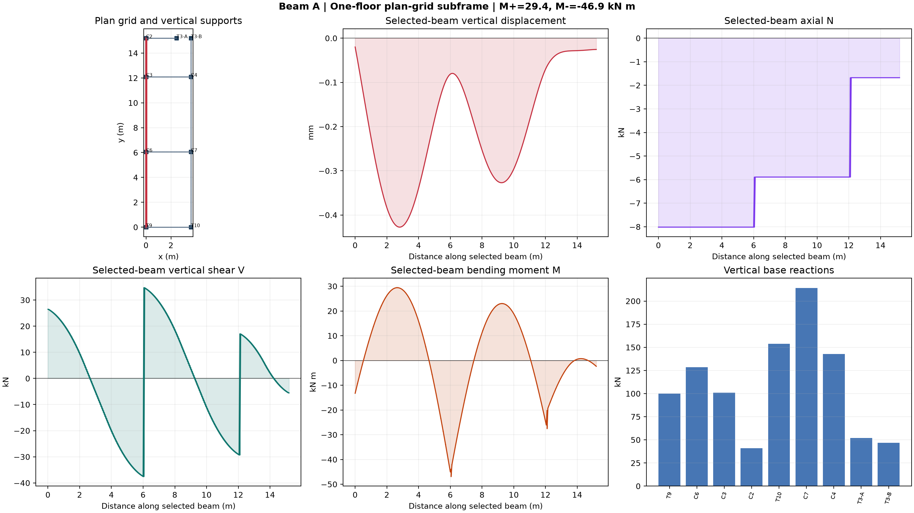
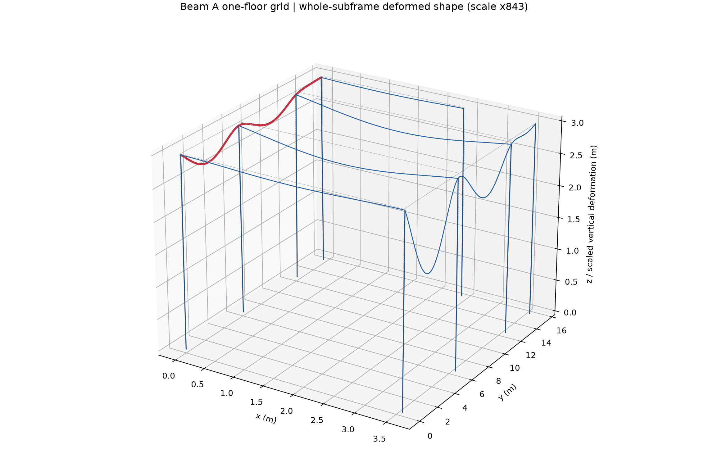
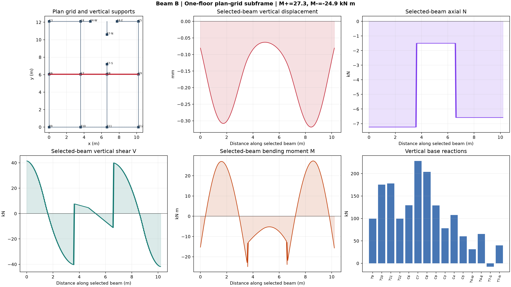
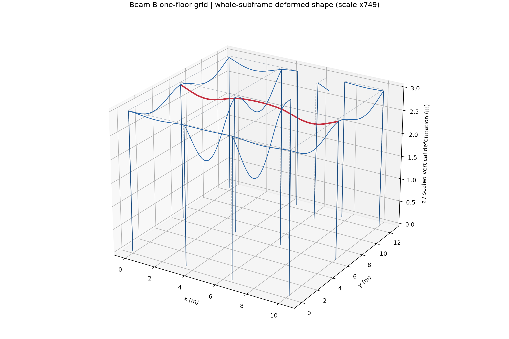
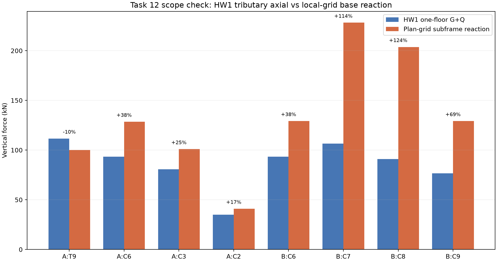

# Tasks 8, 10 and 12 - One-Floor Plan-Grid Subframes

## Scope

This revision replaces the earlier single-line subframe for final comparisons. The pure-beam models remain the Task 7 references. The grid models add perpendicular floor beams and their vertical supports so that the marked beam can redistribute load into neighbouring members.

The models are local strips, not a full-building finite-element model. They use image-derived axes and explicit wall-end idealisations. Direct slab load assigned to walls and 1.707500 m2 of unresolved core area are excluded. Therefore the Task 12 comparison is an explained consistency check, not forced equality.

## Beam A

One bay east of the peripheral Beam A line. D04 terminates at T3; T3 is represented by two half-wall vertical supports, so no fictitious D04 extension is added.

| Quantity | Pure beam | Plan-grid subframe |
|---|---:|---:|
| Peak sagging moment (kN m) | 35.629 | 29.407 |
| Peak hogging moment (kN m) | -50.301 | -46.932 |
| Peak absolute shear (kN) | 40.433 | 37.595 |
| Peak absolute axial (kN) | 0.000 | 8.016 |
| Maximum vertical displacement (mm) | 0.491 | 0.427 |

The pure model restrains only the marked line. The grid subframe introduces column/wall rotational stiffness and alternate paths through perpendicular members; consequently its moments, reactions and deflection differ. The grid subframe is the more defensible of these two for load distribution, while the pure model remains a transparent limiting/check model.

## Beam B

One bay south and the available supported branches north of Beam B. Core walls T4/T7 are split into half-wall vertical supports at actual beam termination points; no fictitious beam is drawn through the openings.

| Quantity | Pure beam | Plan-grid subframe |
|---|---:|---:|
| Peak sagging moment (kN m) | 37.046 | 27.314 |
| Peak hogging moment (kN m) | -22.291 | -24.907 |
| Peak absolute shear (kN) | 43.990 | 41.862 |
| Peak absolute axial (kN) | 0.000 | 7.236 |
| Maximum vertical displacement (mm) | 0.323 | 0.319 |

The pure model restrains only the marked line. The grid subframe introduces column/wall rotational stiffness and alternate paths through perpendicular members; consequently its moments, reactions and deflection differ. The grid subframe is the more defensible of these two for load distribution, while the pure model remains a transparent limiting/check model.

## Task 12 cross-check

| Beam | Grid point | HW1 one-floor G+Q (kN) | Grid reaction (kN) | Difference |
|---|---|---:|---:|---:|
| Beam A | T9 | 111.585 | 99.971 | -10.4% |
| Beam A | C6 | 93.345 | 128.476 | +37.6% |
| Beam A | C3 | 80.686 | 100.927 | +25.1% |
| Beam A | C2 | 35.006 | 40.909 | +16.9% |
| Beam B | C6 | 93.345 | 129.196 | +38.4% |
| Beam B | C7 | 106.457 | 228.152 | +114.3% |
| Beam B | C8 | 90.995 | 203.726 | +123.9% |
| Beam B | C9 | 76.633 | 129.171 | +68.6% |

The signs and force scale must be checked first. Remaining differences are expected because HW1 assigns the complete floor directly by vertical-element tributary regions, whereas these local grids contain only listed beam branches and omit direct wall slab loads, unresolved core load, slab diaphragm/plate stiffness and upper-storey participation. Large differences therefore identify model-scope mismatch rather than being hidden by artificial nodal loads.

For total one-floor column axial magnitude, the HW1 value is presently the safer estimate because it includes the complete adopted floor area. For local beam/frame redistribution and moment continuity, the plan-grid model is more physically informative. Neither should be presented as a final full-building result until the unresolved core path and omitted slab/wall actions are modelled consistently.

## Reproduction and process evidence

- Script: `step08_grid_subframes.py`.
- Source loads: `Step_05_Beam_Load_Profiles.csv`.
- Machine-readable results: `Step_08_BeamA_Grid_Result.json`, `Step_08_BeamB_Grid_Result.json`.
- Reactions and response ordinates: the Step 08 CSV files.
- Independent checks: `verify_step08_grid_subframes.py` and `Step_08_Grid_Subframe_Verification.csv`.
- Human/agent process record: `Step_08_Grid_Subframe_Iteration_Log.md`.

Student sign-off remains required for the image-derived beam mapping, wall-end idealisations, hand moment bounds and four hand-drawn deformation sketches.
