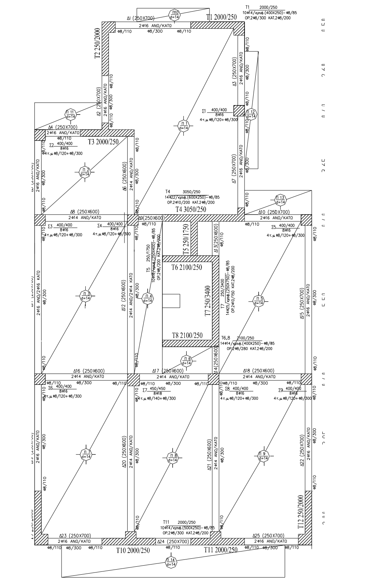
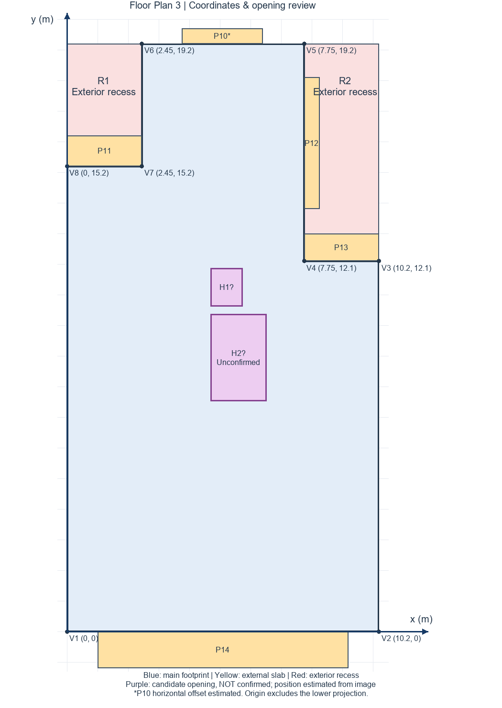
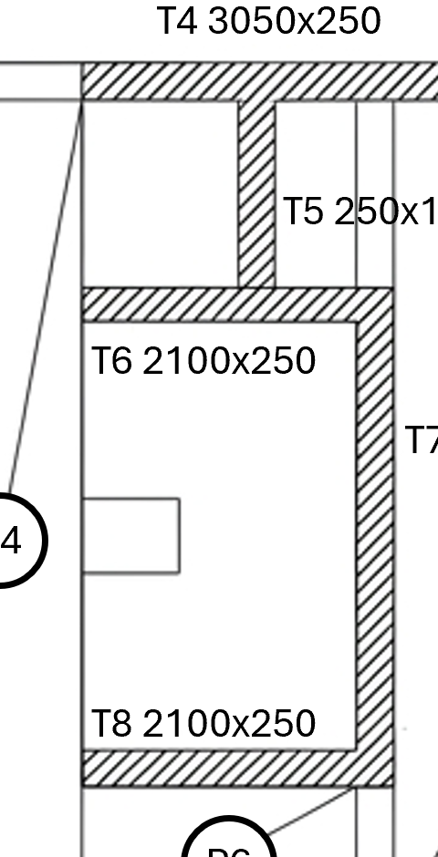

# Floor Plan 3 - Coordinate and Opening Review

Plan dimensions are interpreted in metres; section dimensions are interpreted in millimetres and converted to metres. This is an explicit assumption because the drawing does not state its units.

The origin is at the lower-left external corner of the main building footprint, excluding P14. The x-axis points right and the y-axis points upward. These are outline coordinates, not column-centre coordinates.

| Main-footprint vertex | x (m) | y (m) |
|---|---:|---:|
| V1 | 0.00 | 0.00 |
| V2 | 10.20 | 0.00 |
| V3 | 10.20 | 12.10 |
| V4 | 7.75 | 12.10 |
| V5 | 7.75 | 19.20 |
| V6 | 2.45 | 19.20 |
| V7 | 2.45 | 15.20 |
| V8 | 0.00 | 15.20 |

## External slab projections

| Panel | x range (m) | y range (m) | Area (m²) |
|---|---|---|---:|
| P10 | a to a+2.65; a is not dimensioned and is shown approximately as 3.75 | 19.20 to 19.70 | 1.325 |
| P11 | 0.00 to 2.45 | 15.20 to 16.20 | 2.450 |
| P12 | 7.75 to 8.25 | 13.80 to 18.10 | 2.150 |
| P13 | 7.75 to 10.20 | 12.10 to 13.00 | 2.205 |
| P14 | 1.00 to 9.20 | -1.20 to 0.00 | 9.840 |

## Confirmed external recesses

Relative to the 10.20×19.20 bounding rectangle, recess R1 occupies x=[0,2.45], y=[15.20,19.20], with area 9.800 m². Recess R2 occupies x=[7.75,10.20], y=[12.10,19.20], with area 17.395 m².

These are external recesses rather than internal openings. P11 occupies part of R1; P12 and P13 occupy parts of R2 and are added as external slab projections.

Main-footprint area:

\[
10.20(19.20)-9.800-17.395=168.645\ \mathrm{m^2}
\]

Gross area including P10-P14:

\[
168.645+17.970=186.615\ \mathrm{m^2}
\]

## Central areas

The detailed structural drawing shows no ordinary slab-panel designation in O1, O2, or the larger enclosure bounded by T6, T7, and T8. O1 and O2 are therefore treated as voids. The larger enclosure S1 is classified as a stair/core zone and excluded from the ordinary 150 mm flat-slab allocation; its gravity load must be modelled separately.

The reconstructed excluded plan area is 2.000 m² for O1/O2 plus 5.365 m² for S1, giving 7.365 m² in total. The resulting ordinary flat-slab area is 179.250 m².

These classifications must be updated if an original CAD drawing or instructor clarification becomes available.

